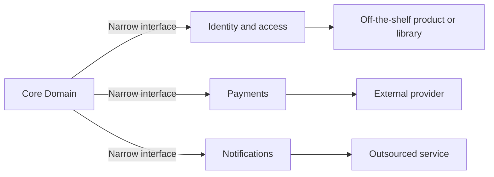

# Generic Subdomains

## Description

Generic Subdomains are parts of the model that are neither the business's differentiator nor specific to it: problems that many organizations share, such as accounting, access control, scheduling, or notifications. Although necessary, they shouldn't compete with the [Core Domain](/design/ddd/distillation/core-domain) for attention and talent.

The pattern guides you to identify these subdomains, isolate them in separate modules or contexts, and handle them at the lowest possible cost. The alternatives, in order of preference, are to adopt an off-the-shelf solution (product or library), reuse a published model, outsource the build, or, as a last resort, implement in-house with a junior team and a simple design.

Because the model is generic, it shouldn't contain core concepts, and the core shouldn't depend on its details. Integration happens through narrow interfaces, preserving the freedom to swap the solution in the future.

## Problems it solves

- Modeling time spent on problems the market has already solved.
- Generic concepts mixed into the core, making it larger and less expressive.
- The core depending on the details of third-party products.
- A strong team wasted on features with no competitive differentiation.

## When to use

- When a mature solution exists on the market for the need (identity, payments, tax calculation, accounting).
- When the subdomain is necessary but doesn't set the company apart from its competitors.
- When you want to free up team capacity to concentrate on the core.

## When to avoid

- When the subdomain, despite looking generic, contains rules that truly differentiate the business; in that case it belongs to the core.
- When off-the-shelf solutions impose an incompatible model, forcing you to contort the core to fit them.
- When compliance requirements, license cost, or vendor risk make the dependency unacceptable.

## Trade-offs

| Benefit | Cost / Risk |
| --- | --- |
| Less in-house code and less maintenance | Dependence on a vendor or an external project |
| Elite team freed up for the core | Customization limited to what the solution allows |
| Mature solutions tested by the market | A third-party model can leak into the core without a protective layer |
| Predictable, lower cost | It can be tempting to classify something strategic as generic |

- **Boundary:** integration should go through an interface of your own, such as an [Anticorruption Layer](/architecture/cloud-design-patterns/integration-and-modernization/anti-corruption-layer), so the external model doesn't contaminate the core.
- **Reversibility:** the choice isn't permanent; a generic subdomain can be swapped out or brought in-house later.
- **Classification:** deciding what is generic depends on the business; the same subdomain can be core at another company.

## Diagram

The core consumes generic subdomains through narrow interfaces, and each of them is served by a replaceable external solution.

## Example

An insurer's core is policy pricing and risk analysis. To issue payment slips, charge cards, authenticate brokers, and send notifications, it doesn't write its own models: it uses a payment provider, an identity service, and a messaging platform.

The core's code talks only to internal interfaces (`PaymentGateway`, `NotificationSender`), implemented by adapters. When the payment provider is replaced by a cheaper one, only the adapter changes and the policy model stays intact.

## Related patterns

- [Core Domain](/design/ddd/distillation/core-domain) — the counterpoint: where investment should be concentrated.
- [Cohesive Mechanisms](/design/ddd/distillation/cohesive-mechanisms) — extraction of technical mechanisms, which resembles generic subdomains but for algorithms instead of business concepts.
- [Anticorruption Layer](/architecture/cloud-design-patterns/integration-and-modernization/anti-corruption-layer) — protects the core's model from the generic solution adopted.
- [Conformist](/design/ddd/context-mapping/conformist) — an alternative when you adopt the vendor's model as is.
- [Published Language](/design/ddd/context-mapping/published-language) — a standardized language that makes it easier to integrate off-the-shelf solutions.
- [Module](/design/ddd/building-blocks/module) — the simplest way to isolate a generic subdomain within the same context.
- [Decompose by Subdomain](/architecture/microservices/service-boundaries/decompose-by-subdomain) — generic subdomains often become services or get replaced by external services.

## Reference

- [DDD Reference, Eric Evans (2015)](https://www.domainlanguage.com/ddd/reference/)
- *Domain-Driven Design: Tackling Complexity in the Heart of Software*, Eric Evans (Addison-Wesley, 2003)
