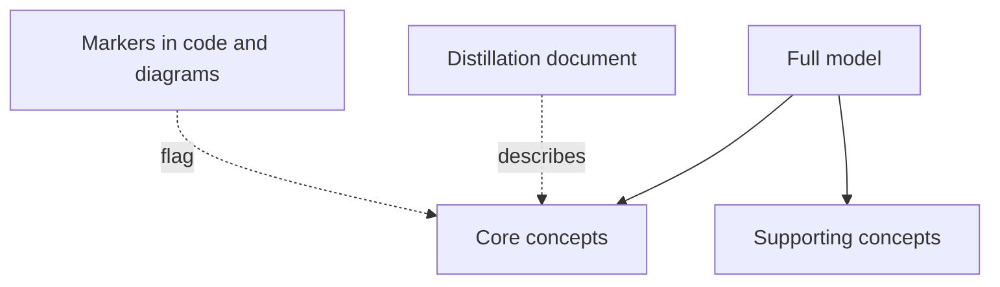

# Highlighted Core

## Description

The Highlighted Core makes the [Core Domain](/design/ddd/distillation/core-domain) easy to find within a large model, without changing the structure of the code. It combines two lightweight tools: a distillation document and explicit markers in the model itself.

The distillation document is a very short description (three to seven pages at most) of the core concepts and the interactions between them, written so that any team member can read it. The markers, in turn, flag in the repository which modules or classes belong to the core, for example with annotations, naming conventions, or highlighting in diagrams.

The advantage is low intrusiveness: the core gains immediate visibility without needing to refactor packages. When the cost of physically separating it is high, this is the initial step, and structural separation can come later with the [Segregated Core](/design/ddd/distillation/segregated-core).

## Problems it solves

- Developers who don't know which parts of the code are central and which are supporting.
- Changes made to the core without the extra care it requires.
- The core diluted among many elements that look the same.
- Difficulty explaining the essentials of the model to someone joining the project.

## When to use

- When the core has been identified, but restructuring the code now is expensive or risky.
- When the team is large or rotating and needs quick guidance.
- As a first step, before deciding on a structural separation.

## When to avoid

- When the model is small and the core is obvious to everyone.
- When the distillation document won't be maintained, since it quickly drifts from reality.
- When the coupling between the core and the rest is the real problem; marking doesn't resolve the dependency, and the case calls for a [Segregated Core](/design/ddd/distillation/segregated-core).

## Trade-offs

| Benefit | Cost / Risk |
| --- | --- |
| Core visibility with little effort | Doesn't reduce the coupling between the core and the rest |
| No structural refactoring | Markers and document can become outdated |
| Guides new members and code reviews | Requires discipline to keep the highlighting consistent |
| Compatible with any code structure | Can give a false sense that the problem is solved |

- **Maintenance:** the document should be reviewed whenever the core changes; it's only useful if it reflects the current model.
- **Format:** what matters is visibility, so it can be a file in the repository, a wiki section, or a code annotation.
- **Evolution:** it's usually the stage that precedes a structural separation.

## Diagram

The model stays whole, but the distillation document and the markers point out which concepts belong to the core.

## Example

A credit fintech has a large loan module in which credit decisioning and risk-based pricing are the core, but the classes are mixed in with registration, collections, and reporting. Refactoring everything now would delay the roadmap by months.

The team writes a two-page document at the repository root, `CORE.md`, listing the core concepts (`CreditPolicy`, `RiskScore`, `PricingRule`) and how they interact. Those classes get a `@CoreDomain` annotation, the main diagram highlights them in color, and code reviews on them require a second senior reviewer.

## Related patterns

- [Core Domain](/design/ddd/distillation/core-domain) — the concept being highlighted.
- [Domain Vision Statement](/design/ddd/distillation/domain-vision-statement) — describes the core's value, while this pattern points to where it is.
- [Segregated Core](/design/ddd/distillation/segregated-core) — a structural alternative, stronger and more expensive.
- [Abstract Core](/design/ddd/distillation/abstract-core) — another way to summarize the core, with a module of abstract concepts instead of a document.
- [Module](/design/ddd/building-blocks/module) — modules are the natural unit to highlight.
- [Context Map](/design/ddd/context-mapping/context-map) — also works as a high-level highlight, across contexts.

## Reference

- [DDD Reference, Eric Evans (2015)](https://www.domainlanguage.com/ddd/reference/)
- *Domain-Driven Design: Tackling Complexity in the Heart of Software*, Eric Evans (Addison-Wesley, 2003)
