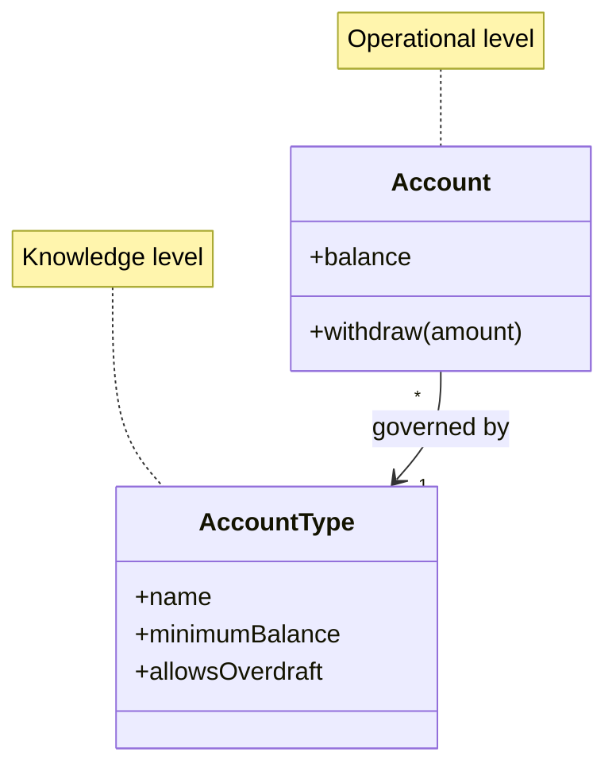

# Knowledge Level

## Description

Knowledge Level is a large-scale structure that splits the model into two groups of objects: the operational level, which represents everyday things (accounts, orders, loans), and the knowledge level, a set of objects that describes and constrains the structure and behavior of the first (account types, product rules, policies). The knowledge level is, in essence, a model that configures the model.

The pattern originates from Martin Fowler's pattern of the same name in *Analysis Patterns* (1997), where it was called Knowledge Level (or Reflection). Evans brings it into DDD as a way of handling requirements in which the domain's rules and structure must vary without changing the code. The knowledge level is a set of ordinary domain objects that users can change at runtime.

Instead of scattering conditionals and subclasses for each variation, the variations become data in the knowledge level, and the operational objects query that level to know what is allowed. It's a form of reflection applied to the domain, with the advantage of being a business model rather than a generic technical mechanism.

## Problems it solves

- Explosion of subclasses and conditionals when each product or customer variant requires its own behavior.
- Business rules that need to change often, without a new software release.
- Operational code mixed with the description of its types and constraints.
- Configurability requirements that turn into type-checking "if"s scattered across the system.

## When to use

- When business users need to define or change types, rules, or constraints without developer intervention.
- When the model's constraints vary per instance, for example rules per product type or per contract.
- When the knowledge-level concepts are stable enough to be modeled clearly.

## When to avoid

- When the variations are few and stable: subclasses or Strategy solve it with less indirection.
- When the flexibility is speculative: the knowledge level becomes a second system that's hard to understand and debug.
- When the team ends up building a generic programming language inside the domain instead of a model of the business.

## Trade-offs

| Benefit | Cost / Risk |
| --- | --- |
| Business variations become data, with no code changes | More indirection and a two-level model, harder to understand |
| Rule changes made by users, at runtime | Risk of creating a generic, fragile "mini-language" |
| Fewer subclasses and type conditionals | Testing and validation are more complex, since part of the behavior lives in data |
| Constraint consistency in a single place | Data migrations when the knowledge level changes |

- **Coupling:** the operational level depends on the knowledge level, never the other way around.
- **Validation:** the allowed combinations must be validated, since badly configured data breaks operational rules.
- **Scope:** use it only for the parts of the model that really vary; the rest stays as ordinary objects.

## Diagram



`Account` is the operational object; `AccountType` belongs to the knowledge level and defines the constraints each account must respect.

## Example

At a bank, each account type has different minimum-balance and overdraft rules. Instead of creating an `Account` subclass for each product, the rules live in `AccountType`, which the product team can edit. The account consults its type when validating an operation.

```java
public class AccountType {
    private final String name;
    private final Money minimumBalance;
    private final boolean allowsOverdraft;

    public boolean permits(Money balanceAfter) {
        return allowsOverdraft || balanceAfter.isGreaterOrEqual(minimumBalance);
    }
}

public class Account {
    private Money balance;
    private final AccountType type;

    public void withdraw(Money amount) {
        Money after = balance.subtract(amount);
        if (!type.permits(after)) {
            throw new IllegalStateException("Operation not allowed for type " + type.name());
        }
        balance = after;
    }
}
```

## Related patterns

- [Evolving Order](/design/ddd/large-scale-structure/evolving-order) — the knowledge level should arise from a real need, not from speculation.
- [Responsibility Layers](/design/ddd/large-scale-structure/responsibility-layers) — distinct structures that can be combined in the same domain.
- [Pluggable Component Framework](/design/ddd/large-scale-structure/pluggable-component-framework) — another way of making parts of the system configurable, focused on components.
- [Entity](/design/ddd/building-blocks/entity) — operational instances are usually entities.
- [Value Object](/design/poeaa/base/value-object) — type and rule descriptions are usually value objects.
- [Strategy](/coding/gof/behavioral/strategy) — a simpler alternative for varying behavior when there are few variants.
- [Domain Model](/design/poeaa/domain-logic/domain-model) — the model that the knowledge level configures.

## Reference

- [DDD Reference, Eric Evans (2015)](https://www.domainlanguage.com/ddd/reference/)
- *Domain-Driven Design: Tackling Complexity in the Heart of Software*, Eric Evans (Addison-Wesley, 2003)
- *Analysis Patterns: Reusable Object Models*, Martin Fowler (Addison-Wesley, 1997), origin of Knowledge Level
