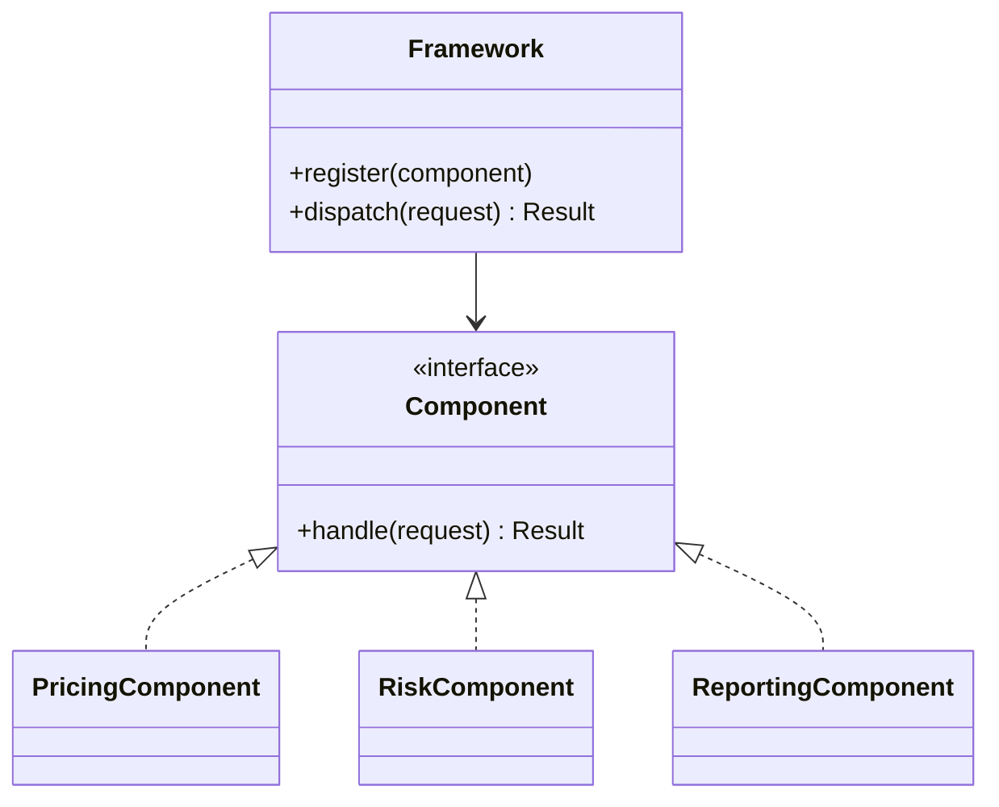

# Pluggable Component Framework

## Description

Pluggable Component Framework is a large-scale structure that emerges when a mature domain has several applications or groups of components that need to interoperate. A central abstraction interface, maintained and shared, expresses the core of the model, and several independent components (often from different teams) are written to fit that interface.

The framework fixes the connection points, interfaces, and interaction protocols, while the components implement the variations. In it, the Abstract Core defines the common vocabulary and the components depend only on it, without knowing about each other. This makes it possible to replace, add, or evolve components without touching the others.

Evans warns that this is a high-investment, high-risk pattern: it requires a well-understood domain, a stable central abstraction, and discipline across teams. That's why it should only be adopted after having gone through the experience of several concrete components, never at the start, as an "a priori framework".

## Problems it solves

- Several teams building applications on the same domain and duplicating or diverging on the core model.
- Difficult integration between components that were born separately and use incompatible abstractions.
- Difficulty replacing or extending parts of the system without affecting the rest.
- The need to offer extension points for partners or product variants.

## When to use

- When several applications or components share the same domain core and there is already experience with at least two or three concrete implementations.
- When teams need autonomy but depend on a stable common contract.
- When there is a clear Abstract Core, extracted from existing components through refactoring.

### When to avoid

- Projects with a single application or just a few components: the cost of the abstraction outweighs the benefit.
- Domains still being discovered, where the central abstraction changes with each iteration and drags all the components along.
- When the framework is born out of speculation, without real components that justify each extension point.
- When a simple Separated Interface or Plugin solves the extensibility problem.

## Trade-offs

| Benefit | Cost / Risk |
| --- | --- |
| Independent, replaceable components | Very high cost of designing and maintaining the framework |
| Autonomy for the component teams | Changes to the central abstraction affect every component |
| Interoperability guaranteed by the common contract | Restricts the components' model to what the interface allows |
| Possibility of an ecosystem and of variants | If poorly designed, it's a premature generalization that's hard to undo |

- **Stability:** the central interface must be stable and carefully versioned.
- **Governance:** requires a team responsible for the framework and clear evolution processes.
- **Alternative:** it's often better to stay with modules coupled through a Shared Kernel or a simple Abstract Core.

## Diagram



The `Framework` only knows the `Component` interface; each concrete component implements the contract and can be developed and replaced independently.

## Example

An insurance broker has several products (auto, home, life), each developed by a different team. After three products are done, the organization extracts what they have in common and defines a `ProductModule` contract with operations such as quote, issue, and renew. The platform loads the modules and orchestrates them.

```python
from abc import ABC, abstractmethod

class ProductModule(ABC):
    @abstractmethod
    def quote(self, request) -> "Quote": ...

    @abstractmethod
    def issue(self, quote) -> "Policy": ...

class Platform:
    def __init__(self):
        self._modules: dict[str, ProductModule] = {}

    def register(self, product_code: str, module: ProductModule):
        self._modules[product_code] = module

    def quote(self, product_code: str, request):
        return self._modules[product_code].quote(request)
```

A new team can create the "travel" product by implementing `ProductModule` and registering it, without changing the platform or the other products.

## Related patterns

- [Abstract Core](/design/ddd/distillation/abstract-core) — the framework's central interface is, in practice, an Abstract Core.
- [Evolving Order](/design/ddd/large-scale-structure/evolving-order) — the framework should only appear after the structure has matured.
- [Knowledge Level](/design/ddd/large-scale-structure/knowledge-level) — another way of making the system configurable, through data instead of components.
- [Shared Kernel](/design/ddd/context-mapping/shared-kernel) — a simpler alternative for sharing between teams.
- [Open Host Service](/design/ddd/context-mapping/open-host-service) — an open protocol for integration, which a framework can adopt.
- [Cohesive Mechanisms](/design/ddd/distillation/cohesive-mechanisms) — mechanisms that can be encapsulated in framework components.
- [Plugin](/design/poeaa/base/plugin) — a technical mechanism for linking implementations at configuration time.
- [Separated Interface](/design/poeaa/base/separated-interface) — separates the interface from the implementation, the technical basis of the components.
- [Strategy](/coding/gof/behavioral/strategy) — behavior variation behind an interface, on a smaller scale.

## Reference

- [DDD Reference, Eric Evans (2015)](https://www.domainlanguage.com/ddd/reference/)
- *Domain-Driven Design: Tackling Complexity in the Heart of Software*, Eric Evans (Addison-Wesley, 2003)
