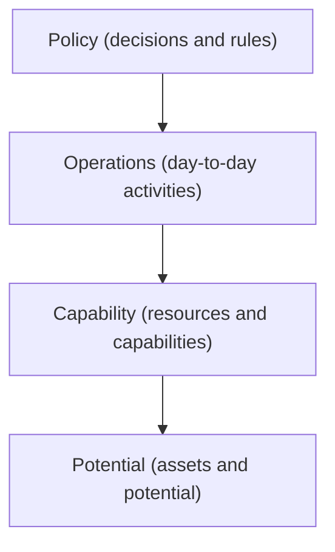

# Responsibility Layers

## Description

Responsibility Layers is a large-scale structure in which the whole domain is organized into a few conceptual layers, each with a broad, well-defined responsibility. Every module and every object in the model belongs to a layer, and dependencies between layers go in a single direction: higher-level layers may know about lower-level ones, but not the other way around.

This is not the technical split into interface, application, domain, and infrastructure (see Layered Architecture). Here the layers divide the domain itself by conceptual role. Evans cites examples such as Potential, Operations, Policy, Commitment, and Capability in logistics and finance systems, where the layers come from studying the business rather than from a ready-made recipe.

By suggesting where each new concept should live and who may depend on whom, the structure gives the model coherence and makes the whole easier to understand. It usually emerges through refactoring, when developers notice that the domain's responsibilities group together naturally, and it should evolve along with the model.

## Problems it solves

- Large models where dependencies between modules become a directionless web, and any change has unpredictable effects.
- Difficulty deciding which module a new concept should live in.
- Lack of an overall view that would let newcomers navigate the domain.
- Business policy rules mixed with day-to-day operations, which makes them hard to change separately.

## When to use

- Large domains, where module responsibilities already group naturally into levels of abstraction.
- When parts of the model change at different paces, for example policies that change often on top of stable operations.
- When it's possible to name layers with business meaning and have most modules fit into them.

### When to avoid

- Small systems or ones with few modules, where the structure becomes ceremony.
- When the layers are artificial and many concepts have no clear place or are forced to fit.
- When the layers resemble the usual technical split, adding no understanding of the domain.

## Trade-offs

| Benefit | Cost / Risk |
| --- | --- |
| Dependencies with a clear direction, which reduces coupling | Requires defining the layers with deep domain knowledge |
| Guidance on where to put each concept | Some concepts don't fit and create exceptions |
| An overview that is easy to explain | Rigid layers can constrain the model |
| Allows changes at different paces per layer | Poorly chosen layers become a burden and need to be refactored |

- **Number:** a few layers (four to six) is recommended; too many layers lose clarity.
- **Dependency:** the dependency rule is the central point; without it the layers are just labels.
- **Evolution:** the layers should be revisited as domain knowledge deepens, in line with Evolving Order.

## Diagram

Each layer depends only on the layers below it: policies know about operations, operations know about capabilities, and so on, never in the opposite direction.

## Example

A freight carrier models its domain in four responsibility layers. Potential gathers what the company owns (vehicles, warehouses, drivers). Operations handles what is happening (deliveries in progress, active routes). Policy holds the decision rules (cargo prioritization, price tables), and is the layer that changes the most.

When adding a new concept, "priority delivery window", the team asks what its responsibility is: it's a decision rule, so it lives in Policy, and it can query Operations to learn the state of the routes. If an Operations module started depending on a Policy class, the dependency rule would be violated and the design would be revisited so that Operations receives the decision as a parameter.

## Related patterns

- [Layered Architecture](/design/ddd/building-blocks/layered-architecture) — technical division into layers; Responsibility Layers divides the domain by conceptual role.
- [Evolving Order](/design/ddd/large-scale-structure/evolving-order) — the layered structure should emerge and be refactored as understanding grows.
- [Module](/design/ddd/building-blocks/module) — each module is allocated to a responsibility layer.
- [Knowledge Level](/design/ddd/large-scale-structure/knowledge-level) — a structure that can coexist when part of the model configures the rest.
- [System Metaphor](/design/ddd/large-scale-structure/system-metaphor) — an alternative way of organizing the whole, by analogy.
- [Conceptual Contours](/design/ddd/supple-design/conceptual-contours) — aligns the model's divisions with the domain's natural lines of change.
- [Core Domain](/design/ddd/distillation/core-domain) — the layers help keep the focus on the core domain.

## Reference

- [DDD Reference, Eric Evans (2015)](https://www.domainlanguage.com/ddd/reference/)
- *Domain-Driven Design: Tackling Complexity in the Heart of Software*, Eric Evans (Addison-Wesley, 2003)
