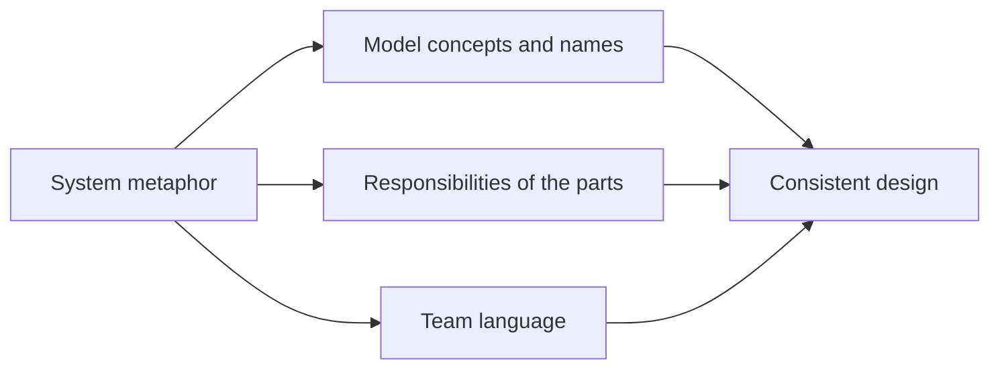

# System Metaphor

## Description

System Metaphor is a large-scale structure in which a concrete, easy-to-understand analogy comes to organize the design of the whole system. When a model is hard to visualize as a whole, a metaphor gives the team a shared image to reason about the system, and guides both the design of the objects and the language used to talk about them.

The metaphor is adopted jointly by developers and domain experts and starts to influence the names, responsibilities, and relationships between the parts. It's a tool for communication and consistency: given a new requirement, the team asks "what does the metaphor suggest?" to decide where it fits.

Evans treats the metaphor with caution. It's useful when it fits the domain naturally, but every metaphor has limits and can distort the model when pushed beyond them. That's why it's a rarely used pattern, and one that should be abandoned when it stops helping.

## Problems it solves

- The team's difficulty in sharing an overall view of an abstract or complex system.
- Inconsistent design decisions across parts of the system for lack of a unifying principle.
- Difficulty explaining the architecture to new team members and to non-technical people.

## When to use

- When there is a natural analogy that developers and experts already use spontaneously to talk about the system.
- When the metaphor correctly explains the domain's essential behavior and guides design decisions.
- In systems whose domain is abstract and benefits from a concrete image.

## When to avoid

- When the metaphor is forced or merely decorates the documentation, without actually guiding the model.
- When it leads to wrong conclusions about the domain, because the analogy doesn't hold in every case.
- When domain experts don't recognize it: the business vocabulary, via Ubiquitous Language, should prevail.

## Trade-offs

| Benefit | Cost / Risk |
| --- | --- |
| A simple, memorable shared view | Every metaphor has limits and can distort the model |
| Consistency across design decisions in different modules | Can compete with the business language if not well aligned |
| Eases learning for people joining the project | The team may "force" requirements to fit the metaphor |
| Guides names and responsibilities | A truly suitable metaphor rarely exists |

- **Replacement:** a metaphor that stops serving should be replaced, not stretched.
- **Language:** the metaphor's terms should be incorporated into the Ubiquitous Language only if they also make sense to the business.
- **Frequency:** Evans notes that few projects have truly useful metaphors; the pattern is a tool, not a goal.

## Diagram

The metaphor influences concepts, responsibilities, and language, and these three elements converge into a more consistent design.

## Example

A package routing system was described by the team as a "pneumatic tube network": each distribution center is a station, each package travels in a capsule, and the legs are tubes with limited capacity. The image helped decide that each center only knows the next leg and that routing is a property of the network, not of the package.

Later, the metaphor started getting in the way: in a pneumatic tube network there are no packages held for tax inspection and no routes by customer type. The team began avoiding the term "capsule" in business rules, kept the image only as an aid for explaining the basic flow, and used logistics domain terms for the new rules.

## Related patterns

- [Ubiquitous Language](/design/ddd/model-in-practice/ubiquitous-language) — the metaphor can feed the language, but the business vocabulary is sovereign.
- [Evolving Order](/design/ddd/large-scale-structure/evolving-order) — the metaphor should emerge and be revisited, never imposed.
- [Responsibility Layers](/design/ddd/large-scale-structure/responsibility-layers) — an alternative structure, based on responsibilities rather than analogy.
- [Model-Driven Design](/design/ddd/model-in-practice/model-driven-design) — the metaphor is only worthwhile if it's reflected in the code.
- [Intention-Revealing Interfaces](/design/ddd/supple-design/intention-revealing-interfaces) — intention-revealing names help keep the metaphor legible in the code.

## Reference

- [DDD Reference, Eric Evans (2015)](https://www.domainlanguage.com/ddd/reference/)
- *Domain-Driven Design: Tackling Complexity in the Heart of Software*, Eric Evans (Addison-Wesley, 2003)
- *Extreme Programming Explained*, Kent Beck (Addison-Wesley, 1999), origin of the term System Metaphor
