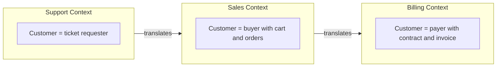

# Bounded Context

## Description

A Bounded Context explicitly defines the boundary within which a specific domain model applies. Inside that boundary, each term has a single meaning and the model is internally consistent; outside it, the same term may mean something else, and that's accepted.

The boundary is defined in practical terms: team organization, parts of the application, codebase, and database schema. Instead of chasing a single, universal model for the whole company, DDD accepts multiple models, each with its own context, and handles the relationships between them explicitly through the Context Map.

The Bounded Context is the foundation of strategic design: it's where the Ubiquitous Language gets its precise meaning, and it's the basis for deciding where to invest modeling effort.

## Problems it solves

- Ambiguous concepts, such as "Customer" or "Product", with conflicting meanings in different areas of the business.
- A "unified" model that tries to please everyone and ends up inconsistent and confusing.
- Teams stepping on each other's code for lack of clear boundaries.
- Concepts leaking from one model into another, corrupting both.

## When to use

- When the same term has different meanings for different areas of the business.
- When more than one team contributes to the same system and the model starts to become incoherent.
- When designing the decomposition of a large system, whether into modules or services.

## When to avoid

- Small systems maintained by a single team, where one cohesive model is enough.
- When the boundary is drawn on technical criteria alone (layers, technology) and ignores the meaning of the domain.

## Trade-offs

| Benefit | Cost / Risk |
| --- | --- |
| Consistent model and precise vocabulary within the boundary | Duplication of concepts across contexts |
| Teams with autonomy to evolve their model | Need for translation and integration at the boundaries |
| Basis for decomposing into modules or services | Poorly drawn boundaries are expensive to fix later |

- **Integration:** relationships between contexts need to be mapped and managed, usually with a Context Map.
- **Organizational boundary:** the context often coincides with a team's boundary; Conway's Law works for or against you.
- **Consistency:** model consistency holds only within the context; between contexts it's negotiated.

## Diagram

The term "Customer" has its own model in each context, and the arrows indicate translation points between them.

## Example

A telecommunications company had a single `Customer` class with more than a hundred attributes, changed by sales, billing, and support. Every change by one team broke another. The team split it into three Bounded Contexts: in Sales, the customer is a lead with proposals and plans; in Billing, it's the holder of a contract with invoices and delinquency; in Support, it's whoever opens tickets and has a service history.

Each context got its own model, code, and database schema, with a shared customer identifier as the only link. Integrations went through a translation layer, and each team's vocabulary became precise within its own context.

## Related patterns

- [Ubiquitous Language](/design/ddd/model-in-practice/ubiquitous-language) — the language holds within a Bounded Context.
- [Continuous Integration](/design/ddd/model-in-practice/continuous-integration) — keeps the model cohesive within the boundary.
- [Context Map](/design/ddd/context-mapping/context-map) — describes the relationships between Bounded Contexts.
- [Anticorruption Layer](/architecture/cloud-design-patterns/integration-and-modernization/anti-corruption-layer) — protects the model from external influences.
- [Shared Kernel](/design/ddd/context-mapping/shared-kernel) — a subset of the model shared between contexts.
- [Decompose by Subdomain](/architecture/microservices/service-boundaries/decompose-by-subdomain) — Bounded Contexts often guide the split into microservices.
- [Database per Service](/architecture/microservices/service-collaboration/database-per-service) — reinforces the model's boundary at the storage level.

## Reference

- [BoundedContext, Martin Fowler's bliki](https://martinfowler.com/bliki/BoundedContext.html)
- [DDD Reference, Eric Evans (2015)](https://www.domainlanguage.com/ddd/reference/)
- *Domain-Driven Design: Tackling Complexity in the Heart of Software*, Eric Evans (Addison-Wesley, 2003)
