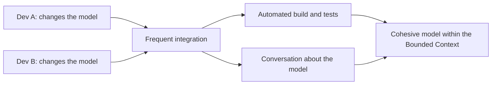

# Continuous Integration

## Description

In DDD, Continuous Integration is the process of continuously integrating all the work done within a Bounded Context, so the model stays cohesive and every team member understands it the same way. When several people work in the same context, concepts tend to fragment: two people model the same idea in incompatible ways, or a term picks up different meanings.

Integration happens on two levels. In the code, there's frequent integration, an automated build, and tests that quickly detect inconsistencies. In the model, the team talks constantly, keeps the Ubiquitous Language alive, and shares its understanding of changes in meetings and discussions, not just in the repository.

The practice applies only within a Bounded Context; between contexts, integration is handled by other patterns, such as those in Context Mapping.

## Problems it solves

- Model fragmentation: parts of the same context start to diverge without anyone noticing.
- Duplicated or conflicting concepts created by different team members.
- Late, painful integration of changes made in isolation.
- Loss of shared understanding as the team grows.

## When to use

- When more than one person changes the model of the same Bounded Context.
- When the team grows and the model starts showing signs of inconsistency.
- Together with automated tests that protect the model's behavior.

### When to avoid

- As a substitute for defining boundaries: if the team is too large to integrate the model continuously, the context should be split.
- Reduced to a build pipeline, with no conversation about the model, the practice loses its main value.

## Trade-offs

| Benefit | Cost / Risk |
| --- | --- |
| A single, coherent model within the context | Requires frequent communication and discipline |
| Divergences caught early, while they're cheap | Investment in automation and tests |
| Shared understanding among members | Doesn't scale to very large teams |

- **Context size:** the practical limit of the technique is the size of the team; beyond it, the Bounded Context should be split.
- **Tests:** the automated suite acts as a safety net for changes to the model.
- **Culture:** requires willingness to integrate early and discuss model changes openly.

## Diagram

Changes from several people go through frequent integration, validated by automated tests and by conversation about the model.

## Example

A team of five works in the Reservations context of an airline. Two people modeled the concept of a "blocked seat" in different weeks: one as a temporary hold, the other as an operational restriction. Because the team integrates code several times a day and has a short conversation about the model every morning, the divergence surfaced within two days instead of after a month.

They chose a single term, `SeatHold`, for the temporary hold and `SeatRestriction` for the other case, updated the tests, and recorded the decision in the glossary. Without continuous integration of the model, both versions would have coexisted in the code and caused business-rule bugs.

## Related patterns

- [Bounded Context](/design/ddd/model-in-practice/bounded-context) — defines the scope in which continuous integration applies.
- [Ubiquitous Language](/design/ddd/model-in-practice/ubiquitous-language) — ongoing conversation keeps the language aligned.
- [Model-Driven Design](/design/ddd/model-in-practice/model-driven-design) — the code reflects the integrated model.
- [Shared Kernel](/design/ddd/context-mapping/shared-kernel) — the part shared between contexts also requires frequent integration.
- [Context Map](/design/ddd/context-mapping/context-map) — deals with integration between contexts, where this practice doesn't apply.

## Reference

- [DDD Reference, Eric Evans (2015)](https://www.domainlanguage.com/ddd/reference/)
- *Domain-Driven Design: Tackling Complexity in the Heart of Software*, Eric Evans (Addison-Wesley, 2003)
