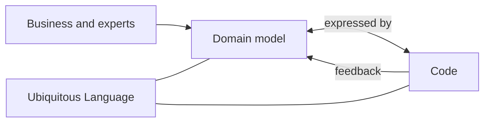

# Model-Driven Design

## Description

Model-Driven Design is the idea that the domain model and the code design must be closely tied: the code is an expression of the model, and a change in the code is a change in the model. Instead of keeping an analysis model separate from the design, the team uses a single model that serves both analysis and implementation.

To achieve this, the implementation uses constructs that mirror the model's concepts, typically with object-oriented programming and the tactical building blocks of DDD, such as Entity, Value Object, Aggregate, and Repository. When the model can't be expressed naturally in code, the model should be revised, rather than working around it in the code.

The pattern requires that those who model be involved in the implementation, which gives rise to Hands-on Modelers.

## Problems it solves

- An analysis model that diverges from the code and becomes outdated documentation.
- A design that ignores the model and results in technical structures with no business meaning.
- Loss of knowledge when moving from the model to the implementation across different teams.
- Difficulty knowing whether a business rule is actually implemented.

## When to use

- In complex domains, where the model is the main asset for understanding.
- When you want the code to be the living documentation of the domain.
- Together with a Ubiquitous Language shared between business and technology.

### When to avoid

- In systems dominated by simple data operations (CRUD), where a rich model doesn't pay off.
- When the chosen platform or paradigm doesn't allow the model to be expressed reasonably.

## Trade-offs

| Benefit | Cost / Risk |
| --- | --- |
| Code and model always aligned | Calls for a team that masters both modeling and programming |
| Business rules localized and readable | May conflict with occasional technical optimizations |
| Model changes are reflected directly | Requires constant refactoring to keep alignment |

- **Boundary:** applies within a Bounded Context, not across the whole system.
- **Tooling:** frameworks that impose their own structures can get in the way of expressing the model.
- **Evolution:** the model changes as the team learns, and the code follows.

## Diagram

The model and the code influence each other, linked by the shared language; feedback from the implementation flows back to the model.

## Example

An insurance team modeled the concept of a "policy" with validity and coverage rules, but the implementation had only tables and services with scattered logic. By adopting Model-Driven Design, the team created `Policy`, `Coverage`, and `CoveragePeriod` in the code, with the validity rules inside those classes.

When the experts changed the rule to allow retroactive coverage, the change was made in a single place in the code and discussed in the model itself. While trying to express the new rule, the developers noticed an ambiguity in the model and went back to the business for a conversation before implementing it.

## Related patterns

- [Hands-on Modelers](/design/ddd/model-in-practice/hands-on-modelers) — those who model take part in the implementation.
- [Ubiquitous Language](/design/ddd/model-in-practice/ubiquitous-language) — the code uses the model's terms.
- [Layered Architecture](/design/ddd/building-blocks/layered-architecture) — isolates the domain layer where the model lives.
- [Entity](/design/ddd/building-blocks/entity) — a building block for expressing the model.
- [Value Object](/design/poeaa/base/value-object) — a building block for expressing the model.
- [Aggregate](/design/ddd/building-blocks/aggregate) — a building block for keeping the model consistent.
- [Domain Model](/design/poeaa/domain-logic/domain-model) — a pattern for organizing domain logic that DDD takes further.

## Reference

- [DDD Reference, Eric Evans (2015)](https://www.domainlanguage.com/ddd/reference/)
- *Domain-Driven Design: Tackling Complexity in the Heart of Software*, Eric Evans (Addison-Wesley, 2003)
