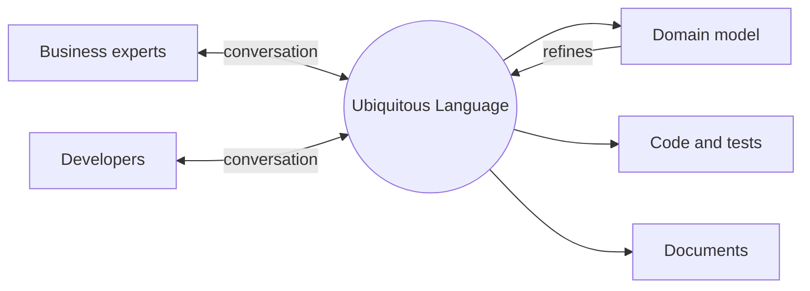

# Ubiquitous Language

## Description

The Ubiquitous Language is a language structured around the domain model and used by every team member, business experts and developers alike, in all activities: conversations, documents, tests, and code. The terms of the language come from the model, and the model is refined through use of the language.

When a conversation reveals an ambiguous or awkward term, that's a sign of a problem in the model, and the code should change along with the language. Without a common language, developers translate constantly between business jargon and technical jargon, and every translation loses information.

The language is valid within a Bounded Context; in different contexts, the same terms can have different meanings.

## Problems it solves

- Constant translation between the business vocabulary and the developers' vocabulary, with loss of meaning.
- Misunderstandings between experts and developers that only surface late, in production.
- Code with technical or generic names that don't reveal business intent.
- Model and implementation that diverge over time.

## When to use

- In any project with a rich domain, where experts and developers need to collaborate closely.
- When you notice the same things being given different names in meetings, documents, and code.
- Together with an evolving model, to validate what has been understood.

### When to avoid

- When there's no access to domain experts, since the language ends up invented by developers alone.
- Trying to impose a single language on the whole company, instead of one per Bounded Context.

## Trade-offs

| Benefit | Cost / Risk |
| --- | --- |
| Precise communication between business and technology | Requires ongoing discipline from the whole team |
| Code that reflects the business and is readable by experts | Renaming code and documents when the language changes |
| Model errors caught early, in conversation | Can cause friction when business terms are ambiguous |

- **Scope:** the language belongs to a context; identical terms in different contexts aren't a conflict, they're a boundary.
- **Documentation:** diagrams and documents help, but the source of truth is the conversation itself and the code.
- **Evolution:** changing the model implies changing the language, and vice versa.

## Diagram

The language sits at the center, connecting people, model, code, and documents; usage refines the model, and the model refines the language.

## Example

In a logistics system, the experts say "consolidate shipments" and "pickup window", while the code had `mergeShipments()` and `pickupTimeRange`. During a modeling session, the team realized that "consolidate" only applies to shipments with the same destination, a rule the code didn't express.

The team renamed the methods and classes to `consolidate()` and `PickupWindow`, adjusted the tests to use the same phrases the experts say, and started rejecting the consolidation of shipments with different destinations. The gain was that the rule, previously implicit, now exists in both the vocabulary and the code.

## Related patterns

- [Bounded Context](/design/ddd/model-in-practice/bounded-context) — delimits where the language holds.
- [Model-Driven Design](/design/ddd/model-in-practice/model-driven-design) — the code uses the model's terms.
- [Hands-on Modelers](/design/ddd/model-in-practice/hands-on-modelers) — those who model also program and use the same language.
- [Refactoring Toward Deeper Insight](/design/ddd/model-in-practice/refactoring-toward-deeper-insight) — the language reveals where the model needs refinement.
- [Published Language](/design/ddd/context-mapping/published-language) — a well-documented language for integration between contexts.

## Reference

- [UbiquitousLanguage, Martin Fowler's bliki](https://martinfowler.com/bliki/UbiquitousLanguage.html)
- [DDD Reference, Eric Evans (2015)](https://www.domainlanguage.com/ddd/reference/)
- *Domain-Driven Design: Tackling Complexity in the Heart of Software*, Eric Evans (Addison-Wesley, 2003)
