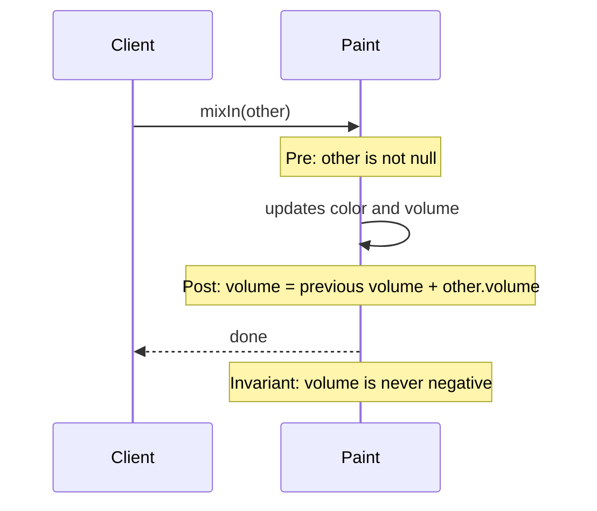

# Assertions

## Description

Assertions means explicitly declaring the postconditions of operations and the invariants of classes and Aggregates. When an operation changes state, it isn't enough for the name to suggest the effect: the contract says what will be true after the call, and what must be true before it.

In languages with contract support, assertions can be written in the code. In the others, automated tests are used, and the model's documentation should present them clearly. What matters is that the client doesn't have to deduce the effect by reading the method body, and that the implementer knows what must be preserved.

Combined with Side-Effect-Free Functions, the pattern makes the few commands that modify state visible, along with what they guarantee, which makes the model safe to compose and extend.

## Problems it solves

- Hidden side effects that are only discovered by reading the implementation or in production.
- Aggregate invariants that exist only in the head of whoever wrote it.
- Subclasses and new implementations that break the contract without noticing.
- Difficulty knowing what to test in an operation that changes state.

## When to use

- In commands that change the state of Entities and Aggregates.
- When there are consistency rules that every modification must preserve.
- In hierarchies or extension points where several implementations must honor the same contract.

## When to avoid

- In trivial operations, where the assertion merely repeats the name.
- When the cost of checking the condition at run time is prohibitive; in that case, prefer tests.

## Trade-offs

| Benefit | Cost / Risk |
| --- | --- |
| Explicit, verifiable contract | Effort to write and maintain the conditions |
| Failures detected close to their source | Run-time checks cost performance |
| Makes testing and safe extension easier | Outdated conditions mislead more than they help |

- **Consistency:** invariants make the model's rules verifiable.
- **Documentation:** tests that express the assertions work as executable documentation.
- **Tooling:** the level of formality depends on the language's support.

## Diagram



The precondition, the postcondition, and the invariant are declared around the `mixIn` command.

## Example

In `Paint.mixIn`, the postcondition is that the final volume is the sum of the volumes. Without a contract language, it becomes an automated test and a check in the method.

```java
public class Paint {
    private int volume;
    private PigmentColor color;

    /**
     * Postcondition: volume() == previousVolume + other.volume().
     * Invariant: volume() >= 0.
     */
    public void mixIn(Paint other) {
        Objects.requireNonNull(other, "other");
        int before = volume;
        color = color.mixedWith(other.color, volume, other.volume);
        volume += other.volume;
        assert volume == before + other.volume;
        assert volume >= 0;
    }
}

@Test
void mixInSumsVolumes() {
    Paint a = new Paint(100, PigmentColor.BLUE);
    a.mixIn(new Paint(50, PigmentColor.YELLOW));
    assertEquals(150, a.volume());
}
```

## Related patterns

- [Side-Effect-Free Functions](/design/ddd/supple-design/side-effect-free-functions) — reduces the number of commands that need assertions.
- [Intention-Revealing Interfaces](/design/ddd/supple-design/intention-revealing-interfaces) — the name suggests the effect; the assertion confirms it.
- [Aggregate](/design/ddd/building-blocks/aggregate) — its invariants are the main target of assertions.
- [Entity](/design/ddd/building-blocks/entity) — commands that change state need clear postconditions.
- [Closure of Operations](/design/ddd/supple-design/closure-of-operations) — makes it easier to reason about the result without new dependencies.

## Reference

- [DDD Reference, Eric Evans (2015)](https://www.domainlanguage.com/ddd/reference/)
- *Domain-Driven Design: Tackling Complexity in the Heart of Software*, Eric Evans (Addison-Wesley, 2003)
