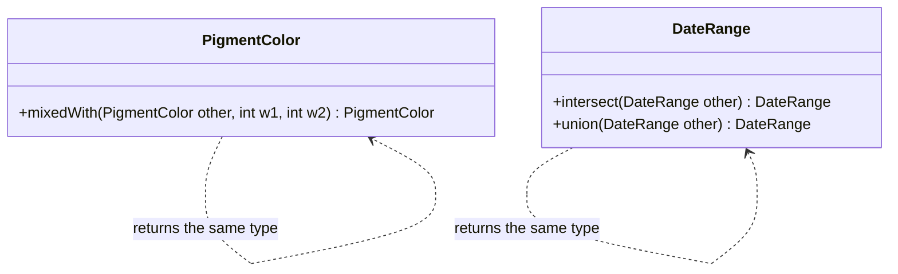

# Closure of Operations

## Description

Closure of Operations means defining operations whose return type is the same as the type of their arguments. As in mathematics, the sum of two numbers is a number: the set is closed under the operation. The result can be used as input to the same operation, and composition comes naturally.

Because the result belongs to the same set, the client doesn't need to know other concepts to use the operation, which reduces dependencies. If the argument's type is that of the implementer, the operation is closed over it; if there is an argument of another type (for example, a configuration parameter), it is said to be partially closed, and the benefit is still large.

The pattern is especially natural in Value Objects, which are immutable and can return new instances. Not every concept admits a closed operation, and in that case it shouldn't be forced.

## Problems it solves

- Operations that return auxiliary types and force the client to know extra concepts.
- Chains of calculations that are hard to compose.
- Unnecessary dependencies introduced by intermediate types.
- Interfaces with many different return types, hard to understand.

## When to use

- In Value Objects with natural combining operations (add, merge, intersect, mix).
- When a calculation can be expressed as a sequence of steps of the same type.
- In rules that compose, such as sets of conditions or date ranges.

## When to avoid

- When there is no natural closed operation: forcing the type distorts the model.
- When the operation needs extra information that the set doesn't carry.

## Trade-offs

| Benefit | Cost / Risk |
| --- | --- |
| Small interface that's easy to understand | Not every concept admits closure |
| Operations can be composed in a chain | Can create many intermediate objects |
| Fewer dependencies for the client | Forced closure can distort the model |

- **Immutability:** generally goes well with immutable objects.
- **Composition:** the result can feed the same operation without adaptations.
- **Model:** the presence of a closed operation is a sign of a well-formed concept.

## Diagram



In both classes, the operation takes and returns the same type, so the results can be chained.

## Example

A date range offers `intersect`, which takes and returns a `DateRange`. To find the window in which three people are available, you just chain the calls.

```typescript
class DateRange {
  constructor(readonly start: Date, readonly end: Date) {}

  // Closed operation: DateRange -> DateRange
  intersect(other: DateRange): DateRange | null {
    const start = this.start > other.start ? this.start : other.start;
    const end = this.end < other.end ? this.end : other.end;
    return start <= end ? new DateRange(start, end) : null;
  }
}

const common = alice
  .intersect(bob)!
  .intersect(carol);
```

## Related patterns

- [Value Object](/design/poeaa/base/value-object) — the most natural environment for closed operations.
- [Side-Effect-Free Functions](/design/ddd/supple-design/side-effect-free-functions) — closed operations are usually pure functions.
- [Standalone Classes](/design/ddd/supple-design/standalone-classes) — closure helps limit dependencies.
- [Composite](/coding/gof/structural/composite) (GoF) — a structure in which the whole and the part share the same type.
- [Declarative Design](/design/ddd/supple-design/declarative-design) — closed operations support declarative combinations.

## Reference

- [DDD Reference, Eric Evans (2015)](https://www.domainlanguage.com/ddd/reference/)
- *Domain-Driven Design: Tackling Complexity in the Heart of Software*, Eric Evans (Addison-Wesley, 2003)
