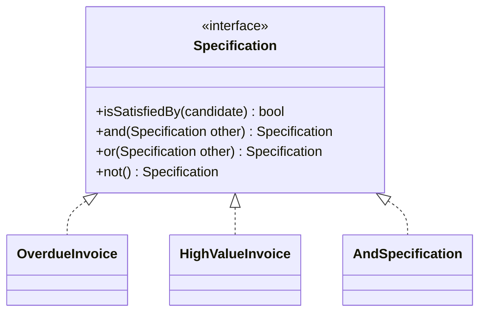

# Declarative Design

## Description

Declarative Design is a style in which the software's behavior is controlled by an executable specification that describes the domain's properties and rules instead of step-by-step instructions. The author declares what they want, and the framework or engine takes care of how to do it.

There are various forms: rules expressed in a domain-specific language (DSL), decision tables, configuration through attributes and annotations, or the composition of small objects with precise meaning. The most accessible style is to build, with Intention-Revealing Interfaces, Side-Effect-Free Functions, and Closure of Operations, a set of elements that can be combined clearly, as in the Specification pattern.

The risk is rigidity: a limited declarative language can prevent what the domain requires. That's why the style works best when the model is mature and the rules are stable enough to justify the investment.

## Problems it solves

- Business rules buried in imperative code, hard to read and to validate with experts.
- Distance between what the expert describes and what the code does.
- Duplicated logic, where the same rule shows up in validation, querying, and selection.
- Difficulty combining rules without rewriting conditionals.

## When to use

- When the rules are numerous, change often, and can be read by experts.
- When there is a stable model and concepts that combine (for example, Specifications).
- When the same set of rules serves to validate, select, and build.

### When to avoid

- In domains that are still poorly understood, where the declarative language becomes a straitjacket.
- When the cost of creating and maintaining the engine or DSL outweighs the gain.
- When code generation hides the logic and keeps the team from evolving the model.

## Trade-offs

| Benefit | Cost / Risk |
| --- | --- |
| Rules readable by experts | Cost of creating and maintaining the language or engine |
| Less imperative and duplicated code | Expressiveness limited by what the language allows |
| The same rule to validate, select, and build | Harder debugging, far from the generated code |

- **Shared language:** the specification becomes a means of communicating with the business.
- **Evolution:** changes the language doesn't support require changing the engine itself.
- **Maturity:** depends on an already deepened model.

## Diagram



The rules are small implementations of `Specification`, combined with `and`, `or`, and `not` to form larger rules declaratively.

## Example

To collect on invoices, the business rule is "overdue and high-value". Instead of conditionals, the rules are small objects that are combined, and the same specification can be used to validate or filter.

```typescript
interface Spec<T> {
  isSatisfiedBy(t: T): boolean;
  and(o: Spec<T>): Spec<T>;
}

const spec = <T>(f: (t: T) => boolean): Spec<T> => ({
  isSatisfiedBy: f,
  and: (o) => spec((t) => f(t) && o.isSatisfiedBy(t)),
});

const overdue = spec<Invoice>((i) => i.dueDate < new Date());
const highValue = spec<Invoice>((i) => i.amount > 10_000);

const toCollect = overdue.and(highValue);
const pending = invoices.filter((i) => toCollect.isSatisfiedBy(i));
```

## Related patterns

- [Intention-Revealing Interfaces](/design/ddd/supple-design/intention-revealing-interfaces) — names that make the declarative style readable.
- [Side-Effect-Free Functions](/design/ddd/supple-design/side-effect-free-functions) — pure rules can be combined without risk.
- [Closure of Operations](/design/ddd/supple-design/closure-of-operations) — `and`, `or`, and `not` return a Specification.
- [Interpreter](/coding/gof/behavioral/interpreter) (GoF) — a technique for executing a rule language.
- [Query Object](/design/poeaa/object-relational-metadata-mapping/query-object) (PoEAA) — a query expressed as a declarative object.
- [Domain Service](/design/ddd/building-blocks/domain-service) — an alternative when the rule doesn't fit in a specification.

## Reference

- [DDD Reference, Eric Evans (2015)](https://www.domainlanguage.com/ddd/reference/)
- *Domain-Driven Design: Tackling Complexity in the Heart of Software*, Eric Evans (Addison-Wesley, 2003)
