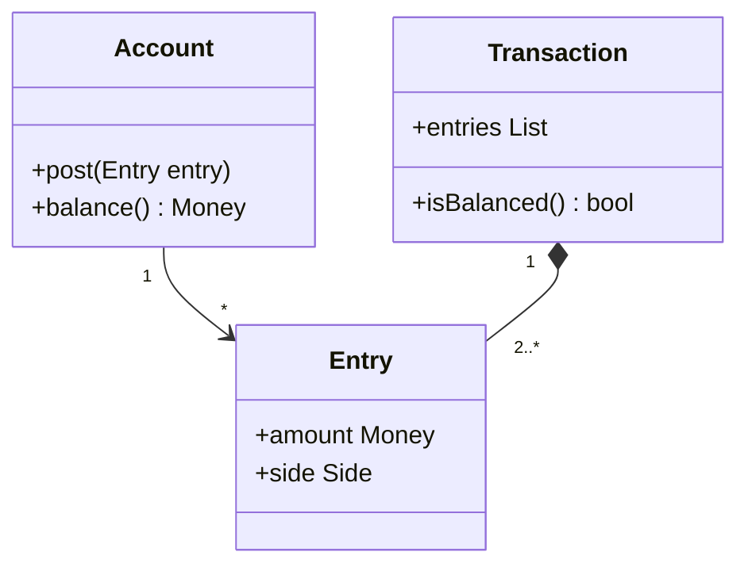

# Drawing on Established Formalisms

## Description

Drawing on Established Formalisms means reusing, in the domain model, a mature and well-understood conceptual system, such as accounting, algebra, set theory, logic, date calculation, or tax rules. These formalisms have been refined over many years and already bring proven concepts, rules, and vocabulary.

Instead of inventing a model from scratch, the team adapts the existing structure to its context. The vocabulary is shared with experts, and the mathematical properties (associativity, closure, identity) are inherited, which helps ensure consistency and predict behavior.

The technique doesn't require applying the formalism in full. Often a part is enough, or an adaptation to the domain. What's essential is that the model rests on something the business already recognizes and that has stood the test of time.

## Problems it solves

- Reinventing concepts that are already well solved, with errors the literature has already corrected.
- Home-grown models that nobody outside the team understands.
- Rules that contradict each other in edge cases for lack of a rigorous foundation.
- Difficulty convincing experts and auditors that the model is correct.

## When to use

- When the domain has an established theory (finance, taxes, geometry, set algebra).
- When the formalism fits the problem with few adjustments.
- When auditing and traceability require concepts recognized by the market.

### When to avoid

- When the formalism doesn't apply well and is forced, distorting the domain.
- When the team doesn't master the formalism and the learning cost outweighs the benefit.
- When the business uses its own vocabulary that diverges from the formalism.

## Trade-offs

| Benefit | Cost / Risk |
| --- | --- |
| Tested conceptual foundation and recognized vocabulary | Requires studying the formalism |
| Predictable properties, fewer edge-case defects | Can be rigid or excessive for the problem |
| Easy communication with experts and auditors | Adapting the formalism to the context takes care |

- **Consistency:** the formalism's properties hold automatically in the model.
- **Adaptation:** use only the useful part, without importing unnecessary complexity.
- **Evolution:** the formalism stabilizes the model, but it changes if the business changes.

## Diagram



The model adopts double-entry bookkeeping: a `Transaction` is only valid if its entries (`Entry`) balance out.

## Example

A financial system adopts double-entry bookkeeping instead of keeping loose balances. The rule "debits equal credits" comes from the accounting formalism and guarantees integrity.

```python
from dataclasses import dataclass
from decimal import Decimal

@dataclass(frozen=True)
class Entry:
    account: str
    amount: Decimal   # positive = debit, negative = credit

class Transaction:
    def __init__(self, entries: list[Entry]):
        if sum(e.amount for e in entries) != 0:
            raise ValueError("Debits and credits must balance")
        self.entries = tuple(entries)

tx = Transaction([
    Entry("cash", Decimal("100")),
    Entry("revenue", Decimal("-100")),
])
```

## Related patterns

- [Conceptual Contours](/design/ddd/supple-design/conceptual-contours) — the formalism helps find the model's natural divisions.
- [Refactoring Toward Deeper Insight](/design/ddd/model-in-practice/refactoring-toward-deeper-insight) — formalisms often emerge as part of that deepening.
- [Ubiquitous Language](/design/ddd/model-in-practice/ubiquitous-language) — the formalism's vocabulary becomes the common language.
- [Closure of Operations](/design/ddd/supple-design/closure-of-operations) — mathematical formalisms bring closed operations.
- [Value Object](/design/poeaa/base/value-object) — formal concepts are usually modeled as values.
- [Money](/design/poeaa/base/money) (PoEAA) — an example of a well-established formal concept.

## Reference

- [DDD Reference, Eric Evans (2015)](https://www.domainlanguage.com/ddd/reference/)
- *Domain-Driven Design: Tackling Complexity in the Heart of Software*, Eric Evans (Addison-Wesley, 2003)
