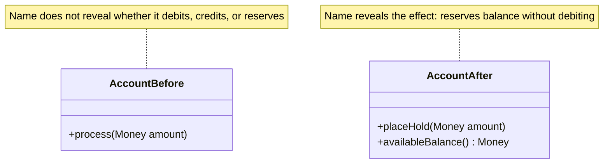

# Intention-Revealing Interfaces

## Description

Intention-Revealing Interfaces means naming classes, methods, and arguments so that they express the purpose and the observable effect, not how the result is obtained. The name comes from the Ubiquitous Language: whoever uses the component understands what it does without having to read the implementation.

In practice, the contract is written first, for example with a test that shows how the client wants to use the operation. Then the implementation is written behind that interface. If the developer has to open the code to find out what a method does, encapsulation has been lost: the client now depends on the internal details.

The pattern is the foundation of Supple Design. Interfaces that reveal intention make the other techniques (side-effect-free functions, assertions, closed operations) easier to apply and to communicate.

## Problems it solves

- Generic names (`process`, `handle`, `calculate`) that force you to read the implementation to understand the effect.
- Clients coupled to the internal mechanism rather than to the purpose of the operation.
- Developers who reimplement something that already exists because they didn't realize what the method did.
- Distance between the business vocabulary and the code vocabulary.

## When to use

- In any public class or method of the domain model.
- When business experts and developers need to read the same code or the same tests.
- When refactoring methods whose name describes the "how" instead of the "what".

## When to avoid

- In private, volatile internal details, where a wordy name adds little value.
- When the concept hasn't been understood yet: a "nice" name for a wrong model only gives false confidence. Deepen the model first.

## Trade-offs

| Benefit | Cost / Risk |
| --- | --- |
| Code readable by people who don't know the implementation | Requires knowing the domain well to choose good names |
| Less duplication and less reading of internal code | Renaming public APIs can affect many clients |
| Tests that serve as documentation | Bad names kept out of inertia lose the benefit |

- **Shared language:** the code's vocabulary and the conversation's vocabulary evolve together.
- **Encapsulation:** the client depends on the contract, not the mechanism.
- **Maintenance:** names need to be revisited when the understanding of the domain changes.

## Diagram



In `AccountBefore`, the method doesn't say what happens to the balance; in `AccountAfter`, `placeHold` reveals the intention and the effect. The book illustrates the pattern with paint mixing.

## Example

A digital account had a method `process(Money amount)` that actually set the amount aside from the available balance, without debiting it. The client had to read the method body to find out the effect, and someone had already called it believing it moved the money. Renamed to `placeHold`, the contract is clear and the test says what's expected.

```java
public class Account {
    private Money balance;
    private final Money overdraftLimit;
    private Money held = Money.brl(0);

    public Account(Money balance, Money overdraftLimit) {
        this.balance = balance;
        this.overdraftLimit = overdraftLimit;
    }

    // Before: public void process(Money amount)
    public void placeHold(Money amount) {
        held = held.plus(amount);
    }

    public Money balance() { return balance; }

    public Money availableBalance() {
        return balance.plus(overdraftLimit).minus(held);
    }
}

// The test writes the contract before the implementation
Account account = new Account(Money.brl(100_00), Money.brl(0));
account.placeHold(Money.brl(30_00));
assertEquals(Money.brl(70_00), account.availableBalance());
assertEquals(Money.brl(100_00), account.balance());
```

## Related patterns

- [Side-Effect-Free Functions](/design/ddd/supple-design/side-effect-free-functions) — separates queries from commands, making the effect explicit.
- [Assertions](/design/ddd/supple-design/assertions) — declare the effects and invariants that the name only suggests.
- [Ubiquitous Language](/design/ddd/model-in-practice/ubiquitous-language) — the source of the names used in the interfaces.
- [Model-Driven Design](/design/ddd/model-in-practice/model-driven-design) — ties the model to the code through these interfaces.
- [Refactoring Toward Deeper Insight](/design/ddd/model-in-practice/refactoring-toward-deeper-insight) — new insights produce new names.

## Reference

- [DDD Reference, Eric Evans (2015)](https://www.domainlanguage.com/ddd/reference/)
- *Domain-Driven Design: Tackling Complexity in the Heart of Software*, Eric Evans (Addison-Wesley, 2003)
