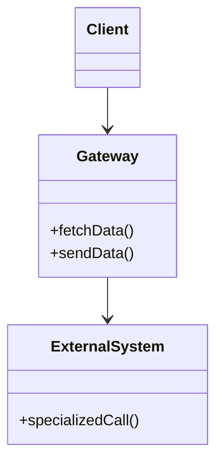

# Gateway

## Description

A Gateway is an object that encapsulates access to an external system or resource, such as a database, a payment service, a queue, or an XML file. External resources usually come with specialized APIs (JDBC, SDKs, HTTP clients) that reflect the nature of the resource, and anyone who uses them has to learn the details of each one.

The solution is to wrap all the code for that specialized API in a class whose interface looks like that of an ordinary object, expressed in the language of the application's domain. The rest of the code talks only to the Gateway, which translates simple method calls into the resource-specific calls.

Because the client depends only on the Gateway's interface, the resource can be swapped, simulated in tests, or replaced by another technology without changing the rest of the application.

## Problems it solves

- Business code mixed with the details of external APIs (SQL, HTTP, SDKs, XML).
- Changing the external resource (for example, from a relational database to an XML message) requires changes scattered across the code.
- Difficulty testing logic that depends directly on an external resource.
- Every developer has to learn the specialized API to touch the code.

## When to use

- When the application accesses an external resource with a complex or specific API and you want to hide it from the rest of the system.
- When there's a chance of changing the resource or the vendor in the future.
- When you want to replace the resource with a [Service Stub](/design/poeaa/base/service-stub) in tests.
- Together with [Separated Interface](/design/poeaa/base/separated-interface), so the interface lives in the client code and the implementation in another package.

### When to avoid

- When the resource already has a simple, stable API and the Gateway would just forward calls without adding value.
- When the layer would end up exposing the whole original API, merely renamed.
- When access is so occasional that the indirection costs more than it gains.

## Trade-offs

| Benefit | Cost / Risk |
| --- | --- |
| Isolates business code from the resource's API | One more layer to write and maintain |
| Makes testing with doubles or stubs easier | May hide resource-specific capabilities |
| Allows swapping the external resource with localized impact | Risk of leaking the resource's abstractions into the Gateway's interface |
| Concentrates error handling and data translation | The Gateway can grow too large if it aggregates many operations |

- **Coupling:** the client depends on a domain interface, not on the external technology.
- **Testability:** easy to replace with a stub or mock.
- **Performance:** the cost of one extra call; the main concern is not hiding expensive remote calls behind seemingly cheap methods.

## Diagram



The `Client` uses only the `Gateway`, which translates its calls into specific operations on the `ExternalSystem`. The external system isn't visible to the rest of the application.

## Example

A store needs to look up currency exchange rates from a third-party HTTP service. An `ExchangeRateGateway` hides the URL, the JSON, and the HTTP client, and exposes an operation in domain terms.

```python
import json
import urllib.request
from decimal import Decimal

class ExchangeRateGateway:
    def __init__(self, base_url: str):
        self._base_url = base_url

    def rate(self, source: str, target: str) -> Decimal:
        url = f"{self._base_url}/rates?from={source}&to={target}"
        with urllib.request.urlopen(url) as response:
            payload = json.load(response)
        return Decimal(str(payload["rate"]))

class PriceConverter:
    def __init__(self, gateway: ExchangeRateGateway):
        self._gateway = gateway

    def convert(self, amount: Decimal, source: str, target: str) -> Decimal:
        return amount * self._gateway.rate(source, target)
```

Common examples: encapsulated payment clients, cloud SDK wrappers, and the [Table Data Gateway](/design/poeaa/data-source-architectural/table-data-gateway) and [Row Data Gateway](/design/poeaa/data-source-architectural/row-data-gateway) variants for databases.

## Related patterns

- [Service Stub](/design/poeaa/base/service-stub) — replaces the Gateway in tests, avoiding the real remote service.
- [Separated Interface](/design/poeaa/base/separated-interface) — is usually where the Gateway plugs in: the interface sits near the client and the implementation in another package.
- [Table Data Gateway](/design/poeaa/data-source-architectural/table-data-gateway) — a Gateway specialized for a database table.
- [Row Data Gateway](/design/poeaa/data-source-architectural/row-data-gateway) — a Gateway specialized for a database row.
- [Mapper](/design/poeaa/base/mapper) — also separates two sides, but the Mapper isolates two subsystems from each other, while the Gateway isolates the application from an external resource.
- [Facade](/coding/gof/structural/facade) — simplifies a subsystem, usually toward the client; the Gateway adapts an external resource to the application's vocabulary.
- [Adapter](/coding/gof/structural/adapter) — the Gateway is often implemented as an Adapter over the resource's API.
- [API Gateway](/architecture/microservices/external-api/api-gateway) — not to be confused: that is an infrastructure component at the edge of the system that receives requests from external clients; the PoEAA Gateway is a class inside the application that accesses an external resource.
- [Gateway Routing](/architecture/cloud-design-patterns/gateways-and-edge/gateway-routing), [Gateway Aggregation](/architecture/cloud-design-patterns/gateways-and-edge/gateway-aggregation), and [Gateway Offloading](/architecture/cloud-design-patterns/gateways-and-edge/gateway-offloading) — cloud patterns that run as a service in front of backends; they have nothing to do with the PoEAA encapsulation class.

## Reference

- [Pattern page in Fowler's catalog](https://martinfowler.com/eaaCatalog/gateway.html)
- *Patterns of Enterprise Application Architecture*, Martin Fowler (Addison-Wesley, 2002)
- [Gateway, Martin Fowler](https://martinfowler.com/articles/gateway-pattern.html)
