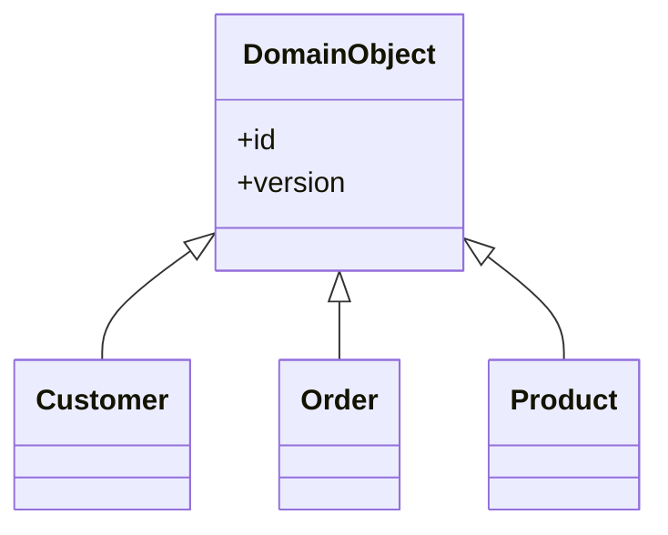

# Layer Supertype

## Description

A Layer Supertype is a type that acts as the supertype for all the types in a layer. Common behavior that every object in the layer would need, such as an identifier, versioning, auditing, or utilities, goes into a single base class from which the others inherit.

This avoids duplicating the same code across dozens of classes and gives you a central place to evolve that behavior. The pattern is simple, and Fowler describes it as something many developers already do naturally: just create, for example, a `DomainObject` class with the identity field and make all the entities inherit from it.

Each layer can have its own Layer Supertype (for example, one for the domain and another for the mappers), with neither knowing about the other.

## Problems it solves

- Methods and fields repeated in every class of the same layer.
- No single place for the layer's cross-cutting behavior (identity, auditing, versioning).
- Difficulty applying a common change to all the classes in the layer.

## When to use

- When the objects in a layer share fields or methods that would otherwise be duplicated.
- To keep identity, versioning, or auditing in one place, together with [Identity Field](/design/poeaa/object-relational-structural/identity-field).
- To give all mappers or repositories common database access behavior.

## When to avoid

- When the language or framework already provides the necessary base and the new class would only duplicate it.
- When the shared behavior is small and inheritance would add unnecessary coupling; composition may be enough.
- When the base class becomes a dumping ground for utilities unrelated to the layer's role.

## Trade-offs

| Benefit | Cost / Risk |
| --- | --- |
| Eliminates duplication of the layer's common code | Inheritance couples all the classes to the base class |
| Central point for evolving the common behavior | The base can grow and become a "god object" |
| Ensures consistency (identity, auditing) across objects | Constrains the hierarchy in single-inheritance languages |
| Simple, well-known implementation | Changes to the base affect the whole layer |

- **Consistency:** all objects in the layer behave the same at the common points.
- **Testability:** the common behavior can be tested just once.

## Diagram



`Customer`, `Order`, and `Product` inherit the identifier and the version from `DomainObject`, the supertype of the domain layer.

## Example

All domain entities need an `id` and comparison by identity. A base class avoids repeating that.

```python
from uuid import UUID, uuid4

class DomainObject:
    def __init__(self, id: UUID | None = None):
        self.id = id or uuid4()

    def __eq__(self, other: object) -> bool:
        return isinstance(other, type(self)) and self.id == other.id

    def __hash__(self) -> int:
        return hash(self.id)

class Customer(DomainObject):
    def __init__(self, name: str, id: UUID | None = None):
        super().__init__(id)
        self.name = name

class Order(DomainObject):
    def __init__(self, customer: Customer, id: UUID | None = None):
        super().__init__(id)
        self.customer = customer
```

Well-known examples: `BaseEntity` in Hibernate projects, `ApplicationRecord` in Rails, and `Entity<TId>` in DDD libraries.

## Related patterns

- [Identity Field](/design/poeaa/object-relational-structural/identity-field) — the identity field usually lives in the Layer Supertype.
- [Domain Model](/design/poeaa/domain-logic/domain-model) — domain entities typically share a base class.
- [Data Mapper](/design/poeaa/data-source-architectural/data-mapper) — mappers often have their own Layer Supertype with common data access logic.
- [Active Record](/design/poeaa/data-source-architectural/active-record) — Active Record frameworks provide a ready-made Layer Supertype for models.
- [Template Method](/coding/gof/behavioral/template-method) — the base class can define algorithm skeletons that subclasses complete.

## Reference

- [Pattern page in Fowler's catalog](https://martinfowler.com/eaaCatalog/layerSupertype.html)
- *Patterns of Enterprise Application Architecture*, Martin Fowler (Addison-Wesley, 2002)
