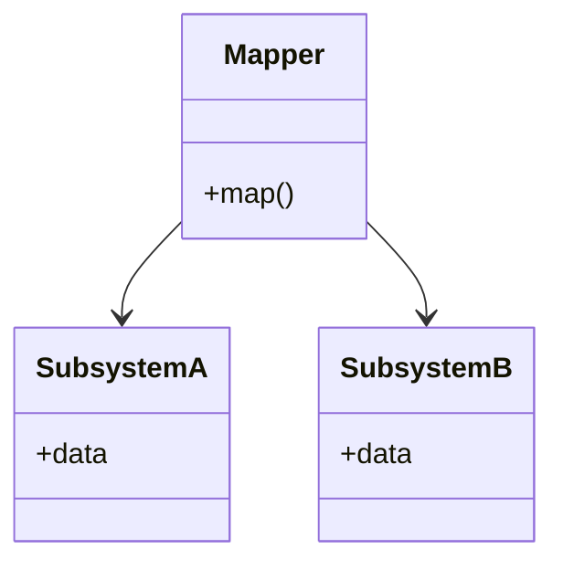

# Mapper

## Description

A Mapper is an object that sets up communication between two independent objects or subsystems. Neither side knows about the other: the Mapper knows how to connect them, sitting between them, reading data from one side and handing it to the other.

The pattern is useful when two subsystems need to communicate but can't (or shouldn't) be changed to know about each other. It's also useful when they can be changed, but you want to avoid dependencies between them and even between them and the isolating element.

In PoEAA, the Mapper is the general form. The [Data Mapper](/design/poeaa/data-source-architectural/data-mapper), which moves data between domain objects and the database, is its best-known specialization.

## Problems it solves

- Two subsystems need to exchange data, but neither should depend on the other.
- One of the sides can't be modified (a library, a legacy system, third-party code).
- Direct dependencies between modules make both harder to evolve.

## When to use

- When two subsystems must collaborate without knowing each other.
- When one or both subsystems can't be modified.
- When they can be modified, but you want to avoid dependencies between them.
- When the logic for translating between the two representations deserves to live in a single place.

## When to avoid

- When both sides already share a vocabulary and a direct dependency is acceptable.
- When the Mapper would be just a field-by-field copy, with no meaningful translation, and would only add code.
- When one side's dependency on the other is desired and stable.

## Trade-offs

| Benefit | Cost / Risk |
| --- | --- |
| The subsystems stay independent of each other | One more class (or layer) to maintain |
| Changes on one side are concentrated in the Mapper | The Mapper can become coupled to both models |
| Allows integrating code that can't be changed | Mapping code is repetitive and error-prone |
| Translation lives in a single place | Possible performance cost in large mappings |

- **Coupling:** the subsystems don't know each other, but the Mapper knows both.
- **Testability:** the mapping can be tested in isolation with input and output data.

## Diagram



The `Mapper` knows `SubsystemA` and `SubsystemB`, but they hold no reference to each other or to the Mapper.

## Example

A card invoice module and a notification module shouldn't know each other. A mapper reads invoices from the first and produces messages for the second.

```typescript
interface CardInvoice { holderEmail: string; totalCents: number; dueDate: Date }
interface EmailMessage { to: string; subject: string; body: string }

class CardInvoiceToEmailMapper {
  map(invoice: CardInvoice): EmailMessage {
    return {
      to: invoice.holderEmail,
      subject: "Your invoice",
      body: `Amount: R$ ${(invoice.totalCents / 100).toFixed(2)} — due: ${invoice.dueDate.toISOString().slice(0, 10)}`,
    };
  }
}

// The invoice module doesn't know about notifications; the notification module doesn't know about invoices.
const message = new CardInvoiceToEmailMapper().map({
  holderEmail: "ana@example.com", totalCents: 128990, dueDate: new Date(),
});
```

The same principle shows up in libraries such as MapStruct and AutoMapper, and in object-relational mapping.

## Related patterns

- [Data Mapper](/design/poeaa/data-source-architectural/data-mapper) — a specialization of Mapper between domain objects and the database.
- [Gateway](/design/poeaa/base/gateway) — isolates the application from an external resource; the Mapper isolates two subsystems from each other.
- [Data Transfer Object](/design/poeaa/distribution/data-transfer-object) — mappers are often used to convert between entities and DTOs.
- [Adapter](/coding/gof/structural/adapter) — adapts one interface to another; the Mapper translates data between two models without either one knowing it.
- [Mediator](/coding/gof/behavioral/mediator) — centralizes communication between objects, but the colleagues know the mediator.

## Reference

- [Pattern page in Fowler's catalog](https://martinfowler.com/eaaCatalog/mapper.html)
- *Patterns of Enterprise Application Architecture*, Martin Fowler (Addison-Wesley, 2002)
