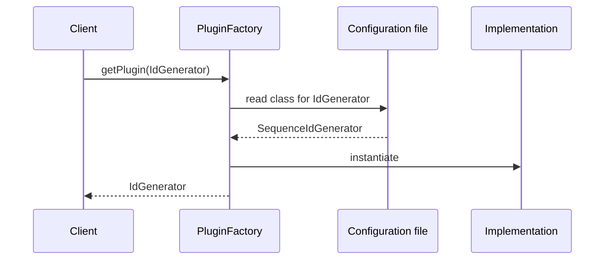

# Plugin

## Description

A Plugin links classes at configuration time, not at compile time. The choice of an interface's implementation moves out of the application code and into a centralized configuration, read at run time.

The typical problem appears when the code runs in different environments and uses a [Separated Interface](/design/poeaa/base/separated-interface) with a different implementation for each: for example, an in-memory key generator for unit tests and a database sequence in production. Usually the choice is made in factory methods that check environment variables. As the factories multiply, changing one environment's configuration means editing several of them, recompiling, and redeploying.

With Plugin, a single configuration file maps each interface to the environment's implementation, and a generic factory instantiates the indicated class (through reflection or dynamic loading). Swapping the implementation becomes a configuration change, with no recompilation. Modern dependency injection containers are, in essence, sophisticated implementations of this pattern.

## Problems it solves

- Environment conditionals (`if (env == "test")`) scattered across several factories.
- Changing the deployment configuration requires changing code, recompiling, and redeploying.
- Difficulty using different implementations in testing, development, and production.
- Difficulty extending the system with new implementations without touching existing code.

## When to use

- When there's a Separated Interface with several implementations for different environments (test, staging, production).
- When implementation choices are scattered across several factories or conditionals.
- When you want to change the configuration without recompiling or redeploying the code.
- When third parties should be able to add implementations (extensions, drivers, connectors).

## When to avoid

- When there's a single implementation and no reason to vary by environment.
- When dynamic configuration would make behavior hard to trace and debug, with errors only at run time.
- When the project already has a dependency injection container: use it instead of building your own mechanism.

## Trade-offs

| Benefit | Cost / Risk |
| --- | --- |
| Change the implementation without recompiling | Configuration errors only show up at run time |
| Configuration centralized in one place | Harder to follow the code flow (indirection through reflection) |
| Makes it easy to swap in stubs for tests and environments | Requires a well-defined interface (Separated Interface) |
| Allows third-party extensions | Security: loading classes from configuration requires care about where it comes from |

- **Testability:** the test environment points to test implementations (for example, [Service Stub](/design/poeaa/base/service-stub)) through configuration alone.
- **Complexity:** moderate, since it relies on reflection, class discovery, or a container.

## Diagram



The `Client` asks the `PluginFactory` for an implementation of the interface. The factory consults the configuration, instantiates the indicated class, and returns the result, without the client knowing which one it is.

## Example

An identifier generator, used to generate the `endToEndId` of Pix transactions, has an in-memory implementation for tests and a database-sequence-based one for production. The choice comes from a properties file.

```java
// plugins.properties (test)
// IdGenerator=com.acme.InMemoryIdGenerator
// plugins.properties (production)
// IdGenerator=com.acme.DatabaseIdGenerator

public class PluginFactory {
    private static final java.util.Properties config = load("plugins.properties");

    @SuppressWarnings("unchecked")
    public static <T> T getPlugin(Class<T> iface) {
        String className = config.getProperty(iface.getSimpleName());
        try {
            return (T) Class.forName(className).getDeclaredConstructor().newInstance();
        } catch (ReflectiveOperationException e) {
            throw new IllegalStateException("Invalid plugin for " + iface, e);
        }
    }

    private static java.util.Properties load(String file) { /* ... */ return new java.util.Properties(); }
}

IdGenerator ids = PluginFactory.getPlugin(IdGenerator.class);
String endToEndId = ids.next();
```

In frameworks, the equivalents are Spring (profiles and bean configuration), Java's `ServiceLoader`, and .NET's provider system.

## Related patterns

- [Separated Interface](/design/poeaa/base/separated-interface) — provides the interface whose implementations the Plugin chooses.
- [Service Stub](/design/poeaa/base/service-stub) — a typical implementation selected in test environments.
- [Gateway](/design/poeaa/base/gateway) — gateways are often configured as plugins per environment.
- [Registry](/design/poeaa/base/registry) — an alternative for locating services, but by querying a well-known object rather than through external configuration.
- [Factory Method](/coding/gof/creational/factory-method) — Plugin replaces factories full of conditionals with a generic, configuration-driven factory.
- [Abstract Factory](/coding/gof/creational/abstract-factory) — also chooses a family of implementations, but fixed in code.
- [Strategy](/coding/gof/behavioral/strategy) — Plugin is a way of selecting the strategy through configuration.
- [Externalized Configuration](/architecture/cloud-design-patterns/deployment-and-topology/external-configuration-store) — the same idea of taking configuration out of the code, applied to services.

## Reference

- [Pattern page in Fowler's catalog](https://martinfowler.com/eaaCatalog/plugin.html)
- *Patterns of Enterprise Application Architecture*, Martin Fowler (Addison-Wesley, 2002)
