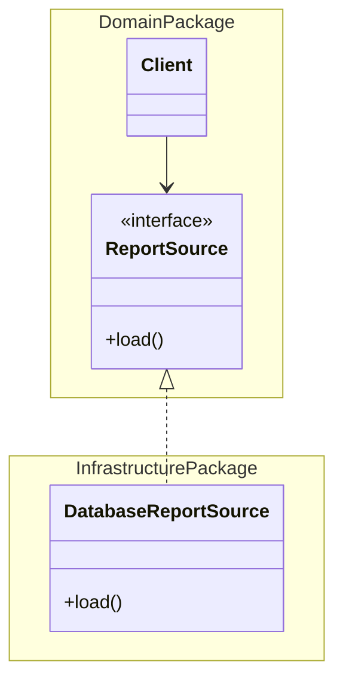

# Separated Interface

## Description

A Separated Interface puts an interface in a different package from its implementation. That way the client depends only on the interface and knows nothing about the implementation, reducing coupling between parts of the system.

Teams often organize classes into packages or modules and define dependency rules, such as "the domain can't depend on presentation" or "the domain doesn't depend on infrastructure." Sometimes a necessary call violates those rules. With Separated Interface, the interface lives in a package the client may depend on, and the implementation lives in another, which depends on the interface.

It's the basis of the dependency inversion principle and the natural plug-in point for a [Gateway](/design/poeaa/base/gateway), a [Service Stub](/design/poeaa/base/service-stub), and the [Plugin](/design/poeaa/base/plugin).

## Problems it solves

- A necessary dependency violates the dependency rules between packages or layers.
- Client code is coupled to a concrete implementation.
- Difficulty swapping the implementation or replacing it in tests.
- Dependency cycles between packages.

## When to use

- When one layer needs to call another without being able to depend on it (for example, the domain calling persistence).
- When you want the client to be unaware of how the dependency is implemented.
- As an extension point for a Gateway with several implementations (real, stub, in-memory).

## When to avoid

- When there's a single implementation and no dependency constraint, since the interface only adds indirection.
- In small code bases or a single package, where the separation brings no benefit.
- When the proliferation of interfaces makes the code harder to navigate and read.

## Trade-offs

| Benefit | Cost / Risk |
| --- | --- |
| Reduces coupling between packages and layers | More interfaces and packages to maintain |
| Allows several implementations and easy swapping | Requires a way to instantiate the implementation (factory, Plugin, dependency injection) |
| Makes testing with doubles easier | Indirection can make the code harder to navigate |
| Respects the architecture's dependency rules | The interface must be well designed, since it's hard to change |

- **Coupling:** the client knows only the contract.
- **Complexity:** the hard part is deciding who instantiates the implementation; see [Plugin](/design/poeaa/base/plugin) and [Registry](/design/poeaa/base/registry).

## Diagram



The `Client` and the `ReportSource` interface live in the domain package; the `DatabaseReportSource` implementation lives in the infrastructure package and depends on the interface, inverting the dependency.

## Example

The domain layer needs to fetch the exchange rate but can't depend on the infrastructure layer. The interface lives in the domain.

```java
// package: domain
public interface ExchangeRates {
    java.math.BigDecimal rate(String from, String to);
}

public class PriceCalculator {
    private final ExchangeRates rates;
    public PriceCalculator(ExchangeRates rates) { this.rates = rates; }

    public java.math.BigDecimal convert(java.math.BigDecimal value, String from, String to) {
        return value.multiply(rates.rate(from, to));
    }
}

// package: infrastructure (depends on domain, not the other way around)
public class HttpExchangeRates implements domain.ExchangeRates {
    public java.math.BigDecimal rate(String from, String to) {
        // HTTP call to the provider
        return new java.math.BigDecimal("5.10");
    }
}
```

In frameworks such as Spring, the dependency injection container plays the role of wiring the implementation to the interface.

## Related patterns

- [Gateway](/design/poeaa/base/gateway) — the Gateway's interface is usually a Separated Interface.
- [Service Stub](/design/poeaa/base/service-stub) — a second implementation of the same interface, used in tests.
- [Plugin](/design/poeaa/base/plugin) — chooses the interface's implementation through configuration, at run time.
- [Registry](/design/poeaa/base/registry) — another way of locating the implementation from the interface.
- [Strategy](/coding/gof/behavioral/strategy) — also uses an interface with several implementations, but focused on varying algorithms, not on separating packages.
- [Abstract Factory](/coding/gof/creational/abstract-factory) — can create the right implementation without the client knowing it.
- [Repository](/design/poeaa/object-relational-metadata-mapping/repository) — is normally defined as an interface in the domain, with the implementation in infrastructure.

## Reference

- [Pattern page in Fowler's catalog](https://martinfowler.com/eaaCatalog/separatedInterface.html)
- *Patterns of Enterprise Application Architecture*, Martin Fowler (Addison-Wesley, 2002)
