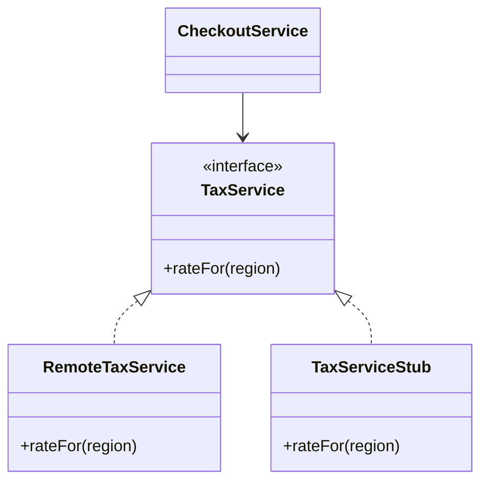

# Service Stub

## Description

A Service Stub removes dependence on problematic services during testing. Enterprise applications often depend on services outside the team's control, such as credit checks, tax calculation, or pricing engines. These services can be late, unstable, slow, or simply unavailable in the development environment.

The solution is to replace the real service, during tests, with a local, in-memory implementation that returns predictable responses. The stub is fast, deterministic, and doesn't depend on the external system being available. It's usually plugged in where a [Gateway](/design/poeaa/base/gateway) would be, through a [Separated Interface](/design/poeaa/base/separated-interface), and chosen through configuration with the [Plugin](/design/poeaa/base/plugin).

The pattern was proposed by David Rice in PoEAA and is the basis of what are now called fakes and stubs in automated testing.

## Problems it solves

- Tests that depend on slow or unstable remote services.
- Development blocked because the external service hasn't been delivered yet.
- Tests that can't run without a network or credentials.
- Hacks in production code to work around a missing service.

## When to use

- When the application depends on third-party or remote services outside the team's control.
- When you want fast, repeatable tests in the development workflow and in continuous integration.
- When you need to simulate scenarios that are hard to trigger in the real service (errors, slowness, specific data).

## When to avoid

- When the real service is cheap, fast, and stable, and testing against it directly is feasible.
- As the only form of testing: the stub doesn't guarantee the real contract is still valid (also use contract or integration tests).
- When the stub would become so complex that it ends up reimplementing the service.

## Trade-offs

| Benefit | Cost / Risk |
| --- | --- |
| Fast, predictable tests independent of the network | The stub can diverge from the real service's behavior |
| Development unblocked even without the service ready | More supporting code to maintain |
| Allows simulating failures and edge cases | False sense of security if the contract isn't verified |
| Production code without test-only detours | Requires a well-defined interface to swap the implementation |

- **Coupling:** requires the client to depend on an interface, not a concrete class.
- **Testability:** this is the main benefit of the pattern.
- **Complexity:** low, as long as the stub is just an in-memory table of responses.

## Diagram



The `CheckoutService` depends on the `TaxService` interface. In production it uses `RemoteTaxService`; in tests, `TaxServiceStub`, which answers from memory.

## Example

A checkout calculates tax by calling a remote service. In tests, a stub returns fixed rates.

```java
interface TaxService {
    java.math.BigDecimal rateFor(String region);
}

class TaxServiceStub implements TaxService {
    private final java.util.Map<String, java.math.BigDecimal> rates = java.util.Map.of(
        "SP", new java.math.BigDecimal("0.18"),
        "RJ", new java.math.BigDecimal("0.20"));

    public java.math.BigDecimal rateFor(String region) {
        return rates.getOrDefault(region, java.math.BigDecimal.ZERO);
    }
}

class CheckoutService {
    private final TaxService taxService;
    CheckoutService(TaxService taxService) { this.taxService = taxService; }

    java.math.BigDecimal total(java.math.BigDecimal net, String region) {
        return net.add(net.multiply(taxService.rateFor(region)));
    }
}

// Test
var checkout = new CheckoutService(new TaxServiceStub());
// checkout.total(new BigDecimal("100"), "SP") -> 118.00
```

Tools such as WireMock, MockServer, and mocking libraries produce stubs without writing them by hand.

## Related patterns

- [Gateway](/design/poeaa/base/gateway) — the Gateway encapsulates the external service; the Service Stub is the test implementation of that Gateway.
- [Separated Interface](/design/poeaa/base/separated-interface) — provides the interface that allows swapping the real service for the stub.
- [Plugin](/design/poeaa/base/plugin) — chooses, through configuration, between the real service and the stub depending on the environment.
- [Null Object](/coding/gof/behavioral/null-object) — is also an alternative implementation of an interface, but aimed at representing absence, not at simulating a service in tests.
- [Proxy](/coding/gof/structural/proxy) — the stub takes the real service's place, but without delegating to it.
- [Consumer-Driven Contract Test](/architecture/microservices/testing/consumer-driven-contract-test) — complements the stub by verifying that it remains faithful to the real contract.

## Reference

- [Pattern page in Fowler's catalog](https://martinfowler.com/eaaCatalog/serviceStub.html)
- *Patterns of Enterprise Application Architecture*, Martin Fowler (Addison-Wesley, 2002)
