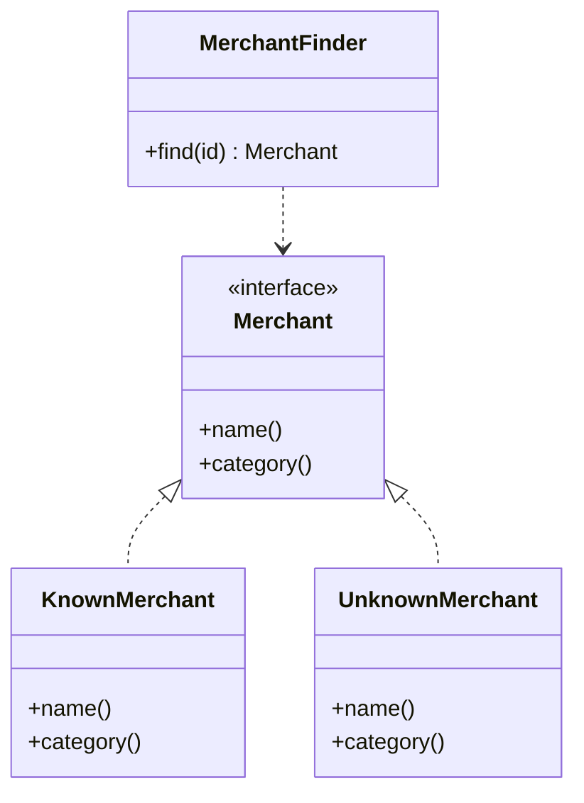

# Special Case

## Description

A Special Case is a subclass that provides special behavior for particular cases. Instead of returning `null` or an odd sentinel value, the code returns a special-case object that implements the same interface the caller expects, so the caller can invoke its methods as usual.

The special-case object encapsulates the default behavior for the situation (for example, an unknown customer, an infinite value, an unidentified occupant). That removes the null checks that would otherwise be repeated in many places, and the handling of the case lives in a single spot.

Special Case is the generalization of the GoF [Null Object](/coding/gof/behavioral/null-object). Null Object is a particular case where the special object does nothing (no behavior). Special Case also covers situations with specific, useful behavior, such as an `UnknownCustomer` that returns the name "occupant" and charges a standard rate, or a `MissingPerson` that returns default values.

## Problems it solves

- Repeated `null` checks scattered across all the client code.
- Forgetting a null check and causing a `NullPointerException` or similar.
- Different behavior for particular cases that turns into an `if` in many places.
- Error codes or magic values returned in place of objects.

## When to use

- When a variable can be null and the "right way" to handle that situation is the same at many call sites.
- When a particular case has its own behavior that should live with the type (unknown customer, nonexistent account, infinite value).
- When you want the client to treat the special and normal cases uniformly (polymorphism).
- For finders that don't find the record, returning a special object instead of `null`.

## When to avoid

- When the caller really needs to distinguish absence and act differently at each point; in that case, an explicit `Optional`/`Maybe` may be more honest.
- When the special case would hide an error that should fail fast (an unexpected absence that deserves an exception).
- When there's only one place that checks and creating a subclass would be overkill.

## Trade-offs

| Benefit | Cost / Risk |
| --- | --- |
| Eliminates repeated null checks | Can mask errors, since absence is no longer visible |
| Polymorphic, uniform handling of cases | More classes to create and maintain |
| Special-case behavior concentrated in one place | Requires the type's interface to support the default behavior |
| Simpler, more readable client code | Deciding the right default behavior isn't always obvious |

- **Testability:** the special case is easy to instantiate in tests and removes the need for null mocks.
- **Variations:** the Special Case can be an immutable singleton, as in Null Object, or have state, when the special case carries data.

## Diagram



`UnknownMerchant` and `KnownMerchant` implement `Merchant`. The `MerchantFinder` returns the `UnknownMerchant` when it doesn't find the merchant, and the client code doesn't need to check for null.

## Example

Card entries may arrive without an identified merchant. Instead of `null`, the finder returns an `UnknownMerchant` with default behavior, and the entry goes on to the invoice normally.

```typescript
interface Merchant {
  name(): string;
  category(): string;
}

class KnownMerchant implements Merchant {
  constructor(private readonly merchantName: string, private readonly merchantCategory: string) {}
  name() { return this.merchantName; }
  category() { return this.merchantCategory; }
}

class UnknownMerchant implements Merchant {
  name() { return "unidentified merchant"; }
  category() { return "uncategorized"; }
}

class MerchantFinder {
  constructor(private readonly store: Map<string, Merchant>) {}
  find(id: string): Merchant {
    return this.store.get(id) ?? new UnknownMerchant();
  }
}

// No if (merchant === null) anywhere
const finder = new MerchantFinder(new Map());
const label = `${finder.find("m-1").name()} / ${finder.find("m-1").category()}`;
```

Well-known examples: `Collections.emptyList()` in Java, `AnonymousUser` in web frameworks, and `Float.POSITIVE_INFINITY` as a special value of a numeric type.

## Related patterns

- [Null Object](/coding/gof/behavioral/null-object) — a particular case of Special Case, where the special object does nothing; Special Case generalizes the idea to any specific behavior.
- [Value Object](/design/poeaa/base/value-object) — special values (zero, infinity, unknown) can be Special Cases of a Value Object.
- [Money](/design/poeaa/base/money) — a "zero" or "undefined" money can be a Special Case of Money.
- [Domain Model](/design/poeaa/domain-logic/domain-model) — entities such as customers and accounts often have special-case variants.
- [Repository](/design/poeaa/object-relational-metadata-mapping/repository) — finders that find no results can return a Special Case instead of null.
- [State](/coding/gof/behavioral/state) — also uses polymorphism to vary behavior, but based on the object's internal state.
- [Strategy](/coding/gof/behavioral/strategy) — the special case is, in practice, a default strategy for the situation.

## Reference

- [Pattern page in Fowler's catalog](https://martinfowler.com/eaaCatalog/specialCase.html)
- *Patterns of Enterprise Application Architecture*, Martin Fowler (Addison-Wesley, 2002)
