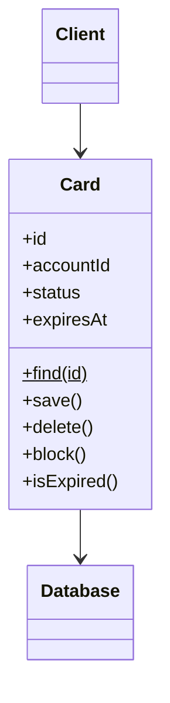

# Active Record

## Description

Active Record is an object that wraps a row in a table or view, encapsulates database access, and adds domain logic on top of that data. The object's fields map directly to the columns, and the object itself knows how to load, save, and delete itself.

In essence, it's a Row Data Gateway with business logic. Finder methods are usually static or live in a helper class, and the object brings together data and behavior, which gives the impression of an object model without a separate mapping layer.

It works well as long as the domain model is similar to the database schema; when the two diverge, the coupling becomes a problem.

## Problems it solves

- Too much infrastructure code to persist simple domain objects.
- The need for a lightweight data access layer, without separate mapping.
- Duplication between data classes and logic classes when the model is almost identical to the tables.

## When to use

- When the domain logic is moderate: create, read, update, delete, and simple validations.
- When the object model can closely follow the database schema.
- To quickly deliver CRUD applications, as in Rails and Laravel.

## When to avoid

- When the business logic is complex and requires inheritance, collections, and relationships that diverge from the schema.
- When you want to test the domain without a database.
- When the schema changes often and shouldn't affect the domain model.

## Trade-offs

| Benefit | Cost / Risk |
| --- | --- |
| Very simple and quick to get started | Domain object coupled to the schema and the database |
| Data and behavior together, easy to understand | Makes unit testing without a database harder |
| Little mapping code | Refactoring schema and model independently is difficult |
| Good for CRUD | Mixes responsibilities (persistence and rules) |

- **Coupling:** high between domain and schema; changes in one affect the other.
- **Testability:** limited, unless you use an in-memory database or test doubles.
- **Complexity:** low at first, but it can grow as the domain becomes richer.

## Diagram



The `Client` uses `Card` directly. `Card` holds the data of one row, contains the domain logic (`block` and `isExpired`), and accesses the `Database` through `save`, `delete`, and `find`.

## Example

A card has simple rules, such as blocking and knowing whether it has expired. The `Card` class represents the row and knows how to save itself, as in the models of Rails ActiveRecord, Django ORM, or Eloquent.

```python
from datetime import date

class Card:
    def __init__(self, conn, id, account_id, status, expires_at):
        self.conn, self.id, self.account_id = conn, id, account_id
        self.status, self.expires_at = status, expires_at

    @classmethod
    def find(cls, conn, id):
        r = conn.execute(
            "SELECT id, account_id, status, expires_at FROM cards WHERE id = ?",
            (id,)).fetchone()
        return cls(conn, r[0], r[1], r[2], date.fromisoformat(r[3]))

    def is_expired(self, today=None):  # domain logic
        return self.expires_at < (today or date.today())

    def block(self):  # domain logic
        if self.status == "CANCELLED":
            raise ValueError("a cancelled card cannot be blocked")
        self.status = "BLOCKED"

    def save(self):
        self.conn.execute(
            "UPDATE cards SET status = ? WHERE id = ?", (self.status, self.id))

card = Card.find(conn, 7)
card.block()
card.save()
```

## Related patterns

- [Row Data Gateway](/design/poeaa/data-source-architectural/row-data-gateway) — same structure, but without domain logic.
- [Table Data Gateway](/design/poeaa/data-source-architectural/table-data-gateway) — per-table access, instead of one object per row.
- [Data Mapper](/design/poeaa/data-source-architectural/data-mapper) — separates domain and persistence when the model is rich.
- [Domain Model](/design/poeaa/domain-logic/domain-model) — with a simple model, Active Record is one way to implement it.
- [Transaction Script](/design/poeaa/domain-logic/transaction-script) — a more procedural alternative for simple logic.
- [Identity Field](/design/poeaa/object-relational-structural/identity-field) — the primary key stored in the object.

## Reference

- [Pattern page in Fowler's catalog](https://martinfowler.com/eaaCatalog/activeRecord.html)
- *Patterns of Enterprise Application Architecture*, Martin Fowler (Addison-Wesley, 2002)
- [Active record pattern on Wikipedia](https://en.wikipedia.org/wiki/Active_record_pattern)
