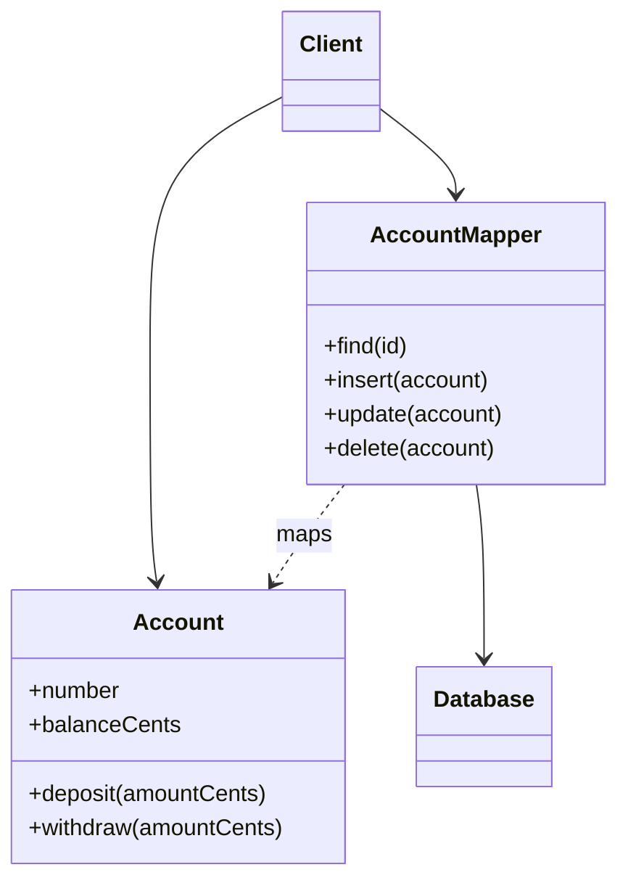

# Data Mapper

## Description

Data Mapper is a data access layer that moves data between in-memory objects and the database, keeping the two independent of each other and of the mapper itself. Domain objects don't know the database exists: they contain no SQL and know nothing about the schema.

Object models have collections, inheritance, and associations that rarely match relational tables. The mapper handles the translation: it loads rows and builds objects, and walks objects to write them back, resolving structural differences. To the domain, the mapper stays hidden behind an interface.

It's the foundation of ORMs such as Hibernate, Entity Framework, and SQLAlchemy, and usually comes along with Unit of Work, Identity Map, and Lazy Load.

## Problems it solves

- A domain coupled to the database schema and to SQL.
- Object-relational impedance mismatch: inheritance, collections, and associations with no direct equivalent in tables.
- Difficulty evolving the object model and the schema independently.
- Domain tests that need the database.

## When to use

- With a rich Domain Model whose structure diverges from the schema.
- When the model and the database evolve at different paces.
- When you want to test business rules without a database.
- When the schema is inherited and can't be changed.

## When to avoid

- In simple CRUD applications, where Active Record solves the problem with far less code.
- When the team has no ORM experience or tooling and the cost of building a mapper isn't worth it.
- When the logic is procedural and table-based.

## Trade-offs

| Benefit | Cost / Risk |
| --- | --- |
| Domain independent of the database | More layers and more mapping code |
| Model and schema evolve separately | Learning curve and configuration |
| Makes unit testing the domain easier | Can hide inefficient queries (N+1) |
| Supports inheritance and complex associations | Building your own mapper is laborious; you use an ORM |

- **Coupling:** low between domain and persistence; the coupling is concentrated in the mapper.
- **Consistency:** usually combined with Unit of Work and Identity Map to manage changes and identity.
- **Complexity:** high; it pays off in complex domains.

## Diagram



`Account` knows nothing about the database or the `AccountMapper`. The mapper reads from and writes to the `Database` and converts `contas_correntes` rows into `Account` objects, and vice versa.

## Example

A digital bank has an `Account` entity with balance rules, and a legacy `contas_correntes` table with different names and columns. The `AccountMapper` does the translation and the domain stays pure.

```java
class Account {                        // pure domain
    private final String number;
    private long balanceCents;
    Account(String number, long balanceCents) { this.number = number; this.balanceCents = balanceCents; }
    void deposit(long amountCents) { balanceCents += amountCents; }
    void withdraw(long amountCents) {
        if (amountCents > balanceCents) throw new IllegalStateException("insufficient balance");
        balanceCents -= amountCents;
    }
}

class AccountMapper {
    private final JdbcTemplate jdbc;
    AccountMapper(JdbcTemplate jdbc) { this.jdbc = jdbc; }

    Account find(long id) {
        return jdbc.queryForObject(
            "SELECT num_conta, saldo_centavos FROM contas_correntes WHERE id = ?",
            (rs, n) -> new Account(rs.getString("num_conta"),
                                   rs.getLong("saldo_centavos")),
            id);
    }

    void insert(Account a) { /* INSERT from the fields of Account */ }
}
```

In Hibernate and Entity Framework, the mapping is configured through metadata instead of being written by hand.

## Related patterns

- [Active Record](/design/poeaa/data-source-architectural/active-record) — a simpler alternative in which the object knows how to persist itself.
- [Row Data Gateway](/design/poeaa/data-source-architectural/row-data-gateway) — per-row gateway, without domain logic.
- [Table Data Gateway](/design/poeaa/data-source-architectural/table-data-gateway) — per-table gateway, used by tabular logic.
- [Domain Model](/design/poeaa/domain-logic/domain-model) — the model that Data Mapper keeps independent of the database.
- [Unit of Work](/design/poeaa/object-relational-behavioral/unit-of-work) — tracks which objects changed and coordinates writing them.
- [Identity Map](/design/poeaa/object-relational-behavioral/identity-map) — ensures a single object per loaded row.
- [Lazy Load](/design/poeaa/object-relational-behavioral/lazy-load) — defers loading associations.
- [Repository](/design/poeaa/object-relational-metadata-mapping/repository) — gives the domain a collection-like view over the mapper.
- [Mapper](/design/poeaa/base/mapper) — the base pattern of which this is a specialization.
- [Metadata Mapping](/design/poeaa/object-relational-metadata-mapping/metadata-mapping) — mapping described by metadata in ORMs.

## Reference

- [Pattern page in Fowler's catalog](https://martinfowler.com/eaaCatalog/dataMapper.html)
- *Patterns of Enterprise Application Architecture*, Martin Fowler (Addison-Wesley, 2002)
- [Data mapper pattern on Wikipedia](https://en.wikipedia.org/wiki/Data_mapper_pattern)
