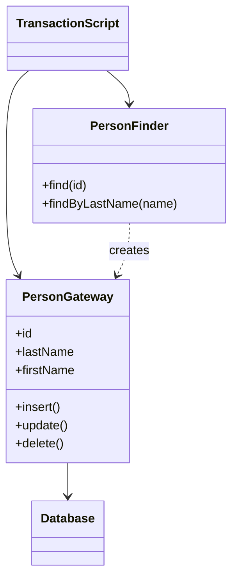

# Row Data Gateway

## Description

Row Data Gateway is an object that acts as a gateway to a single record in a data source, with one instance per row. Its interface mirrors the structure of the record: there's one field for each column, so client code uses it like an ordinary object.

All database access is hidden inside the gateway, which knows how to insert, update, and delete itself. It's normally accompanied by a finder class that loads gateways from queries. Unlike Active Record, the gateway contains no domain logic: only data and database access.

This keeps persistence code out of the in-memory domain objects, simplifying the business logic and isolating SQL variations across databases.

## Problems it solves

- Business logic mixed with SQL and data access details.
- Slow tests that depend on the database to exercise business rules.
- The need to support SQL variations across different databases.
- Procedural code that needs to handle records as objects.

## When to use

- With Transaction Script, when the logic prefers to handle records as objects.
- When the record format is stable and nearly identical to the table.
- When code generated automatically from the schema can produce the gateways.

## When to avoid

- When there's a Domain Model: the gateway becomes a redundant layer between the model and the database.
- When there are many tables and the effort of maintaining a gateway and a finder per table isn't worth it.
- When domain logic starts migrating into the gateway, making it an Active Record in disguise.

## Trade-offs

| Benefit | Cost / Risk |
| --- | --- |
| Database access isolated in one object per row | One class per table, with lots of repetitive code |
| Business logic free of SQL | Can be redundant in the presence of a Domain Model |
| Makes testing with gateway test doubles easier | Requires a separate finder for queries |
| Allows varying SQL across databases | Temptation to put domain logic in it |

- **Coupling:** the client depends on the record's interface, not on SQL.
- **Testability:** good, since it's easy to replace the gateway with an in-memory object.
- **Complexity:** moderate, because of the number of classes; code generation helps.

## Diagram



The `TransactionScript` uses the `PersonFinder` to get `PersonGateway` instances, each representing one row, and persists them by calling their `insert`, `update`, and `delete` methods.

## Example

A customer registration script handles one record at a time. Each row of the `customers` table becomes a `CustomerGateway`.

```typescript
class CustomerGateway {
  constructor(
    private db: Db,
    public id: number | null,
    public name: string,
    public email: string,
  ) {}

  async insert(): Promise<void> {
    this.id = await this.db.insert(
      "INSERT INTO customers (name, email) VALUES (?, ?)",
      [this.name, this.email]);
  }

  async update(): Promise<void> {
    await this.db.exec(
      "UPDATE customers SET name = ?, email = ? WHERE id = ?",
      [this.name, this.email, this.id]);
  }
}

class CustomerFinder {
  constructor(private db: Db) {}
  async find(id: number): Promise<CustomerGateway> {
    const r = await this.db.one("SELECT * FROM customers WHERE id = ?", [id]);
    return new CustomerGateway(this.db, r.id, r.name, r.email);
  }
}
```

## Related patterns

- [Table Data Gateway](/design/poeaa/data-source-architectural/table-data-gateway) — one object per table instead of one per row.
- [Active Record](/design/poeaa/data-source-architectural/active-record) — same structure, but it incorporates domain logic.
- [Data Mapper](/design/poeaa/data-source-architectural/data-mapper) — fully separates domain objects and persistence.
- [Transaction Script](/design/poeaa/domain-logic/transaction-script) — the most common use of Row Data Gateway.
- [Gateway](/design/poeaa/base/gateway) — the base pattern of which this is a specialization.
- [Identity Map](/design/poeaa/object-relational-behavioral/identity-map) — avoids loading the same row into duplicate gateways.

## Reference

- [Pattern page in Fowler's catalog](https://martinfowler.com/eaaCatalog/rowDataGateway.html)
- *Patterns of Enterprise Application Architecture*, Martin Fowler (Addison-Wesley, 2002)
- [Row data gateway on Wikipedia](https://en.wikipedia.org/wiki/Row_data_gateway)
