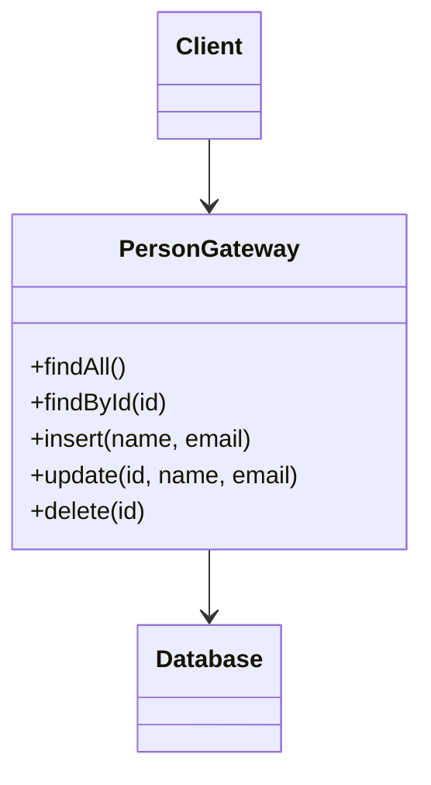

# Table Data Gateway

## Description

Table Data Gateway is an object that acts as a gateway to a database table (or view). A single instance handles all the rows in the table and concentrates all the SQL for querying, inserting, updating, and deleting.

The rest of the application doesn't write SQL: it calls methods such as `findById`, `findByCustomer`, or `insert`. The gateway is normally stateless and returns simple data structures, such as Record Sets or DTOs, instead of domain objects with behavior.

As a result, the SQL lives in one place, which helps people who aren't fluent in SQL and lets DBAs find and tune the queries when the schema changes.

## Problems it solves

- SQL scattered across the business logic and the presentation layer.
- Schema changes that require edits in many places in the code.
- Difficulty for DBAs to locate and optimize the queries the application uses.
- The need for a simple access layer for table-oriented domain logic.

## When to use

- With Transaction Script, where the business logic operates on tabular data.
- With Table Module, which usually receives Record Sets produced by the gateway.
- To encapsulate access to stored procedures, treating them as a gateway.
- When you want to isolate SQL without the cost of a full object-relational mapping.

## When to avoid

- When there's a rich Domain Model with complex rules; a Data Mapper or ORM fits better.
- When you expect to map inheritance, associations, and collections of objects transparently.
- When the gateway tends to accumulate dozens of queries and turn into a table "god object".

## Trade-offs

| Benefit | Cost / Risk |
| --- | --- |
| All the SQL is centralized and easy to tune | Little help mapping rich domain objects |
| Simple interface, close to the table's structure | Tabular results expose the schema to their consumers |
| Fits well with Transaction Script and Table Module | Gateways can grow with many specific queries |
| Simple to replace with a test double | Doesn't manage identity or concurrency on its own |

- **Coupling:** business code depends on the gateway's interface, not on SQL; even so, it sees the shape of the tables.
- **Testability:** the gateway can be swapped for a Service Stub or an in-memory database.
- **Complexity:** low, with one class per table.

## Diagram



The `Client` (for example, a Transaction Script) calls only methods of the `PersonGateway`, which contains the SQL and talks to the `Database`. One instance serves all the rows in the table.

## Example

An order system uses business scripts that need to query and write orders. An `OrderGateway` isolates the SQL for the `orders` table and returns plain rows.

```python
class OrderGateway:
    def __init__(self, conn):
        self.conn = conn

    def find_by_id(self, order_id):
        cur = self.conn.execute(
            "SELECT id, customer_id, total FROM orders WHERE id = ?", (order_id,))
        return cur.fetchone()

    def find_by_customer(self, customer_id):
        cur = self.conn.execute(
            "SELECT id, customer_id, total FROM orders WHERE customer_id = ?",
            (customer_id,))
        return cur.fetchall()

    def insert(self, customer_id, total):
        cur = self.conn.execute(
            "INSERT INTO orders (customer_id, total) VALUES (?, ?)",
            (customer_id, total))
        return cur.lastrowid

# Transaction Script
def close_order(gateway, order_id):
    order = gateway.find_by_id(order_id)
    ...
```

In .NET, ADO.NET's `TableAdapter` and the DAO class from the Java world follow a similar idea.

## Related patterns

- [Row Data Gateway](/design/poeaa/data-source-architectural/row-data-gateway) — one object per row instead of one per table.
- [Active Record](/design/poeaa/data-source-architectural/active-record) — the domain object also accumulates the database access.
- [Data Mapper](/design/poeaa/data-source-architectural/data-mapper) — an alternative when the domain model is rich and independent of the schema.
- [Transaction Script](/design/poeaa/domain-logic/transaction-script) — the typical pairing of domain logic with this gateway.
- [Table Module](/design/poeaa/domain-logic/table-module) — consumes the Record Sets the gateway produces.
- [Record Set](/design/poeaa/base/record-set) — the common format of the results.
- [Gateway](/design/poeaa/base/gateway) — the base pattern of which this is a specialization.
- [Facade](/coding/gof/structural/facade) — also hides the details of a subsystem behind a simple interface.

## Reference

- [Pattern page in Fowler's catalog](https://martinfowler.com/eaaCatalog/tableDataGateway.html)
- *Patterns of Enterprise Application Architecture*, Martin Fowler (Addison-Wesley, 2002)
- [Table data gateway on Wikipedia](https://en.wikipedia.org/wiki/Table_data_gateway)
