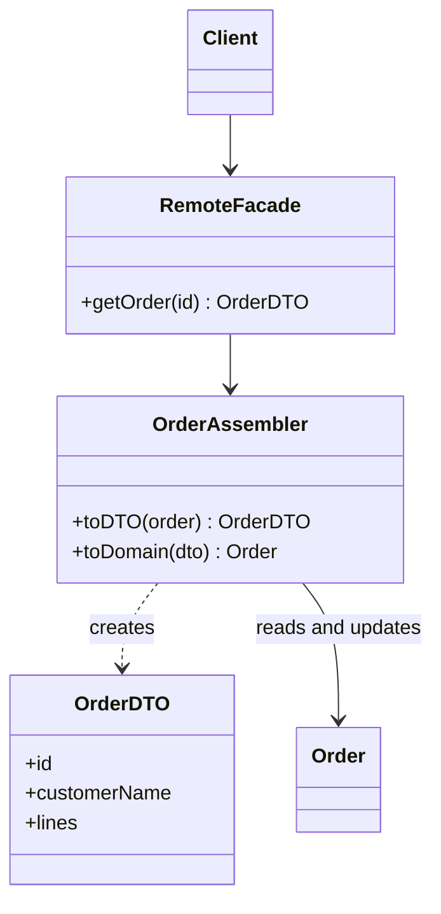

# Data Transfer Object

## Description

The Data Transfer Object (DTO) is an object that carries data between processes to reduce the number of calls. Since every remote call is expensive, the goal is to make fewer calls, each carrying more data. Passing many parameters is awkward, and some languages return only one value, so the DTO bundles everything a call needs to send or receive.

A DTO is a simple object with only fields and accessors, no domain behavior, and it must be serializable to cross the boundary. Usually an Assembler (or Mapper) converts between the DTO and the domain objects, so the domain knows nothing about the transport format.

A secondary benefit is encapsulating serialization: the wire format (JSON, XML, binary) lives in a single place, and the rest of the code doesn't depend on it. Historically the pattern was called "value object" in Java, which conflicts with the [Value Object](/design/poeaa/base/value-object) pattern; that's why the name "Transfer Object" stuck.

## Problems it solves

- Many small remote calls to get or send a set of related data.
- Signatures with long parameter lists, or the need to return several values.
- Domain objects coupled to the serialization format and the remote contract.
- Accidental exposure of internal fields, lazy relationships, and domain rules to external clients.

## When to use

- In remote interfaces, usually behind a [Remote Facade](/design/poeaa/distribution/remote-facade), where each call is costly.
- When you want to group what would be several calls into one.
- When the data contract with the client must evolve independently of the domain model.

## When to avoid

- In local calls within the same process: Fowler warns in the LocalDTO article that the mapping cost is high and the benefit is nil; prefer a [Service Layer](/design/poeaa/domain-logic/service-layer) working with domain objects.
- When the DTO tends to mirror the domain field by field, merely duplicating classes with no isolation gain.
- When the DTO gains behavior and business rules, which turns it into a parallel anemic model.

## Trade-offs

| Benefit | Cost / Risk |
| --- | --- |
| Fewer remote calls, more data per call | More classes and mapping code to maintain |
| Remote contract decoupled from the domain | Field duplication between DTO and entity |
| Serialization concentrated in one place | Risk of transferring too much data or stale data |
| Control over what leaves the system | Mapping costs time and can hide conversion errors |

- **Performance:** pays off only when the network is the bottleneck; locally, it's pure cost.
- **Coupling:** the domain stays free of annotations and serialization details.
- **Testability:** DTOs are trivial, but the Assembler deserves its own tests.
- **Evolution:** versioning the DTO lets you change the domain without breaking clients.

## Diagram



The `Client` receives an `OrderDTO` from the `RemoteFacade`. The `OrderAssembler` is the only one that knows both the DTO and the domain `Order`.

## Example

An API returns an order with its customer and items in a single response. The DTO is an immutable record and the assembler converts the entity.

```java
public record OrderLineDTO(String sku, int quantity, long priceCents) {}

public record OrderDTO(String id, String customerName, List<OrderLineDTO> lines) {}

public class OrderAssembler {
    public OrderDTO toDTO(Order order) {
        List<OrderLineDTO> lines = order.getLines().stream()
            .map(l -> new OrderLineDTO(
                l.getProduct().getSku(), l.getQuantity(), l.getPrice().cents()))
            .toList();
        return new OrderDTO(order.getId(), order.getCustomer().getName(), lines);
    }
}
```

In frameworks, the assembler's role is played by libraries such as MapStruct (Java), AutoMapper (.NET), and Django REST Framework serializers.

## Related patterns

- [Remote Facade](/design/poeaa/distribution/remote-facade) — the DTO's typical consumer: the facade receives and returns DTOs.
- [Service Layer](/design/poeaa/domain-logic/service-layer) — the local alternative, which dispenses with DTOs and works with the domain.
- [Mapper](/design/poeaa/base/mapper) — the Assembler is a mapper between DTO and domain.
- [Value Object](/design/poeaa/base/value-object) — a historically confused name; the Value Object has behavior and value-based equality.
- [Data Mapper](/design/poeaa/data-source-architectural/data-mapper) — does something similar between the domain and the database; the assembler does it between the domain and the remote boundary.
- [Remote Procedure Invocation](/architecture/microservices/communication-styles/remote-procedure-invocation) — the communication style in which the cost of each call justifies the DTO.

## Reference

- [Pattern page in Fowler's catalog](https://martinfowler.com/eaaCatalog/dataTransferObject.html)
- [LocalDTO, on Fowler's bliki](https://martinfowler.com/bliki/LocalDTO.html)
- *Patterns of Enterprise Application Architecture*, Martin Fowler (Addison-Wesley, 2002)
- [Data transfer object on Wikipedia](https://en.wikipedia.org/wiki/Data_transfer_object)
