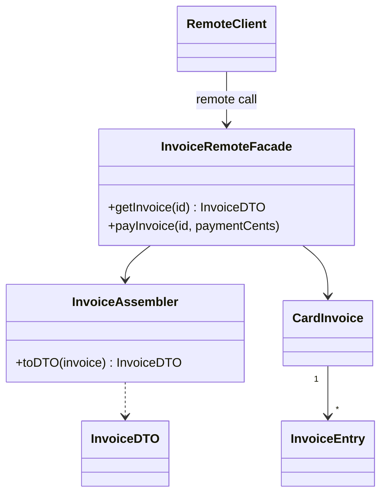

# Remote Facade

## Description

The Remote Facade provides a coarse-grained interface over fine-grained objects to make network access efficient. Domain objects stay small, with many simple methods (getters, setters, single-purpose operations), designed for use within the same process. Calls between processes, however, are much more expensive: they involve serialization, routing, security checks, and network latency.

The facade sits at the application boundary and exposes a few methods that do a lot: for example, instead of fetching an invoice and then each of its entries, the remote client gets the entire invoice in a single call. Each facade method translates the coarse request into local calls to the fine-grained objects.

The facade contains no domain logic: it only translates, delegates, and usually handles boundary concerns such as security and transactions. It typically works together with the [Data Transfer Object](/design/poeaa/distribution/data-transfer-object), which carries the data exchanged between the two ends.

## Problems it solves

- Remote clients need to make dozens of small calls to complete a task, and network latency dominates the total time.
- Fine-grained domain objects can't be exposed directly over the network without excessive cost and coupling.
- The domain model gets tied to distribution protocols and requirements (serialization, remote access security).
- Domain changes break remote clients that depend on its internal structure.

## When to use

- When application objects are accessed from another process or machine (rich client, another application, public API).
- When fine-grained interaction would require many remote calls for a single business task.
- When you want to keep the domain thin and testable, isolating distribution concerns in an edge layer.

## When to avoid

- When all clients run in the same process; the coarse interface only gets in the way and hides the intent of the methods.
- When the facade starts receiving business rules; that turns it into a second domain model.
- When a local [Service Layer](/design/poeaa/domain-logic/service-layer) is already enough and remote access isn't a real requirement.

## Trade-offs

| Benefit | Cost / Risk |
| --- | --- |
| Fewer network round trips and better performance | A coarse interface is less expressive and harder to program against |
| Domain stays thin and free of distribution concerns | One more layer, with methods that must keep up with clients' use cases |
| Single point for security, transactions, and serialization | Risk of domain logic leaking into the facade |
| Stable remote contract, independent of the internal model | Unnecessary data may be transferred when a method returns more than the client needs |

- **Performance:** the gain comes from reducing calls, not from speeding up each one.
- **Testability:** the facade is thin and easy to test; the domain is tested without a network.
- **Coupling:** clients depend on the facade's contract, not on the domain.
- **Complexity:** it requires designing methods per use case, which can produce overly specific interfaces.

## Diagram



The `RemoteClient` makes a single call to the `InvoiceRemoteFacade`, which uses the `InvoiceAssembler` and the fine-grained objects (`CardInvoice`, `InvoiceEntry`) to build a complete `InvoiceDTO` or apply a payment.

## Example

A digital bank mobile app needs to display the card invoice with its entries. Instead of exposing `CardInvoice` and `InvoiceEntry` over the network, a coarse endpoint returns the complete invoice in one call, and the facade just delegates.

```typescript
class InvoiceRemoteFacade {
  constructor(
    private invoices: InvoiceRepository,
    private assembler: InvoiceAssembler,
  ) {}

  // One remote call, several local objects
  getInvoice(id: string): InvoiceDTO {
    const invoice = this.invoices.find(id);
    return this.assembler.toDTO(invoice); // invoice + entries
  }

  // The payment is applied to the domain object, in a single transaction
  payInvoice(id: string, paymentCents: number): void {
    const invoice = this.invoices.find(id);
    invoice.pay(Money.ofCents(paymentCents));
    this.invoices.save(invoice);
  }
}
```

In Java EE, a remote session bean over entities was the classic implementation; today the same role shows up in REST API controllers and gRPC services that aggregate data.

## Related patterns

- [Data Transfer Object](/design/poeaa/distribution/data-transfer-object) — carries the data exchanged in the facade's coarse call.
- [Service Layer](/design/poeaa/domain-logic/service-layer) — also defines a use-case boundary, but local and with coordination logic; the remote facade can sit on top of it.
- [Gateway](/design/poeaa/base/gateway) — the Gateway encapsulates access to an external system on the client side; the Remote Facade exposes the system on the server side.
- [Facade](/coding/gof/structural/facade) — the general GoF version, aimed at simplification; the Remote Facade focuses on reducing network calls.
- [API Gateway](/architecture/microservices/external-api/api-gateway) — takes the coarse entry-point idea to the edge of a microservices system.
- [Gateway Aggregation](/architecture/cloud-design-patterns/gateways-and-edge/gateway-aggregation) — aggregates several backend calls into one for the client.
- [Remote Procedure Invocation](/architecture/microservices/communication-styles/remote-procedure-invocation) — the communication style whose cost motivates the pattern.

## Reference

- [Pattern page in Fowler's catalog](https://martinfowler.com/eaaCatalog/remoteFacade.html)
- *Patterns of Enterprise Application Architecture*, Martin Fowler (Addison-Wesley, 2002)
