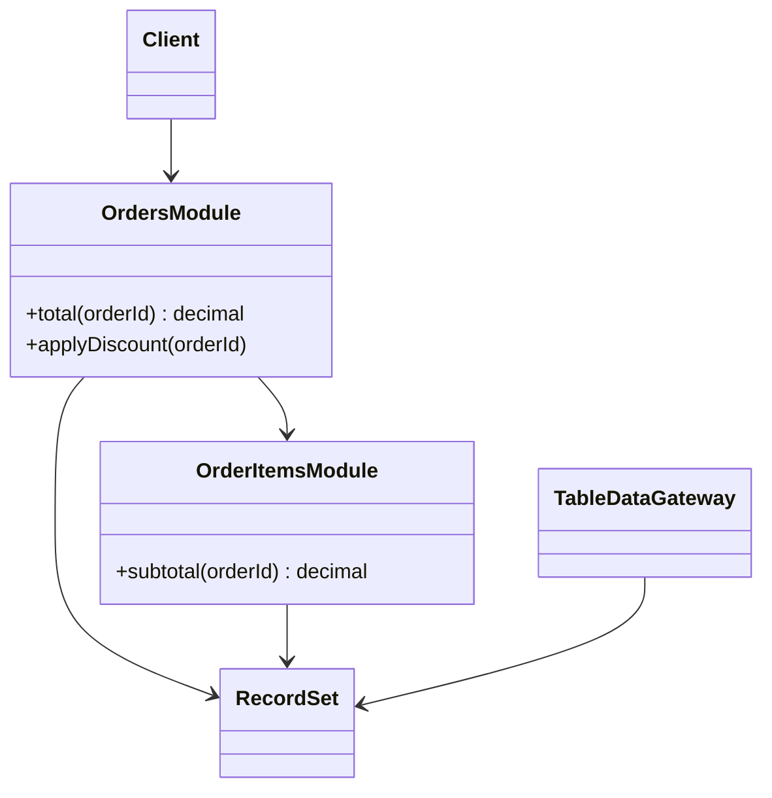

# Table Module

## Description

Table Module is a single instance that handles the business logic for all the rows in a database table or view. There is one class per table, and its methods receive or operate on a set of tabular data.

Unlike Domain Model, which creates one object per record (one object for each order), Table Module has a single `Orders` object that processes all the orders. To identify a row, the client passes a key or the method receives the record as an argument.

The pattern works very well with Record Set, in-memory tabular structures provided by platforms such as .NET (DataSet), which integrate them with user interface and data access tools.

## Problems it solves

- Avoiding the cost and complexity of object-relational mapping for a Domain Model.
- Organizing logic in a predictable place instead of scattering it across scripts.
- Taking advantage of platforms and tools oriented toward tabular data.

## When to use

- When the platform offers strong support for Record Set and for data-bound UI controls.
- Logic of moderate complexity, organized around tables.
- When you want more structure than Transaction Script, without the cost of a Domain Model.

## When to avoid

- When the rules require polymorphism, inheritance, and rich relationships between entities.
- When the logic grows and spreads across many table modules that need to call each other.
- When the platform's Record Set support is weak.

## Trade-offs

| Benefit | Cost / Risk |
| --- | --- |
| Clearer structure than loose scripts | No polymorphism or per-object identity |
| No object-relational mapping needed | Coupled to the tabular shape of the data |
| Integrates well with data-oriented tools | Complex logic is hard to express |
| Few queries and efficient batch operations | Hard to migrate to a Domain Model later |

- **Performance:** processing many rows at once is usually efficient.
- **Testability:** requires building in-memory Record Sets, but doesn't need a database.
- **Evolution:** relationships between tables become calls between modules.

## Diagram



Each table has a module (`OrdersModule`, `OrderItemsModule`) that operates on a `RecordSet` loaded by a table gateway.

## Example

An `Orders` module calculates an order's total from the loaded set of items.

```csharp
public class OrderItems
{
    private readonly DataTable table;
    public OrderItems(DataTable table) { this.table = table; }

    public decimal Subtotal(int orderId) =>
        table.AsEnumerable()
             .Where(r => r.Field<int>("OrderId") == orderId)
             .Sum(r => r.Field<decimal>("Price") * r.Field<int>("Qty"));
}

public class Orders
{
    private readonly DataTable table;
    private readonly OrderItems items;
    public Orders(DataTable table, OrderItems items) { this.table = table; this.items = items; }

    public decimal Total(int orderId)
    {
        var row = table.AsEnumerable().Single(r => r.Field<int>("Id") == orderId);
        var subtotal = items.Subtotal(orderId);
        return row.Field<bool>("Vip") ? subtotal * 0.9m : subtotal;
    }
}
```

## Related patterns

- [Transaction Script](/design/poeaa/domain-logic/transaction-script) — organizes by request instead of by table.
- [Domain Model](/design/poeaa/domain-logic/domain-model) — one object per record, instead of one per table.
- [Record Set](/design/poeaa/base/record-set) — in-memory tabular structure that Table Module operates on.
- [Table Data Gateway](/design/poeaa/data-source-architectural/table-data-gateway) — loads the table data for the module.
- [Service Layer](/design/poeaa/domain-logic/service-layer) — can serve as the boundary over the modules.

## Reference

- [Pattern page in Fowler's catalog](https://martinfowler.com/eaaCatalog/tableModule.html)
- *Patterns of Enterprise Application Architecture*, Martin Fowler (Addison-Wesley, 2002)
