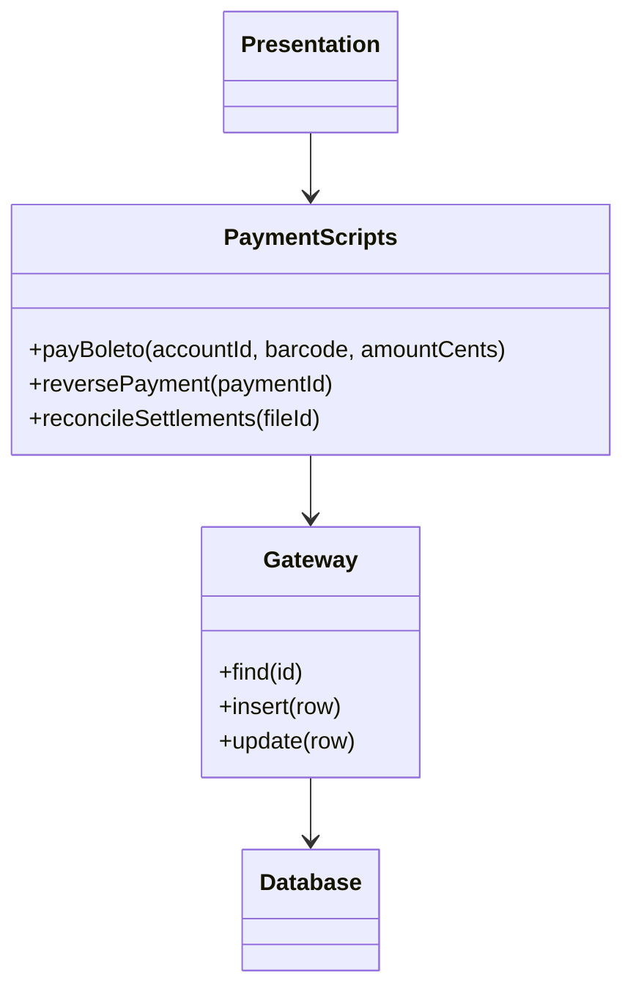

# Transaction Script

## Description

Transaction Script organizes business logic as procedures, with one procedure for each request coming from the presentation layer. Each script receives the input, validates it, calculates, accesses the database (directly or through a thin gateway), and returns the result.

An enterprise application can be seen as a series of transactions: some only display data, others change it. Each transaction gets its own script, which runs linearly from start to finish. Common steps can be extracted into subprocedures, and several related scripts are usually grouped in the same class.

It's the most direct way to structure domain logic and works well as long as the rules are simple. As the logic grows, duplication between scripts tends to increase.

## Problems it solves

- The need to quickly implement simple use cases without building an infrastructure of objects and mapping.
- Teams with no object-modeling experience that need a style that's easy to understand.
- Operations that boil down to read, calculate, and write, where each request has a well-defined flow.

## When to use

- Simple business logic, with few rules and few interactions between them.
- Applications that need fine-grained control over SQL queries and performance.
- Small systems, prototypes, or reporting and import modules.

## When to avoid

- When the rules are complex and repeat across several use cases: duplication between scripts piles up.
- When the domain has many behavior variations that benefit from polymorphism.
- When the application must keep growing for a long time and logic scattered across procedures will become hard to maintain.

## Trade-offs

| Benefit | Cost / Risk |
| --- | --- |
| Simple to understand and implement | Logic duplicated across scripts as the system grows |
| No object-relational mapping layer; easy to control the SQL | Hard to refactor into a richer model later |
| Clear transaction boundaries: one script, one transaction | Business rules coupled to the table structure |
| Good, predictable performance | Tests depend on the database or on mocked gateways |

- **Complexity:** grows nonlinearly; what starts out simple becomes a tangle of procedures.
- **Testability:** good for small scripts, but depends on separating logic from data access.
- **Evolution:** migrating to a Domain Model is usually costly.

## Diagram



The presentation layer calls one script per request. The scripts, grouped in `PaymentScripts`, use a thin gateway to access the `Database`.

## Example

The fintech app needs to pay a boleto: check the balance, debit the account, and record the payment. A single procedure does all the work, in one transaction.

```python
class PaymentScripts:
    def __init__(self, db):
        self.db = db

    def pay_boleto(self, account_id: int, barcode: str, amount_cents: int) -> int:
        with self.db.transaction():
            account = self.db.fetch_one(
                "SELECT balance_cents FROM accounts WHERE id = %s FOR UPDATE",
                account_id,
            )
            if account["balance_cents"] < amount_cents:
                raise ValueError("Insufficient balance")
            self.db.execute(
                "UPDATE accounts SET balance_cents = balance_cents - %s WHERE id = %s",
                amount_cents, account_id,
            )
            return self.db.insert(
                "INSERT INTO boleto_payments (account_id, barcode, amount_cents) "
                "VALUES (%s, %s, %s)",
                account_id, barcode, amount_cents,
            )
```

## Related patterns

- [Domain Model](/design/poeaa/domain-logic/domain-model) — an alternative for complex logic, with objects that combine data and behavior.
- [Table Module](/design/poeaa/domain-logic/table-module) — organizes logic by table instead of by request.
- [Service Layer](/design/poeaa/domain-logic/service-layer) — can be implemented with transaction scripts as the application boundary.
- [Table Data Gateway](/design/poeaa/data-source-architectural/table-data-gateway) — thin gateway frequently used by the scripts to access the database.
- [Command](/coding/gof/behavioral/command) — scripts can be organized as command objects, one per transaction.

## Reference

- [Pattern page in Fowler's catalog](https://martinfowler.com/eaaCatalog/transactionScript.html)
- *Patterns of Enterprise Application Architecture*, Martin Fowler (Addison-Wesley, 2002)
