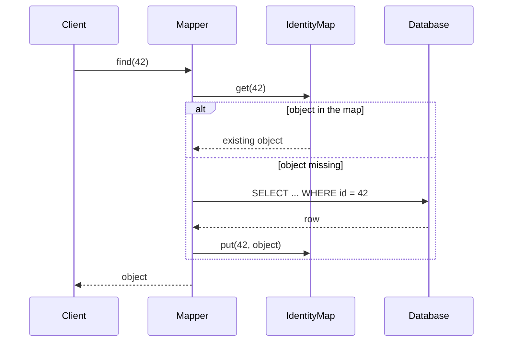

# Identity Map

## Description

Identity Map ensures that each object is loaded from the database only once per session by keeping a map of already-read objects, indexed by primary key. Before fetching a record, the system checks the map; if the object is already there, it's returned instead of creating a new instance.

This prevents two distinct references from representing the same database row. Without the pattern, changes made to one copy don't show up in the other, and saving both causes conflicts and lost updates.

There is usually one map per class (or per table), and it lives within the scope of a session or a Unit of Work. It isn't a global cache shared across requests, but an identity mechanism within a business transaction.

## Problems it solves

- Two in-memory objects representing the same record, with diverging state.
- Write conflicts between copies of the same entity in the same session.
- Repeated database queries for the same record during an operation.
- Circular references in the object graph that would lead to infinite loading.

## When to use

- When using a domain model with Data Mapper and several parts of the code may load the same entity.
- When you want the identity of the in-memory object to match the identity of the row.
- Together with Unit of Work, to track what was read and changed.

### When to avoid

- With immutable objects, such as Value Objects, where multiple copies don't cause inconsistency.
- In very short, read-only operations where duplication poses no risk.
- When the map is mistaken for a long-lived cache; other strategies are better suited for that.

## Trade-offs

| Benefit | Cost / Risk |
| --- | --- |
| A single instance per record in the session | Memory grows with the number of loaded objects |
| Fewer repeated database queries | Data can become stale if the session is long |
| Prevents conflicting updates within the same session | Requires managing the map's scope and disposal |
| Resolves cyclic references in the graph | Extra complexity in concurrent or distributed environments |

- **Scope:** one map per session avoids concurrency problems between threads; global maps require synchronization.
- **Queries:** queries by criteria other than the key still go to the database, but the results pass through the map to reuse instances.
- **Testability:** the behavior is transparent and easy to verify by comparing object identities.

## Diagram



The `Mapper` checks the `IdentityMap` before going to the `Database`; if the object isn't there, it loads the row, registers it in the map, and returns it. Subsequent calls with the same id return the same instance.

## Example

In an order, both the billing module and the shipping module fetch the same `Customer`. With Identity Map, both receive the same instance.

```typescript
class IdentityMap<T extends { id: number }> {
  private items = new Map<number, T>();
  get(id: number): T | undefined { return this.items.get(id); }
  put(entity: T): void { this.items.set(entity.id, entity); }
}

class CustomerMapper {
  private map = new IdentityMap<Customer>();

  constructor(private db: Database) {}

  find(id: number): Customer {
    const cached = this.map.get(id);
    if (cached) return cached;
    const row = this.db.queryOne("SELECT * FROM customers WHERE id = ?", [id]);
    const customer = new Customer(row.id, row.name);
    this.map.put(customer);
    return customer;
  }
}

// mapper.find(1) === mapper.find(1)  // true
```

Hibernate (the `Session` first-level cache) and Entity Framework (the `DbContext` change tracking) apply the pattern automatically.

## Related patterns

- [Unit of Work](/design/poeaa/object-relational-behavioral/unit-of-work) — often contains the Identity Map and uses it to know which objects have been loaded.
- [Lazy Load](/design/poeaa/object-relational-behavioral/lazy-load) — on-demand loading consults the map to avoid duplicate objects.
- [Identity Field](/design/poeaa/object-relational-structural/identity-field) — provides the key that indexes the map.
- [Data Mapper](/design/poeaa/data-source-architectural/data-mapper) — checks the map before accessing the database.
- [Cache-Aside](/architecture/cloud-design-patterns/data-management/cache-aside) — also avoids repeated reads, but as a shared cache rather than an identity guarantee.

## Reference

- [Pattern page in Fowler's catalog](https://martinfowler.com/eaaCatalog/identityMap.html)
- *Patterns of Enterprise Application Architecture*, Martin Fowler (Addison-Wesley, 2002)
- [Identity map pattern on Wikipedia](https://en.wikipedia.org/wiki/Identity_map_pattern)
