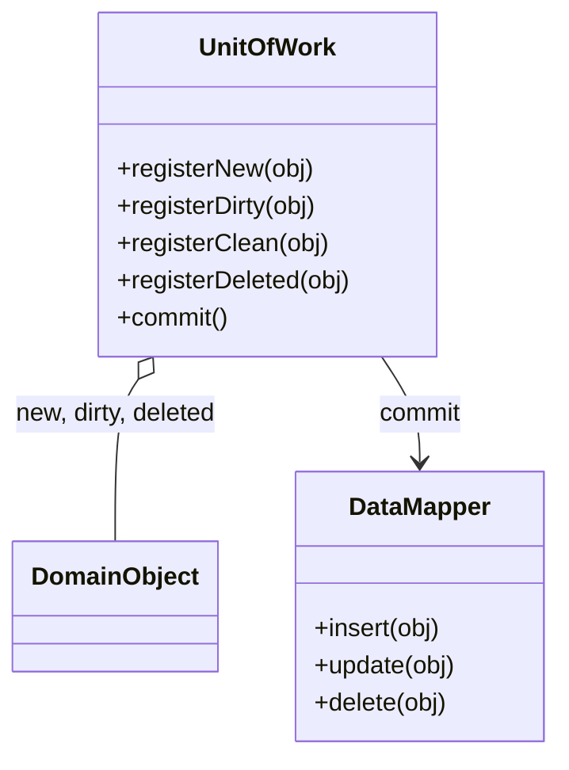

# Unit of Work

## Description

Unit of Work keeps a list of the objects affected by a business transaction and coordinates writing the changes to the database, as well as resolving concurrency problems. Instead of each change triggering an immediate `INSERT`, `UPDATE`, or `DELETE`, the unit of work object records what was created, modified, or removed.

When the business transaction ends, the Unit of Work's `commit` works out what changed, opens a single database transaction, orders the operations (respecting foreign keys), and runs them in a batch. Registration can be done by the caller (caller registration), by the object itself (object registration), or by comparing against a snapshot of the data that was read (unit of work controller).

This way, domain code doesn't need to know when or how to persist: it just manipulates objects, and the Unit of Work takes care of writing everything atomically and consistently.

## Problems it solves

- Writes scattered across the code, each in its own transaction, leaving the database in a partial state if something fails.
- Many small database calls for the same object modified several times during an operation.
- Difficulty knowing which objects were changed and need to be written.
- Incorrect write ordering that violates referential integrity constraints.

## When to use

- When a business operation changes several objects that must be persisted together.
- When using a Data Mapper or a domain model and you want to isolate persistence logic.
- When you want to reduce the number of database round trips by batching writes.

## When to avoid

- In simple applications using Transaction Script or Active Record, where each operation writes a single record.
- When the framework already provides the pattern and a custom layer would only duplicate the work.
- In flows that require immediate writes visible to other processes before the operation ends.

## Trade-offs

| Benefit | Cost / Risk |
| --- | --- |
| Atomic, consistent writing of changes | More complexity to track object state |
| Fewer database calls, with batched writes | Changes stay pending in memory until commit |
| Centralized persistence, outside the domain logic | A long-lived Unit of Work can grow and consume memory |
| Operation ordering that respects referential integrity | Errors only surface at commit, far from where the change was made |

- **Concurrency:** it's the natural place to apply Optimistic Offline Lock at write time.
- **Testability:** domain logic can be tested without a database; the Unit of Work can be replaced by a test double.
- **Scope:** it normally lives per request or per business transaction.

## Diagram



The `UnitOfWork` holds the lists of new, modified, and removed objects. On `commit()`, it delegates writing each one to the corresponding `DataMapper`, within a single transaction.

## Example

A bank transfer changes two accounts and creates a ledger entry. The Unit of Work writes everything in a single transaction at the end.

```python
class UnitOfWork:
    def __init__(self, mappers, connection):
        self.mappers, self.conn = mappers, connection
        self.new, self.dirty, self.deleted = [], [], []

    def register_new(self, obj): self.new.append(obj)
    def register_dirty(self, obj):
        if obj not in self.dirty and obj not in self.new:
            self.dirty.append(obj)
    def register_deleted(self, obj): self.deleted.append(obj)

    def commit(self):
        with self.conn.transaction():
            for o in self.new:     self.mappers[type(o)].insert(o)
            for o in self.dirty:   self.mappers[type(o)].update(o)
            for o in self.deleted: self.mappers[type(o)].delete(o)

uow = UnitOfWork(mappers, conn)
src.withdraw(100); uow.register_dirty(src)
dst.deposit(100);  uow.register_dirty(dst)
uow.register_new(Entry(src, dst, 100))
uow.commit()
```

Hibernate's `Session` and Entity Framework's `DbContext` (`SaveChanges`) are ready-made implementations of the pattern.

## Related patterns

- [Identity Map](/design/poeaa/object-relational-behavioral/identity-map) — they usually go together: the Unit of Work uses the map to know which objects have already been loaded.
- [Lazy Load](/design/poeaa/object-relational-behavioral/lazy-load) — on-demand loading operates within the scope of the Unit of Work.
- [Data Mapper](/design/poeaa/data-source-architectural/data-mapper) — performs the writes that the Unit of Work coordinates.
- [Repository](/design/poeaa/object-relational-metadata-mapping/repository) — is often the entry point that registers objects with the Unit of Work.
- [Optimistic Offline Lock](/design/poeaa/offline-concurrency/optimistic-offline-lock) — checked at commit to detect conflicts.

## Reference

- [Pattern page in Fowler's catalog](https://martinfowler.com/eaaCatalog/unitOfWork.html)
- *Patterns of Enterprise Application Architecture*, Martin Fowler (Addison-Wesley, 2002)
- [Unit of work on Wikipedia](https://en.wikipedia.org/wiki/Unit_of_work)
