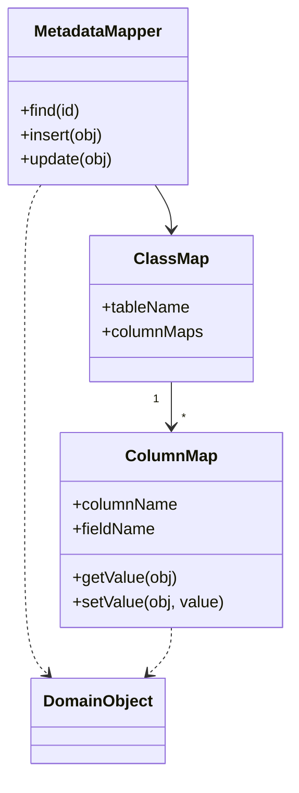

# Metadata Mapping

## Description

Metadata Mapping keeps the details of the object-relational mapping in metadata instead of scattering them across hand-written code. Each correspondence between an object field and a table column is described in a declarative structure (a file, annotations, or a table).

Generic code reads this metadata and performs the read, insert, and update operations. To map a new class, you just add a metadata entry; the access code doesn't change. Code generation from the metadata and runtime reflection are the two most common ways to implement it.

It is the foundation of most ORM frameworks, which combine the pattern with [Data Mapper](/design/poeaa/data-source-architectural/data-mapper) and [Unit of Work](/design/poeaa/object-relational-behavioral/unit-of-work).

## Problems it solves

- Repetitive, tedious mapping code written for every domain class.
- Schema changes that require editing several pieces of persistence code.
- Typos and inconsistencies between hand-written mappers.

## When to use

- When there are many mapped classes and the mapping follows uniform rules.
- When you want to adopt or build an ORM instead of writing mappers one by one.
- When you need to generate the schema, DDL, or queries from a single description.

## When to avoid

- When there are few tables and manual mapping is simpler to understand.
- When the mapping is so irregular that the generic engine would need so many exceptions that it would lose its value.
- When the cost of reflection or the difficulty of debugging generated code outweighs the benefit.

## Trade-offs

| Benefit | Cost / Risk |
| --- | --- |
| Less repetitive mapping code | The generic engine is more complex to build and debug |
| Mapping changes become metadata edits | Non-standard cases are hard to express |
| Mapping described in a single place | Reflection can cost performance; code generation adds a build step |
| Makes schema generation and tooling easier | Errors only show up at runtime if the metadata isn't validated |

- **Coupling:** the domain is free of SQL details, but now depends on the metadata format.
- **Testability:** the generic engine is tested once; each mapping requires configuration checks.
- **Complexity:** high at the start of the project, low for each additional class.

## Diagram



The generic `MetadataMapper` looks up the class's `ClassMap`, which holds one `ColumnMap` per field, and uses that information to read and write the `DomainObject` without any class-specific code.

## Example

An application maps `Account` to the `accounts` table. Instead of writing SQL by hand, JPA annotations serve as the metadata, and Hibernate reads them through reflection to generate the statements. The balance is stored as integer cents.

```java
@Entity
@Table(name = "accounts")
public class Account {
    @Id
    @GeneratedValue
    private Long id;

    @Column(name = "holder_name", nullable = false)
    private String holderName;

    @Embedded
    private Cpf holderCpf;

    @Column(name = "balance_cents", nullable = false)
    private long balanceCents;

    @OneToMany(mappedBy = "account")
    private List<LedgerEntry> entries;
}
```

Hibernate, Entity Framework (fluent API), and Doctrine follow this approach, using annotations, XML, or configuration in code.

## Related patterns

- [Data Mapper](/design/poeaa/data-source-architectural/data-mapper) — Metadata Mapping is the way to implement a generic Data Mapper, without hand-written mappers.
- [Query Object](/design/poeaa/object-relational-metadata-mapping/query-object) — uses the metadata to translate classes and fields into tables and columns.
- [Repository](/design/poeaa/object-relational-metadata-mapping/repository) — is usually built on top of a metadata-driven mapping.
- [Unit of Work](/design/poeaa/object-relational-behavioral/unit-of-work) — coordinates writing the mapped objects.
- [Lazy Load](/design/poeaa/object-relational-behavioral/lazy-load) — the generic engine can insert proxies based on the metadata.

## Reference

- [Pattern page in Fowler's catalog](https://martinfowler.com/eaaCatalog/metadataMapping.html)
- *Patterns of Enterprise Application Architecture*, Martin Fowler (Addison-Wesley, 2002)
