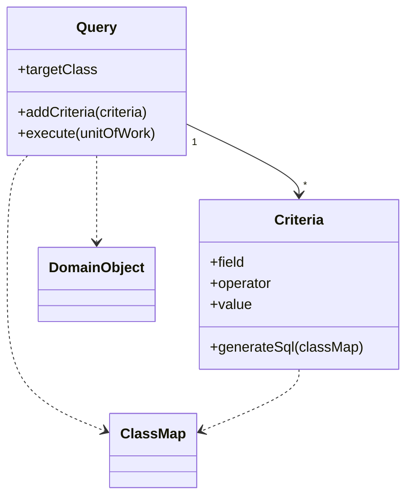

# Query Object

## Description

A Query Object is an object that represents a database query. Instead of writing SQL, the developer builds the query in terms of domain classes and fields, combining criteria, ordering, and joins as objects.

In practice, it is an application of the Interpreter pattern: a set of objects that can turn itself into a SQL statement. The mapping metadata translates classes and fields into tables and columns, so whoever writes the query doesn't need to know the schema, and changes to it stay confined to a single place.

## Problems it solves

- SQL is complex and not every developer masters it.
- Queries written in SQL require knowledge of the schema and spread it throughout the code.
- Specialized finder methods hide the SQL, but make ad hoc queries difficult and duplicate SQL when the schema changes.

## When to use

- When the application needs flexible, dynamic queries built at runtime.
- When you want to isolate the code from the physical database schema.
- When there are many combinable filters (search screens and reports).

## When to avoid

- When queries are few and fixed; simple finder methods are enough.
- When the query is complex and hand-optimized, and the abstraction would get in the way of performance tuning.
- When building the Query Object from scratch costs more than using one that already exists in an ORM.

## Trade-offs

| Benefit | Cost / Risk |
| --- | --- |
| Queries expressed in the domain's vocabulary | The abstraction leaks in complex queries |
| Schema changes stay isolated | Building a good Query Object is laborious |
| Dynamic, combinable queries | Generated SQL can be inefficient |
| Criteria can be reused | Harder to debug than plain SQL |

- **Coupling:** client code depends on the object model, not on the schema.
- **Testability:** criteria can be verified without a database, by inspecting the query object.
- **Complexity:** grows quickly if the query language tries to cover all of SQL.

## Diagram



The `Query` aggregates several `Criteria`. When executed, it uses the mapping's `ClassMap` to translate fields into columns, generate the SQL, and return domain objects.

## Example

The statement screen filters an account's ledger entries by period, entry type, and minimum amount, and every filter except the account is optional. The JPA Criteria API builds the query in a type-safe way, without writing SQL.

```java
CriteriaBuilder cb = em.getCriteriaBuilder();
CriteriaQuery<LedgerEntry> q = cb.createQuery(LedgerEntry.class);
Root<LedgerEntry> e = q.from(LedgerEntry.class);

List<Predicate> filters = new ArrayList<>();
filters.add(cb.equal(e.get("account").get("id"), accountId));
if (from != null && to != null) {
    filters.add(cb.between(e.get("bookedAt"), from, to));
}
if (type != null) {
    filters.add(cb.equal(e.get("type"), type));
}
if (minAmountCents != null) {
    filters.add(cb.greaterThanOrEqualTo(e.get("amountCents"), minAmountCents));
}

q.select(e)
 .where(filters.toArray(new Predicate[0]))
 .orderBy(cb.desc(e.get("bookedAt")));

List<LedgerEntry> result = em.createQuery(q).getResultList();
```

LINQ in Entity Framework and Specification in Spring Data follow the same idea.

## Related patterns

- [Interpreter](/coding/gof/behavioral/interpreter) — a Query Object is an Interpreter whose output is SQL.
- [Metadata Mapping](/design/poeaa/object-relational-metadata-mapping/metadata-mapping) — provides the mapping from classes and fields to tables and columns.
- [Repository](/design/poeaa/object-relational-metadata-mapping/repository) — accepts Query Objects as a way to describe declarative queries.
- [Data Mapper](/design/poeaa/data-source-architectural/data-mapper) — executes the query and materializes the objects.
- [Unit of Work](/design/poeaa/object-relational-behavioral/unit-of-work) — objects loaded by the query are registered with it.

## Reference

- [Pattern page in Fowler's catalog](https://martinfowler.com/eaaCatalog/queryObject.html)
- *Patterns of Enterprise Application Architecture*, Martin Fowler (Addison-Wesley, 2002)
