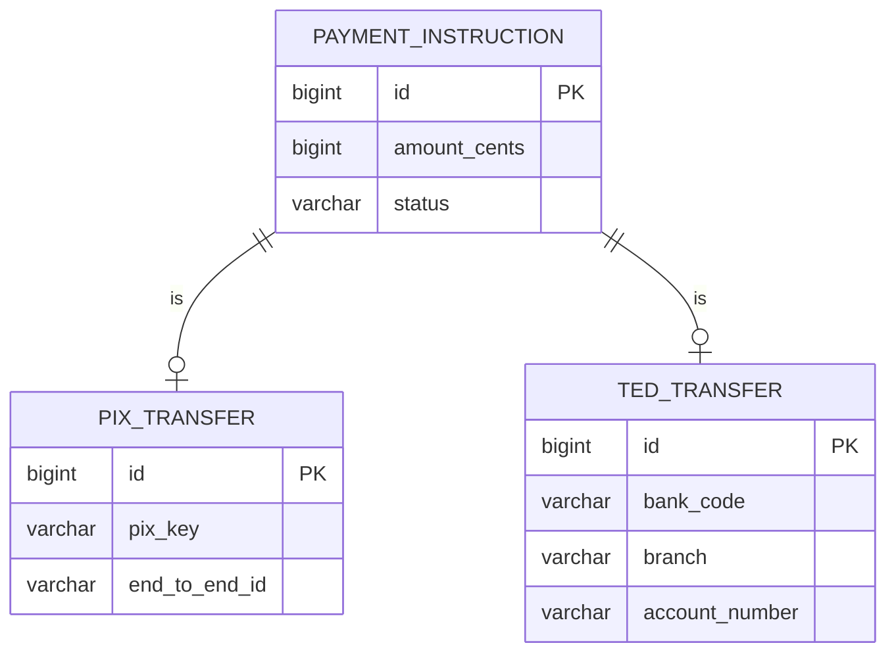

# Class Table Inheritance

## Description

Class Table Inheritance represents an inheritance hierarchy with one table per class. Each table holds only the fields declared in its own class, and subclasses are linked to the superclass table through a shared primary key.

To load a complete object, the mapper joins the tables along the inheritance chain. To find the concrete type, it uses a discriminator or the result of the joins.

The schema mirrors the object model, keeps the database normalized, and allows `NOT NULL` on each class's fields.

## Problems it solves

- Mapping inheritance with a normalized schema and no null columns.
- Keeping a direct relationship between domain classes and tables.
- Applying integrity constraints per subclass.

## When to use

- When subclasses have many fields of their own.
- When schema integrity is a priority.
- When references to the superclass (foreign key) must work for any subtype.

## When to avoid

- When the number of joins per query hurts performance.
- When the hierarchy changes frequently, moving fields between tables.

## Trade-offs

| Benefit | Cost / Risk |
| --- | --- |
| Normalized schema that mirrors the model | Joins on every object load |
| `NOT NULL` per subclass | Refactoring the hierarchy requires altering tables |
| Foreign key to the superclass works | Deep hierarchies produce heavy queries |

- **Performance:** cost grows with the depth of the hierarchy.
- **Maintenance:** a change to one class touches its corresponding table.

## Diagram



`PAYMENT_INSTRUCTION` holds the common fields; `PIX_TRANSFER` and `TED_TRANSFER` hold the specific ones, sharing the same primary key. Fowler's source illustrates the pattern with a `Player` hierarchy; here it is replaced by `PaymentInstruction`, the same one in all four inheritance patterns.

## Example

Each class has its own table; JPA joins the tables with `JOINED`.

```java
@Entity
@Inheritance(strategy = InheritanceType.JOINED)
public abstract class PaymentInstruction {
    @Id @GeneratedValue
    private Long id;
    private long amountCents;
    private String status;
}

@Entity
public class PixTransfer extends PaymentInstruction {
    @Column(nullable = false)
    private String pixKey;
    private String endToEndId;
}

@Entity
public class TedTransfer extends PaymentInstruction {
    private String bankCode;
    private String branch;
    private String accountNumber;
}
```

In EF Core, this is Table-per-Type (TPT).

## Related patterns

- [Single Table Inheritance](/design/poeaa/object-relational-structural/single-table-inheritance) — an alternative with a single table.
- [Concrete Table Inheritance](/design/poeaa/object-relational-structural/concrete-table-inheritance) — an alternative with one table per concrete class.
- [Inheritance Mappers](/design/poeaa/object-relational-structural/inheritance-mappers) — organizes the hierarchy's mappers.
- [Foreign Key Mapping](/design/poeaa/object-relational-structural/foreign-key-mapping) — the link between tables uses the same principle.
- [Identity Field](/design/poeaa/object-relational-structural/identity-field) — the key shared across the tables.

## Reference

- [Pattern page in Fowler's catalog](https://martinfowler.com/eaaCatalog/classTableInheritance.html)
- *Patterns of Enterprise Application Architecture*, Martin Fowler (Addison-Wesley, 2002)
