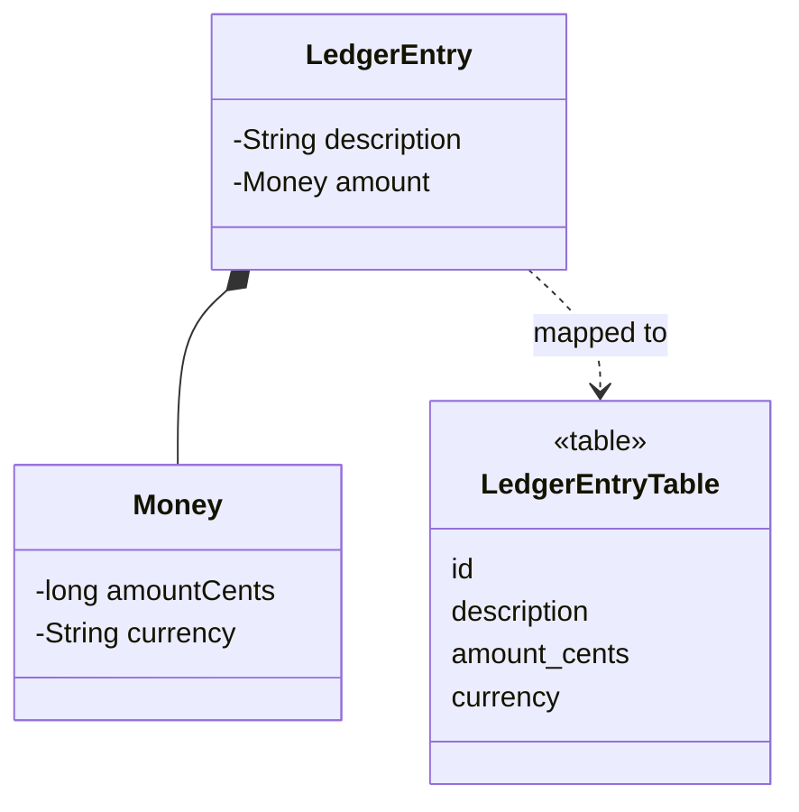

# Embedded Value

## Description

Embedded Value maps an object into several fields of another object's table. Many small objects, such as money, a date range, or an address, don't make sense as tables of their own: they're just values of the object that contains them.

Instead of creating a table and a foreign key, the smaller object's properties become columns of the owner's table. When loading, the mapper builds the value object from those columns; when saving, it copies the values back.

It's often used with Value Object, Money, and other types without identity.

## Problems it solves

- Avoiding a table and a join for small value objects.
- Keeping the domain model expressive (rich types) without complicating the schema.

## When to use

- For Value Objects with few fields, such as `Money`, `Address`, or `DateRange`.
- When the value object belongs to a single owner.

## When to avoid

- When the object has its own identity or is shared between owners.
- When the object needs to be queried or indexed independently of the owner.

## Trade-offs

| Benefit | Cost / Risk |
| --- | --- |
| No joins; reads in a single query | Extra columns in the owner's table |
| Domain model with rich types | Querying the value in isolation is hard |
| Simple schema | Reusing the same type in several owners duplicates columns |

- **Performance:** a single row brings everything.
- **Consistency:** the value is written together with the owner, atomically.

## Diagram



`Money` has no table: its fields become columns of `LedgerEntryTable`.

## Example

A `LedgerEntry` has an embedded `Money`; the `amount_cents` and `currency` columns live in the entry's table.

```java
@Embeddable
public class Money {
    private long amountCents;
    private String currency;
}

@Entity
public class LedgerEntry {
    @Id @GeneratedValue
    private Long id;
    private String description;

    @Embedded
    private Money amount;
}
```

In EF Core, the equivalent is `OwnsOne`.

## Related patterns

- [Value Object](/design/poeaa/base/value-object) — the kind of object that's usually embedded.
- [Money](/design/poeaa/base/money) — a classic example of an embedded value object.
- [Serialized LOB](/design/poeaa/object-relational-structural/serialized-lob) — an alternative when the group is larger or less structured.
- [Dependent Mapping](/design/poeaa/object-relational-structural/dependent-mapping) — for dependents that need a table of their own.
- [Identity Field](/design/poeaa/object-relational-structural/identity-field) — not needed for the embedded object.

## Reference

- [Pattern page in Fowler's catalog](https://martinfowler.com/eaaCatalog/embeddedValue.html)
- *Patterns of Enterprise Application Architecture*, Martin Fowler (Addison-Wesley, 2002)
