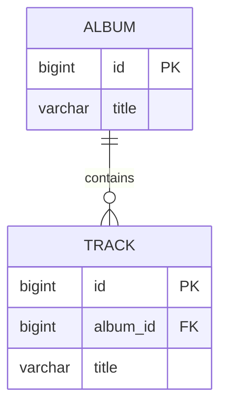

# Foreign Key Mapping

## Description

Foreign Key Mapping maps an association between objects to a foreign key between tables. In memory, objects reference each other through pointers; in the database, rows relate through keys. The pattern converts one into the other using the referenced object's Identity Field.

When loading an object, the mapper reads the foreign key and fetches (or gets from the Identity Map) the referenced object. When saving, it writes the referenced object's identifier into the foreign key field. For collections (one-to-many), the foreign key lives in the "many" side's table, and the "one" object holds the collection.

Loading of the referenced object is usually deferred with Lazy Load, to avoid loading entire graphs.

## Problems it solves

- Persisting references between domain objects in a relational schema.
- Loading and navigating one-to-one and one-to-many associations.
- Maintaining referential integrity between tables.

## When to use

- In one-to-one, many-to-one, and one-to-many associations between entities.
- When the entities have their own identity and independent lifecycles.

## When to avoid

- In many-to-many associations: use Association Table Mapping.
- When the child depends exclusively on the parent: consider Dependent Mapping.

## Trade-offs

| Benefit | Cost / Risk |
| --- | --- |
| Direct, natural mapping in the relational model | Bidirectional associations require keeping both sides in sync |
| Referential integrity guaranteed by the database | Loading the graph can generate many queries (N+1 problem) |
| Simple to understand and to query | Updating collections may require comparing old and new state |

- **Consistency:** foreign key constraints prevent orphan references.
- **Performance:** use Lazy Load or joins to control the number of queries.

## Diagram



Each `TRACK` holds `album_id`, the foreign key that points to the `ALBUM` it belongs to.

## Example

An `Order` belongs to a `Customer`. The `customer_id` column holds the reference.

```java
@Entity
public class Order {
    @Id @GeneratedValue
    private Long id;

    @ManyToOne(fetch = FetchType.LAZY)
    @JoinColumn(name = "customer_id")
    private Customer customer;
}
```

```sql
CREATE TABLE orders (
  id BIGINT PRIMARY KEY,
  customer_id BIGINT NOT NULL REFERENCES customer(id)
);
```

## Related patterns

- [Identity Field](/design/poeaa/object-relational-structural/identity-field) — provides the key that the foreign key references.
- [Association Table Mapping](/design/poeaa/object-relational-structural/association-table-mapping) — used when the association is many-to-many.
- [Dependent Mapping](/design/poeaa/object-relational-structural/dependent-mapping) — an alternative when the child depends entirely on the parent.
- [Lazy Load](/design/poeaa/object-relational-behavioral/lazy-load) — defers loading of the referenced object.
- [Identity Map](/design/poeaa/object-relational-behavioral/identity-map) — guarantees a single object per row when resolving the reference.

## Reference

- [Pattern page in Fowler's catalog](https://martinfowler.com/eaaCatalog/foreignKeyMapping.html)
- *Patterns of Enterprise Application Architecture*, Martin Fowler (Addison-Wesley, 2002)
