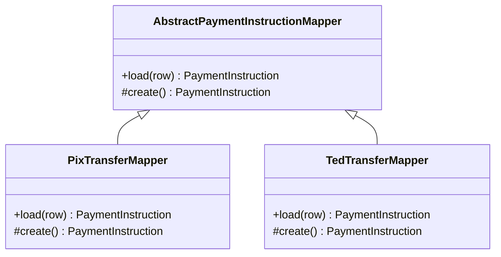

# Inheritance Mappers

## Description

Inheritance Mappers organizes the mappers of an inheritance hierarchy so that common mapping logic lives in one place and class-specific logic in another. It's a supporting structure for the inheritance mapping patterns, which define how the table schema is designed.

Typically there's an abstract mapper class at the root, with the common load, insert, and update logic, and one concrete mapper per class in the hierarchy. Each concrete mapper handles its own fields and delegates the inherited fields to the superclass. A superclass mapper can also delegate to the subclasses' mappers when loading an object whose concrete type isn't yet known.

It doesn't matter which schema is chosen (Single Table, Class Table, or Concrete Table): the mapper structure follows the class hierarchy.

## Problems it solves

- Duplicating the mapping code for inherited fields in every subclass.
- Loading a superclass without knowing the row's concrete type.
- Adding a new subclass without changing the logic of the others.

## When to use

- When the domain has an inheritance hierarchy mapped with Data Mapper.
- When the three inheritance schemas need to share a consistent code structure.

## When to avoid

- When using an ORM framework that already handles inheritance through metadata.
- When the hierarchy is shallow and direct mapping is enough.

## Trade-offs

| Benefit | Cost / Risk |
| --- | --- |
| Reuse of the common mapping logic | More mapper classes to maintain |
| A new subclass requires only a new mapper | The superclass mapper must know the subclasses or a registry of them |
| Independent of the chosen table schema | Hand-written code grows with the hierarchy |

- **Extensibility:** adding subtypes is a local change.
- **Complexity:** polymorphic loading requires a strategy for discovering the type.

## Diagram



The abstract mapper holds the common flow; each concrete mapper handles its class's fields and calls the superclass's for the inherited fields. Fowler's source illustrates the pattern with a `Player` hierarchy; here it is replaced by `PaymentInstruction`, the same one in all four inheritance patterns.

## Example

A `PaymentInstruction`, `PixTransfer`, and `TedTransfer` hierarchy uses chained mappers.

```python
class AbstractPaymentInstructionMapper:
    def load(self, row):
        instruction = self.create()
        instruction.id = row["id"]
        instruction.amount_cents = row["amount_cents"]
        instruction.status = row["status"]
        return instruction

class PixTransferMapper(AbstractPaymentInstructionMapper):
    def create(self):
        return PixTransfer()

    def load(self, row):
        transfer = super().load(row)
        transfer.pix_key = row["pix_key"]
        transfer.end_to_end_id = row["end_to_end_id"]
        return transfer

class TedTransferMapper(AbstractPaymentInstructionMapper):
    def create(self):
        return TedTransfer()

    def load(self, row):
        transfer = super().load(row)
        transfer.bank_code = row["bank_code"]
        transfer.branch = row["branch"]
        transfer.account_number = row["account_number"]
        return transfer
```

## Related patterns

- [Single Table Inheritance](/design/poeaa/object-relational-structural/single-table-inheritance) — one of the schemas that the inheritance mapper implements.
- [Class Table Inheritance](/design/poeaa/object-relational-structural/class-table-inheritance) — another schema supported by the same structure.
- [Concrete Table Inheritance](/design/poeaa/object-relational-structural/concrete-table-inheritance) — the third supported schema.
- [Data Mapper](/design/poeaa/data-source-architectural/data-mapper) — the pattern whose mappers are organized in a hierarchy.
- [Layer Supertype](/design/poeaa/base/layer-supertype) — the same idea of gathering common behavior at the root of the hierarchy.
- [Template Method](/coding/gof/behavioral/template-method) — the common flow with steps that subclasses specialize.

## Reference

- [Pattern page in Fowler's catalog](https://martinfowler.com/eaaCatalog/inheritanceMappers.html)
- *Patterns of Enterprise Application Architecture*, Martin Fowler (Addison-Wesley, 2002)
