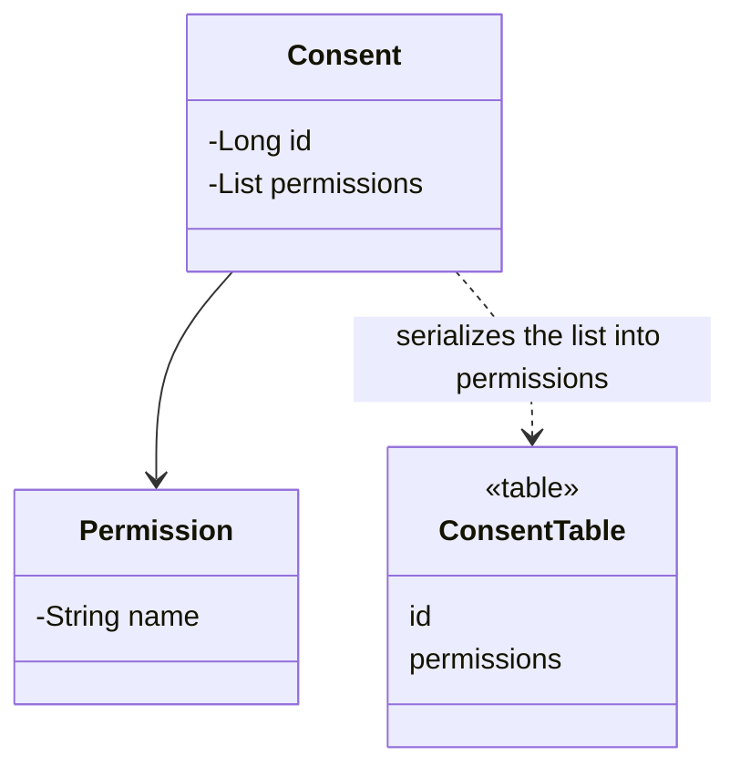

# Serialized LOB

## Description

Serialized LOB saves an object graph by serializing it and writing the result into a large object (LOB) field in a single column. The LOB can be binary (BLOB) or text (CLOB), in formats such as JSON, XML, or binary.

Instead of mapping each object in the graph to tables and foreign keys, the mapper turns the entire graph into a document and writes it as an opaque value. When reading, it deserializes everything at once.

It's simple and fast for small graphs that are always read and written together, but it hides the structure from the database: SQL can't query the inside of the LOB (unless the database offers types such as JSON/JSONB).

## Problems it solves

- Persisting hierarchies or complex graphs without creating many tables.
- Storing data of variable structure or nested configuration.

## When to use

- When the graph is always read and written as a unit.
- When there's no need to query or filter by the internal content.
- For data with a flexible structure, such as preferences or metadata.

## When to avoid

- When other systems or SQL reports need to access the internal data.
- When the format is likely to change and break reading of old data.
- When parts of the graph need referential integrity.

## Trade-offs

| Benefit | Cost / Risk |
| --- | --- |
| Very simple mapping | No SQL querying over the content |
| One read and one write per graph | Format evolution can break old data |
| No joins | No referential integrity or easy reporting |

- **Performance:** good for bulk reads; poor if only part of the graph is needed.
- **Consistency:** the graph is written atomically, but the database doesn't validate the structure.
- **Partial update:** any change rewrites the entire LOB.

## Diagram



The `Permission` list is serialized into a single `permissions` column of `ConsentTable`.

## Example

An Open Finance `Consent` holds the list of granted permissions, always read as a whole. It is stored as JSON.

```sql
CREATE TABLE consent (
  id BIGINT PRIMARY KEY,
  status VARCHAR(20),
  permissions JSONB
);
```

```java
@Entity
public class Consent {
    @Id @GeneratedValue
    private Long id;

    @JdbcTypeCode(SqlTypes.JSON)
    private List<Permission> permissions;
}
```

## Related patterns

- [Embedded Value](/design/poeaa/object-relational-structural/embedded-value) — an alternative for small, structured groups that should still be columns.
- [Dependent Mapping](/design/poeaa/object-relational-structural/dependent-mapping) — an alternative when the children need to be tables.
- [Foreign Key Mapping](/design/poeaa/object-relational-structural/foreign-key-mapping) — the traditional relational mapping that the LOB avoids.
- [Data Transfer Object](/design/poeaa/distribution/data-transfer-object) — also serializes an object graph, but for transport.

## Reference

- [Pattern page in Fowler's catalog](https://martinfowler.com/eaaCatalog/serializedLOB.html)
- *Patterns of Enterprise Application Architecture*, Martin Fowler (Addison-Wesley, 2002)
