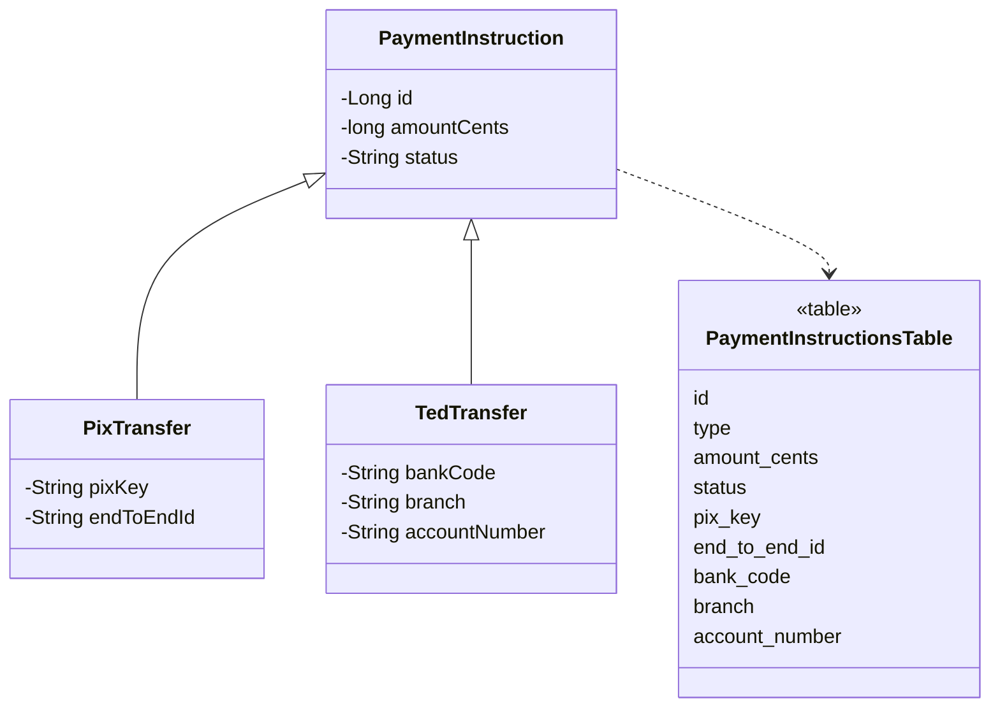

# Single Table Inheritance

## Description

Single Table Inheritance represents a class hierarchy as a single table, with columns for all the fields of all the classes. Each row holds one object, and a discriminator column indicates which concrete class it belongs to.

Fields that don't apply to a subclass are left null. When loading, the mapper reads the discriminator to decide which class to instantiate.

It's the simplest of the three inheritance schemas, and has the advantage of requiring no joins and of not requiring the table to change when a field moves up or down the hierarchy.

## Problems it solves

- Mapping inheritance with a simple, join-free schema.
- Querying the entire hierarchy polymorphically in a single table.

## When to use

- When the hierarchy is small and subclasses differ in only a few fields.
- When polymorphic read performance matters.
- When refactorings frequently move fields around the hierarchy.

## When to avoid

- When subclasses have many exclusive fields, producing a wide, sparse table.
- When `NOT NULL` is required on subclass columns.

## Trade-offs

| Benefit | Cost / Risk |
| --- | --- |
| A single table, no joins | Null columns waste space |
| Moving fields in the hierarchy doesn't change the schema | No `NOT NULL` on the specific columns |
| Simple polymorphic query | The table grows and can become a bottleneck; column names can collide |

- **Integrity:** per-subclass constraints are only possible with conditional `CHECK`s.
- **Readability:** the table mixes different concepts.

## Diagram



The whole hierarchy lives in `PaymentInstructionsTable`; the `type` column identifies the subclass and the specific columns stay null in the others. Fowler's source illustrates the pattern with a `Player` hierarchy; here it is replaced by `PaymentInstruction`, the same one in all four inheritance patterns.

## Example

A hierarchy of payment instructions is mapped to a single table, `payment_instructions`, with a discriminator.

```java
@Entity
@Inheritance(strategy = InheritanceType.SINGLE_TABLE)
@DiscriminatorColumn(name = "type")
public abstract class PaymentInstruction {
    @Id @GeneratedValue
    private Long id;
    private long amountCents;
    private String status;
}

@Entity
@DiscriminatorValue("PIX")
public class PixTransfer extends PaymentInstruction {
    private String pixKey;
    private String endToEndId;
}

@Entity
@DiscriminatorValue("TED")
public class TedTransfer extends PaymentInstruction {
    private String bankCode;
    private String branch;
    private String accountNumber;
}
```

In EF Core, this is the Table-per-Hierarchy (TPH) pattern.
## Related patterns

- [Class Table Inheritance](/design/poeaa/object-relational-structural/class-table-inheritance) — one table per class, with joins.
- [Concrete Table Inheritance](/design/poeaa/object-relational-structural/concrete-table-inheritance) — one table per concrete class, with no joins between types.
- [Inheritance Mappers](/design/poeaa/object-relational-structural/inheritance-mappers) — mapper structure used with any of the three schemas.
- [Embedded Value](/design/poeaa/object-relational-structural/embedded-value) — another case of columns grouped in the owner's table.

## Reference

- [Pattern page in Fowler's catalog](https://martinfowler.com/eaaCatalog/singleTableInheritance.html)
- *Patterns of Enterprise Application Architecture*, Martin Fowler (Addison-Wesley, 2002)
- [Single Table Inheritance on Wikipedia](https://en.wikipedia.org/wiki/Single_Table_Inheritance)
