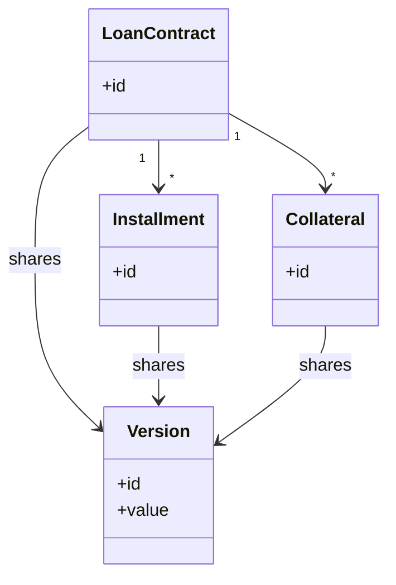

# Coarse-Grained Lock

## Description

Coarse-Grained Lock locks a set of related objects with a single lock. Instead of acquiring a lock for each object in an aggregate (for example, a loan contract and all its installments), the application protects the whole group through a single point, usually the aggregate root.

For optimistic locking, this is usually done with a shared version object: all members of the group reference the same version number, and changing any of them increments that version. For pessimistic locking, locking the root implies locking the whole group. One variation is the Root Lock, where each child object navigates up to the root to obtain the lock.

The pattern aligns the lock granularity with the model's consistency boundary, reducing the number of locks and eliminating the chance of locking only part of an aggregate.

## Problems it solves

- Acquiring and managing many individual locks is costly and error-prone.
- Locking only part of an aggregate leaves the group in an inconsistent state (e.g., an installment changed by someone else while the contract is being recalculated).
- Forgetting to lock one member of the group breaks the aggregate's invariant.

## When to use

- When objects are always edited together, such as an aggregate or a set of entities with shared invariants.
- When the cost of managing per-object locks is high.
- Together with Optimistic or Pessimistic Offline Lock to align locking with the aggregate.

## When to avoid

- When objects in the group are frequently edited independently; the coarse lock creates unnecessary contention.
- When the group is very large, and locking all of it prevents legitimate parallel work.
- When the model has no clear aggregate boundary.

## Trade-offs

| Benefit | Cost / Risk |
| --- | --- |
| A single lock protects the whole group | Reduces concurrency: independent edits now conflict |
| Preserves aggregate invariants | A poorly defined boundary causes contention or protection gaps |
| Fewer locks to acquire and release | Requires all members to point to the root or shared version |
| Simpler application code | Updates to children must increment the root's version |

- **Consistency:** the lock granularity matches the aggregate's transactional boundary.
- **Performance:** fewer locks per operation, but a higher chance of conflict.
- **Modeling:** reinforces the discipline of defining clear aggregates.

## Diagram



`LoanContract`, `Installment`, and `Collateral` reference the same `Version` object. Any change to one of them increments that version, and the conflict is detected for the whole group.

## Example

In a loan contract, renegotiating an installment while someone else replaces the collateral should conflict. Everyone uses the version of the `LoanContract` root.

```sql
-- Installments and collaterals share the contract's version
UPDATE installment SET due_date = '2026-12-10' WHERE id = 3;

UPDATE loan_contract
   SET version = version + 1
 WHERE id = 10 AND version = 4;  -- 0 rows => conflict on the aggregate
```

```java
@Entity
class LoanContract {
    @Version long version;

    @OneToMany(cascade = CascadeType.ALL)
    List<Installment> installments;

    @OneToMany(cascade = CascadeType.ALL)
    List<Collateral> collaterals;
}

// In JPA, the root's version can be incremented when children change:
// entityManager.lock(contract, LockModeType.OPTIMISTIC_FORCE_INCREMENT);
```

## Related patterns

- [Optimistic Offline Lock](/design/poeaa/offline-concurrency/optimistic-offline-lock) — Coarse-Grained Lock is often implemented as a version shared by the group.
- [Pessimistic Offline Lock](/design/poeaa/offline-concurrency/pessimistic-offline-lock) — locking the root implies locking the whole group.
- [Implicit Lock](/design/poeaa/offline-concurrency/implicit-lock) — automates acquiring the group's lock.
- [Unit of Work](/design/poeaa/object-relational-behavioral/unit-of-work) — responsible for writing the group of changed objects and incrementing the shared version.
- [Layer Supertype](/design/poeaa/base/layer-supertype) — hosts the common logic for accessing the root or shared version.

## Reference

- [Pattern page in Fowler's catalog](https://martinfowler.com/eaaCatalog/coarseGrainedLock.html)
- *Patterns of Enterprise Application Architecture*, Martin Fowler (Addison-Wesley, 2002)
