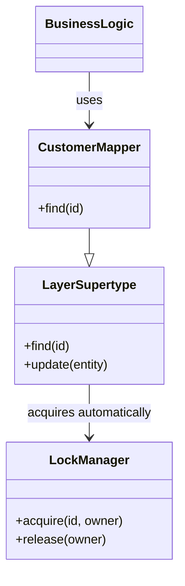

# Implicit Lock

## Description

Implicit Lock lets framework code or a layer supertype acquire offline locks automatically, instead of relying on the developer to remember to do so at every point of use. Fowler's central idea is that forgetting to acquire a lock is a bug that can cause subtle data corruption that's hard to catch in tests, so the mechanism shouldn't be left in the hands of business code.

In practice, acquisition is built into a point that all data access passes through: the data mappers, the Unit of Work, or a Layer Supertype. When loading or saving an object, this infrastructure applies the chosen lock (optimistic or pessimistic), transparently to the application code.

The pattern isn't a type of lock; it's a way of applying the other locking patterns reliably and in a centralized manner.

## Problems it solves

- Developers forget to acquire the lock and open concurrency gaps.
- Locking logic is duplicated and scattered across the business layer.
- It's hard to change the locking strategy (for example, from optimistic to pessimistic) without touching all the code.

## When to use

- In any system that adopts Optimistic or Pessimistic Offline Lock at scale.
- When there's a single data access layer, such as mappers or repositories.
- When you want concurrency control to be a property of the infrastructure, not of the use case.

### When to avoid

- When the system is small and locking is needed in only a few places, so doing it explicitly is clearer.
- When data access is scattered and there's no central point to build the logic into.
- When the magic behavior would make it harder to understand or debug why a lock was (or wasn't) acquired.

## Trade-offs

| Benefit | Cost / Risk |
| --- | --- |
| Eliminates the risk of forgetting the lock | Less visible, "magic" behavior |
| Centralized concurrency logic | Depends on well-designed infrastructure (mappers, supertypes) |
| Strategy can change without touching use cases | May acquire unnecessary locks, reducing concurrency |
| Cleaner business code | Locking problems are harder to debug |

- **Coupling:** business code is decoupled from the locking mechanism.
- **Testability:** the locking infrastructure can be tested in isolation.
- **Consistency:** the guarantee only holds if all access goes through the central point.

## Diagram



The business code only uses the `CustomerMapper`. The `LayerSupertype`, which the mapper inherits from, acquires the lock from the `LockManager` whenever an object is loaded or changed.

## Example

All mappers inherit from a supertype that acquires the pessimistic lock when loading an entity for editing, without the use case having to call the lock manager.

```typescript
abstract class LockingMapper<T extends { id: string }> {
  constructor(private locks: LockManager, private session: Session) {}

  async findForUpdate(id: string): Promise<T> {
    // lock acquired implicitly
    await this.locks.acquire(this.resourceKey(id), this.session.id);
    return this.load(id);
  }

  protected abstract resourceKey(id: string): string;
  protected abstract load(id: string): Promise<T>;
}

class CustomerMapper extends LockingMapper<Customer> {
  protected resourceKey(id: string) { return `customer:${id}`; }
  protected async load(id: string) { /* SELECT ... */ return {} as Customer; }
}

// Use case: doesn't mention locks
const customer = await customerMapper.findForUpdate("42");
```

Frameworks like Hibernate apply the `@Version` check implicitly on every `flush`, with no extra code in the domain.

## Related patterns

- [Optimistic Offline Lock](/design/poeaa/offline-concurrency/optimistic-offline-lock) — a strategy whose application can be made implicit.
- [Pessimistic Offline Lock](/design/poeaa/offline-concurrency/pessimistic-offline-lock) — likewise, with automatic acquisition when loading objects.
- [Coarse-Grained Lock](/design/poeaa/offline-concurrency/coarse-grained-lock) — implicit acquisition must respect the group's lock.
- [Layer Supertype](/design/poeaa/base/layer-supertype) — the classic place to build in the locking logic.
- [Unit of Work](/design/poeaa/object-relational-behavioral/unit-of-work) — another central point where locking can be applied automatically.

## Reference

- [Pattern page in Fowler's catalog](https://martinfowler.com/eaaCatalog/implicitLock.html)
- *Patterns of Enterprise Application Architecture*, Martin Fowler (Addison-Wesley, 2002)
