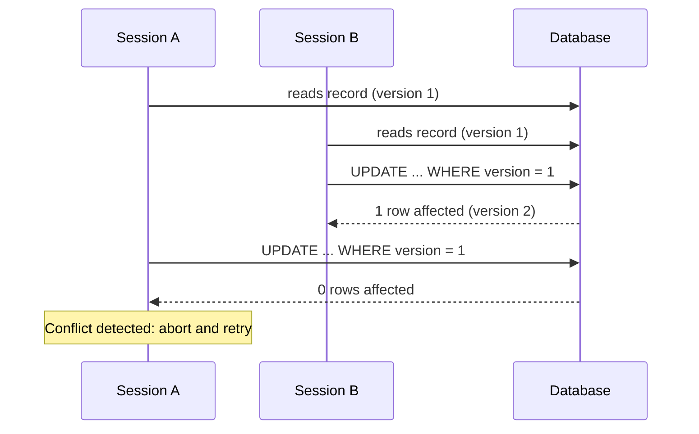

# Optimistic Offline Lock

## Description

Optimistic Offline Lock prevents conflicts between concurrent business transactions by validating, at commit time, that nobody has changed the data the session read. It assumes conflicts are rare: it locks nothing during reading or editing, and only detects the problem at write time.

The typical implementation associates a version number (or timestamp) with each record. When loading the data, the session keeps the version it read; when saving, the `UPDATE` includes the condition `WHERE id = ? AND version = ?` and increments the version. If no row is affected, another business transaction has already modified the record and the write fails, usually forcing the session to abort, reload, and redo its work.

Because the business transaction spans several requests (and therefore several database transactions), database transactions alone don't protect against lost updates. This pattern moves the consistency check to the application layer.

## Problems it solves

- Lost update: two sessions read the same record, edit it, and the last write silently overwrites the first.
- Inconsistent reads when a business transaction depends on data that changed midway.
- The need for high concurrency without holding locks during the user's think time.

## When to use

- When the probability of conflict is low and the cost of redoing work is acceptable.
- When most sessions are read-only or touch different records.
- In HTTP APIs and web UIs, where locks can't be held across requests.

## When to avoid

- When conflicts are frequent or the cost of losing the user's work is high; Pessimistic Offline Lock is a better fit.
- When the system can't handle commit failures gracefully (no retry or conflict-resolution flow).
- When updates are made by processes that don't respect the version column.

## Trade-offs

| Benefit | Cost / Risk |
| --- | --- |
| High concurrency, no long-held locks | Conflict is only discovered at commit, after the work is done |
| Simple implementation (one version column) | Requires handling failures and defining a retry or merge policy |
| No risk of deadlock or orphaned locks | All writes must go through the version check |
| Scales well in web and distributed environments | Under high contention, it causes a lot of rework |

- **Consistency:** ensures no lost update goes unnoticed, but doesn't prevent dirty reads during the session.
- **Performance:** no locking cost; the only cost is the extra condition on the `UPDATE`.
- **Usability:** the user may lose minutes of editing if the conflict occurs at the end.

## Diagram



Session B writes first and increments the version. Session A tries to write with the old version, affects no rows, and detects the conflict.

## Example

Two credit analysts open the same customer to change the credit limit. The first one saves; the second, on saving, gets a conflict error instead of overwriting the change. In JPA, annotating a field with `@Version` is enough; in HTTP, the same effect comes from `ETag` and `If-Match`. The amounts are illustrative.

```java
@Entity
class Account {
    @Id Long id;
    long creditLimitCents;

    @Version
    long version; // Hibernate adds "AND version = ?" to the UPDATE
}

try {
    account.setCreditLimitCents(500_000); // R$ 5,000.00
    entityManager.flush();
} catch (OptimisticLockException e) {
    // another analyst changed the limit: reload and ask for a new decision
}
```

```sql
UPDATE account
   SET credit_limit_cents = 500000, version = version + 1
 WHERE id = 42 AND version = 7;  -- 0 rows => conflict
```

## Related patterns

- [Pessimistic Offline Lock](/design/poeaa/offline-concurrency/pessimistic-offline-lock) — an alternative for high contention: locks before editing instead of validating afterward.
- [Coarse-Grained Lock](/design/poeaa/offline-concurrency/coarse-grained-lock) — makes a single version number protect a group of related objects.
- [Implicit Lock](/design/poeaa/offline-concurrency/implicit-lock) — ensures the version check isn't forgotten by application code.
- [Unit of Work](/design/poeaa/object-relational-behavioral/unit-of-work) — usually the one that applies the version check when writing the changes.
- [Layer Supertype](/design/poeaa/base/layer-supertype) — a common place for the version field shared by entities.

## Reference

- [Pattern page in Fowler's catalog](https://martinfowler.com/eaaCatalog/optimisticOfflineLock.html)
- *Patterns of Enterprise Application Architecture*, Martin Fowler (Addison-Wesley, 2002)
- [Optimistic concurrency control on Wikipedia](https://en.wikipedia.org/wiki/Optimistic_concurrency_control)
