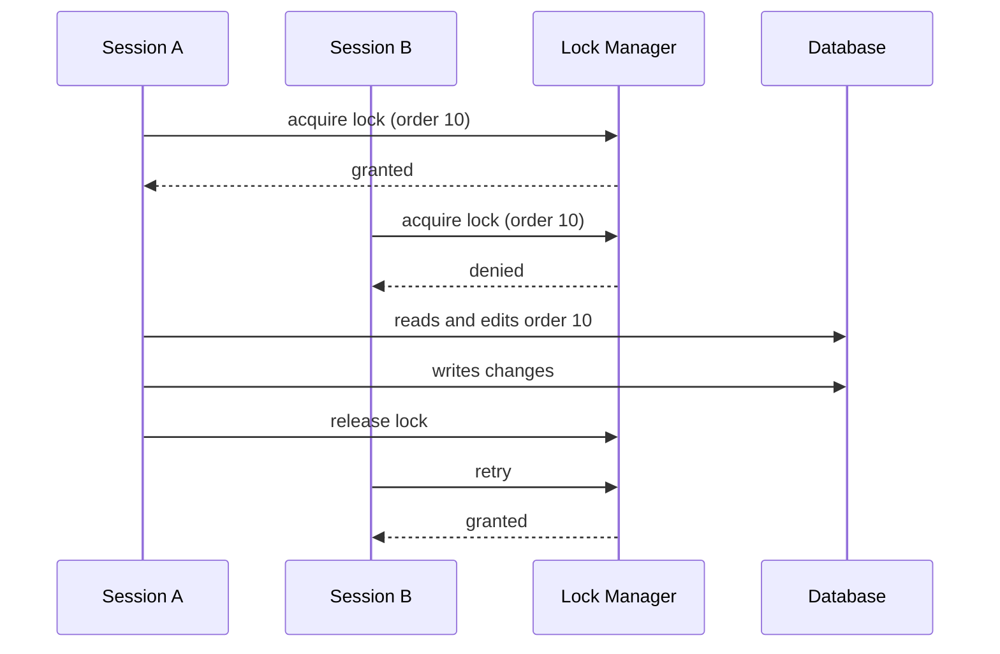

# Pessimistic Offline Lock

## Description

Pessimistic Offline Lock prevents conflicts between concurrent business transactions by allowing only one session at a time to edit a piece of data. The session must acquire the lock before it starts working with the record, and releases it only when the business transaction completes. This way, the conflict is avoided from the start, instead of being detected at the end.

Because the business transaction spans several database transactions, the database's own locks don't work: you need your own lock manager, usually a table holding the resource identifier and the lock owner, with a uniqueness constraint. Fowler describes lock types (exclusive write, exclusive read, and read/write) and the need to define what happens when the lock can't be obtained, as well as handling orphaned locks with a timeout.

The pattern is the safest option when losing the user's work is unacceptable, at the cost of reduced concurrency.

## Problems it solves

- Frequent or costly conflicts, where the rework of Optimistic Offline Lock would be unacceptable.
- Long business transactions, where the user can't find out about the conflict only at the end.
- Reads that need a guarantee that the data won't change during the session.

## When to use

- When the chance of conflict is high or the cost of failing at commit is greater than the cost of locking.
- When the user's work is long and can't easily be redone.
- When you need read consistency beyond simple detection of write conflicts.

### When to avoid

- When conflicts are rare; Optimistic Offline Lock is simpler and scales better.
- When the application has extremely high concurrency and can't tolerate waiting.
- When you can't guarantee reliable lock release (dropped sessions, clients that vanish without a timeout).

## Trade-offs

| Benefit | Cost / Risk |
| --- | --- |
| Eliminates write conflicts before they start | Reduces concurrency: other users wait or are rejected |
| Users never lose work to a conflict | Risk of deadlock and orphaned locks |
| Enables read consistency | Requires a lock manager, timeouts, and an acquisition-order policy |
| Predictable behavior for the user | Higher operational complexity |

- **Consistency:** maximum, as long as all access goes through the lock manager.
- **Performance:** the cost of an extra trip to the lock manager and potential waiting.
- **Operations:** requires monitoring and cleaning up expired locks.

## Diagram



Session A obtains the lock and works without competition. Session B is rejected until A releases the resource.

## Example

A document editing system allows only one writer to edit a contract at a time. A lock table with a primary key on the resource guarantees exclusivity: the `INSERT` fails if someone else already holds the lock.

```sql
CREATE TABLE app_lock (
  resource_id VARCHAR(100) PRIMARY KEY,
  owner       VARCHAR(100) NOT NULL,
  expires_at  TIMESTAMP    NOT NULL
);
```

```python
def acquire(conn, resource_id, owner, ttl_seconds=300):
    try:
        conn.execute(
            "INSERT INTO app_lock VALUES (?, ?, now() + ?)",
            (resource_id, owner, ttl_seconds),
        )
        return True
    except UniqueViolation:
        return False  # another user holds the lock

def release(conn, resource_id, owner):
    conn.execute(
        "DELETE FROM app_lock WHERE resource_id = ? AND owner = ?",
        (resource_id, owner),
    )
```

## Related patterns

- [Optimistic Offline Lock](/design/poeaa/offline-concurrency/optimistic-offline-lock) — the alternative that detects conflicts at commit instead of preventing them.
- [Coarse-Grained Lock](/design/poeaa/offline-concurrency/coarse-grained-lock) — lets you lock a group of objects with a single lock.
- [Implicit Lock](/design/poeaa/offline-concurrency/implicit-lock) — makes lock acquisition happen automatically, without depending on the developer.
- [Unit of Work](/design/poeaa/object-relational-behavioral/unit-of-work) — a natural point to release the locks at the end of the business transaction.

## Reference

- [Pattern page in Fowler's catalog](https://martinfowler.com/eaaCatalog/pessimisticOfflineLock.html)
- *Patterns of Enterprise Application Architecture*, Martin Fowler (Addison-Wesley, 2002)
