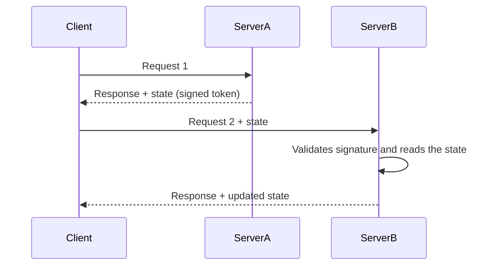

# Client Session State

## Description

Client Session State stores session state on the client. With each response, the server returns the session data (in a cookie, a hidden form field, a URL parameter, or a token) and the client sends it back with every following request. The server keeps nothing between requests and rebuilds the context from what arrived.

Because the server stays stateless, any instance can handle any request, which makes horizontal scaling and failure recovery easier. In exchange, the data travels with every call and lives in an environment the server doesn't control, so it must be small and protected against reading and tampering.

Today the most common form is the JWT in a cookie or header: the token carries identity and a few claims, is signed (and optionally encrypted), and is validated by the server on every call.

## Problems it solves

- Need to keep the server stateless so it can scale horizontally without session affinity (sticky sessions).
- Cost and complexity of operating a shared session store for small amounts of data.
- Loss of the session when a server instance goes down or is restarted.
- User context that has to travel between services without querying a central repository.

## When to use

- When session state is small (identity, preferences, steps of a short wizard).
- When you want fully stateless servers, with free load balancing across instances.
- When the data can be signed or encrypted and expiration is acceptable as an invalidation mechanism.

## When to avoid

- When the state is large, because the traffic on every request and cookie limits (about 4 KB) make the approach unworkable.
- When there is sensitive data that must not leave the server, even encrypted.
- When sessions must be revoked immediately (forced logout, compromised account) without maintaining a revocation list.
- When state must be consistent across tabs or devices, since each client carries its own copy.

## Trade-offs

| Benefit | Cost / Risk |
| --- | --- |
| Stateless server and simple horizontal scaling | State travels with every request and consumes bandwidth |
| No server-side session store to operate | Size limits (cookies, URLs) |
| Survives restarts and instance changes | Data is exposed to the client: requires signing, encryption, and validation |
| Simple implementation | Revocation is hard before expiration |

- **Security:** the client is untrusted; without a signature (HMAC) the state can be forged, and without encryption it is readable.
- **Consistency:** there is no single source; old copies of the token can be resent (replay).
- **Performance:** eliminates store lookups, but increases the payload of every call.

## Diagram



The `Client` holds the state and sends it back with every call. Any server validates the signature and uses the data, without querying a shared store.

## Example

An API issues a JWT containing the user identifier and role, signed with HMAC. The client sends it in the `Authorization` header, and any instance verifies the signature without hitting a database.

```typescript
import jwt from "jsonwebtoken";

const SECRET = process.env.JWT_SECRET!;

export function issueSession(userId: string, role: string): string {
  return jwt.sign({ sub: userId, role }, SECRET, { expiresIn: "15m" });
}

export function readSession(authHeader?: string) {
  const token = authHeader?.replace("Bearer ", "");
  if (!token) throw new Error("unauthenticated");
  // Throws if the signature is invalid or the token has expired
  return jwt.verify(token, SECRET) as { sub: string; role: string };
}
```

Frameworks such as ASP.NET (protected authentication cookies), Rails (encrypted cookie store), and Flask (signed sessions) use this approach.

## Related patterns

- [Server Session State](/design/poeaa/session-state/server-session-state) — alternative that keeps the data on the server and sends the client only an identifier.
- [Database Session State](/design/poeaa/session-state/database-session-state) — persists the state in a database instead of sending it to the client.
- [Data Transfer Object](/design/poeaa/distribution/data-transfer-object) — the state sent to the client is usually serialized as a transfer object.
- [Access Token](/architecture/microservices/security/access-token) — the JWT is the most common form of Client Session State in microservice architectures.

## Reference

- [Pattern page in Fowler's catalog](https://martinfowler.com/eaaCatalog/clientSessionState.html)
- *Patterns of Enterprise Application Architecture*, Martin Fowler (Addison-Wesley, 2002)
