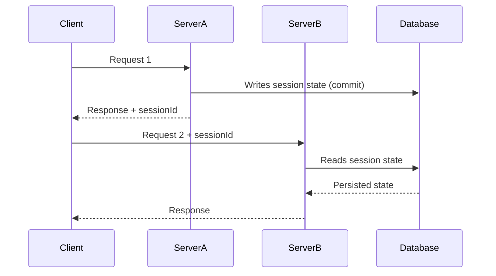

# Database Session State

## Description

Database Session State stores session data as committed data in the database. Instead of keeping the state in memory or on the client, each interaction writes the session information to tables, usually associated with a session or process identifier.

The central difference from the other patterns is the distinction between session data and committed business data. Fowler discusses two approaches: writing the pending data to separate session tables, or writing it to the real tables marked as pending (with a status flag), which makes queries more complex because they must filter out pending data.

Because the state lives in the database, the server stays stateless and any instance can handle the next request. This also lets the session survive failures and long periods of inactivity, as in workflows that last for days.

## Problems it solves

- Long sessions (approval processes, multi-step registrations) that must survive restarts and days of inactivity.
- Session state that must be durable, auditable, and recoverable after failures.
- Need to resume work on another device or another instance.
- State too large for the client and too critical to keep only in memory.

## When to use

- When session durability matters more than access speed.
- When the workflow is long and can be resumed later, including by another person or device.
- When a reliable database already exists and you want to avoid an additional component such as Redis.
- When the pending state needs to take part in transactions with the business data.

## When to avoid

- When the state is small, short-lived, and read-heavy; the database becomes a bottleneck.
- When the latency of every request must be minimal.
- When cleanup of abandoned sessions can't be handled (it requires expiration routines).
- When pending data mixed into the real tables would complicate queries and reports.

## Trade-offs

| Benefit | Cost / Risk |
| --- | --- |
| Durability and recovery after failures | Database reads and writes on every request increase latency |
| Stateless server, interchangeable instances | Extra load on the database, which is usually the hardest resource to scale |
| Session can be resumed days later, on any device | Need to clean up abandoned sessions |
| State takes part in transactions and is auditable | Pending data in the real tables complicates queries and rules |

- **Consistency:** state and business data can be updated in the same transaction.
- **Concurrency:** simultaneous requests from the same session require control (for example, optimistic locking).
- **Operations:** expiration routines are part of the pattern, not a detail.

## Diagram



The `Client` keeps only the `sessionId`. Any server reads and writes the state in the `Database`, which is the single, durable source of the session.

## Example

A multi-step insurance registration is saved at each step in a `session_state` table, expiring after 7 days. The user can come back from another device and continue.

```python
import json
import sqlite3

db = sqlite3.connect("app.db")
db.execute("""CREATE TABLE IF NOT EXISTS session_state (
    session_id TEXT PRIMARY KEY,
    data TEXT NOT NULL,
    expires_at TEXT NOT NULL)""")

def save(session_id: str, data: dict) -> None:
    with db:
        db.execute(
            "INSERT OR REPLACE INTO session_state VALUES (?, ?, datetime('now', '+7 days'))",
            (session_id, json.dumps(data)))

def load(session_id: str) -> dict | None:
    row = db.execute(
        "SELECT data FROM session_state WHERE session_id = ? AND expires_at > datetime('now')",
        (session_id,)).fetchone()
    return json.loads(row[0]) if row else None
```

Frameworks such as Django (`django.contrib.sessions.backends.db`) and Laravel (`database` driver) offer this storage.

## Related patterns

- [Client Session State](/design/poeaa/session-state/client-session-state) — keeps the state on the client, without touching the database.
- [Server Session State](/design/poeaa/session-state/server-session-state) — keeps the state on the server or in a cache, faster but less durable.
- [Optimistic Offline Lock](/design/poeaa/offline-concurrency/optimistic-offline-lock) — protects against concurrent writes to the same session state.
- [Serialized LOB](/design/poeaa/object-relational-structural/serialized-lob) — the state is often stored as a serialized object in a column.

## Reference

- [Pattern page in Fowler's catalog](https://martinfowler.com/eaaCatalog/databaseSessionState.html)
- *Patterns of Enterprise Application Architecture*, Martin Fowler (Addison-Wesley, 2002)
