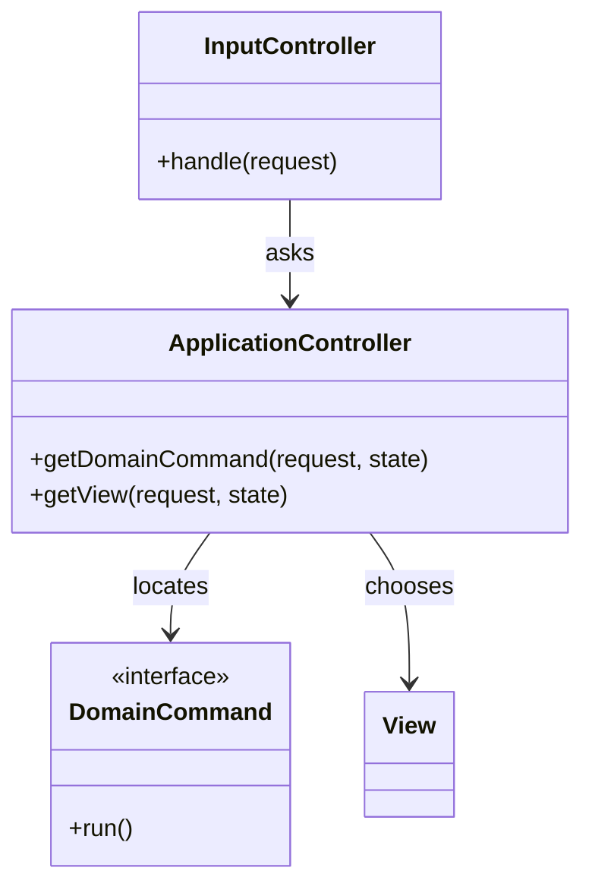

# Application Controller

## Description

Application Controller is a central point for handling navigation between screens and the application's flow. Based on the request and the current state, it decides which **domain command** to run and which **view** to show next. This frees the input controller (Page or Front Controller) from having to know the order of the screens.

The pattern has two parts: one that maps the input to the appropriate domain logic, and another that chooses the view based on the result. These flow rules, such as wizards or screens that depend on the state of an object, live in a single configurable place, and the views and the domain don't need to know about navigation.

## Problems it solves

- Navigation logic scattered across several controllers and views.
- State-dependent flows (wizards, approvals) that are hard to change and test.
- Coupling between screens, which need to know the next screen.

## When to use

- In applications with a complex screen flow, or one that depends on the state of the domain.
- When navigation rules change often or are configurable.
- When you want to test navigation without the web framework.

### When to avoid

- When navigation is simple and linear, and a direct mapping is enough.
- When the framework already provides a flow engine (Spring Web Flow) and you can just use it.

## Trade-offs

| Benefit | Cost / Risk |
| --- | --- |
| Centralized navigation rules | Extra layer of indirection for simple flows |
| Screens independent of one another | Can turn into a state machine that's hard to understand |
| Flow testable without a UI | Requires explicitly modeling states and transitions |
| Makes it easier to reuse the logic in other channels | Risk of improperly absorbing domain rules |

- **Coupling:** reduces coupling between screens and between the web layer and the domain.
- **Testability:** the flow is tested with plain objects, without a server.
- **State:** long flows require storing the current step, typically in the session.

## Diagram



The `InputController` consults the `ApplicationController`, which locates the `DomainCommand` to run and chooses the next `View` based on the result and the state.

## Example

An order goes through the address, payment, and confirmation screens. The application controller decides the next screen based on the state.

```python
class CheckoutFlow:
    TRANSITIONS = {
        ("address", "ok"): "payment",
        ("payment", "ok"): "confirmation",
        ("payment", "declined"): "payment_error",
    }

    def next_view(self, state: str, result: str) -> str:
        return self.TRANSITIONS.get((state, result), "error")

class CheckoutController:
    def __init__(self, flow, commands):
        self.flow, self.commands = flow, commands

    def handle(self, session, action):
        result = self.commands[session["step"]].run(action)
        session["step"] = self.flow.next_view(session["step"], result)
        return session["step"]
```

Spring Web Flow, JSF flows, and Windows Workflow are examples. In SPAs, routing libraries and state machines (XState) play this role on the client.

## Related patterns

- [Front Controller](/design/poeaa/web-presentation/front-controller) — usually delegates the flow decision to this pattern.
- [Page Controller](/design/poeaa/web-presentation/page-controller) — same, when navigation stops being trivial.
- [Model View Controller](/design/poeaa/web-presentation/model-view-controller) — Application Controller refines the role of the controller.
- [Server Session State](/design/poeaa/session-state/server-session-state) — stores the current step of long flows.
- [Service Layer](/design/poeaa/domain-logic/service-layer) — domain commands are usually service layer operations.
- [Command](/coding/gof/behavioral/command) — domain commands are command objects.
- [State](/coding/gof/behavioral/state) — state-dependent flows can be modeled this way.

## Reference

- [Pattern page in Fowler's catalog](https://martinfowler.com/eaaCatalog/applicationController.html)
- *Patterns of Enterprise Application Architecture*, Martin Fowler (Addison-Wesley, 2002)
