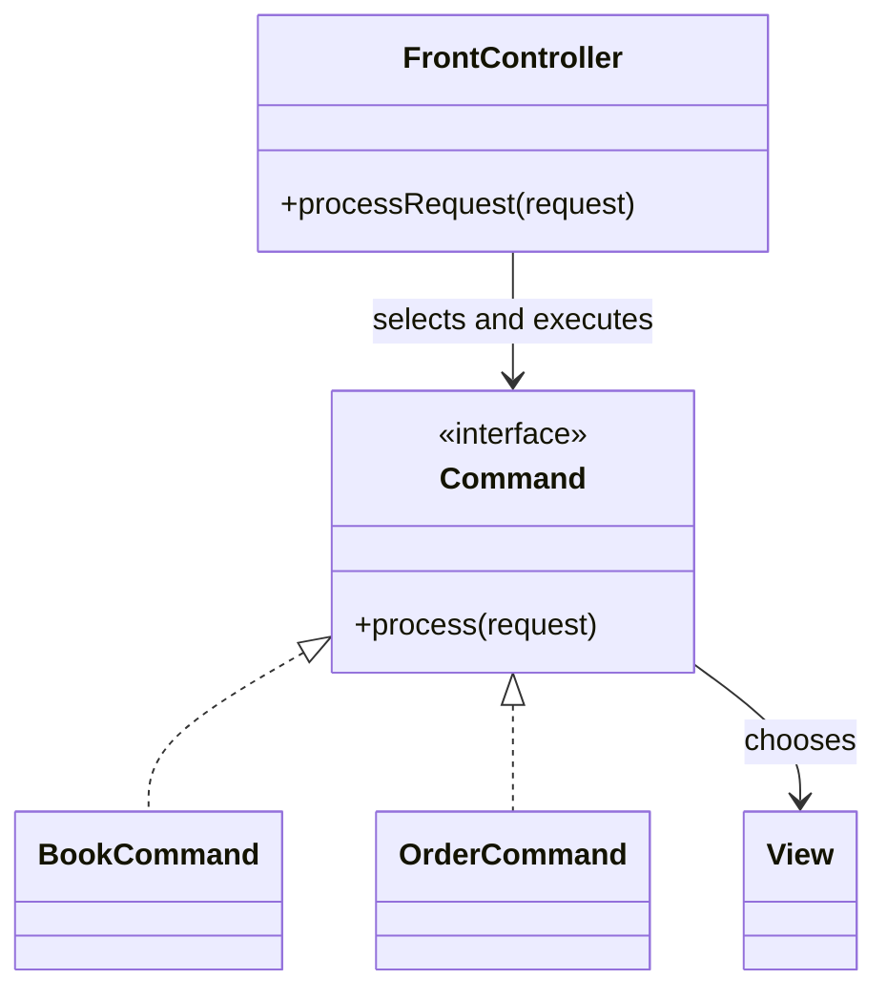

# Front Controller

## Description

Front Controller is a single controller that handles all requests for a website. It's split into two parts: an entry **handler**, which receives the request and performs the common behavior (authentication, localization, logging), and a hierarchy of **commands** (actions) to which it delegates the specific handling of each request.

The handler decides which command to run, usually based on a URL mapping configured in a file or discovered by convention, and the command chooses the view. Because the command is an ordinary class, not a script tied to the URL, the mapping can be changed dynamically without touching the web server.

## Problems it solves

- Cross-cutting logic (security, session, i18n) duplicated in every Page Controller.
- The need to intercept all requests at a single point.
- Difficulty changing the mapping between URLs and behavior without reconfiguring the server.

## When to use

- In applications with behavior common to all requests.
- When you want to configure routing and filters centrally.
- When you need extensibility through chained handlers or filters.

## When to avoid

- In very simple sites, where a single entry point is more complexity than benefit.
- When the framework already provides one, and building another on top would be redundant.

## Trade-offs

| Benefit | Cost / Risk |
| --- | --- |
| Common behavior implemented only once | Single point of failure and possible bottleneck if poorly implemented |
| Configurable, dynamic routing | More up-front complexity than a Page Controller |
| Easy to add filters and interceptors | The handler can become a "god object" |
| Commands are simple, testable objects | Requires configuration or a mapping convention |

- **Coupling:** commands don't know about the HTTP infrastructure when well designed.
- **Consistency:** security and other cross-cutting policies are applied uniformly.
- **Performance:** a single handler isn't a problem in practice, since it's lightweight and stateless.

## Diagram



The `FrontController` receives all requests, chooses the appropriate `Command`, and delegates. The command runs the logic and selects the `View`.

## Example

All requests go through a servlet that maps the path to a command, applying authentication before delegating.

```java
public class FrontServlet extends HttpServlet {
    private final Map<String, Command> routes = Map.of(
        "/books", new BookCommand(),
        "/orders", new OrderCommand());

    @Override
    protected void service(HttpServletRequest req, HttpServletResponse resp)
            throws IOException {
        if (req.getSession(false) == null) {
            resp.sendRedirect("/login");
            return;
        }
        Command cmd = routes.getOrDefault(req.getPathInfo(), new NotFoundCommand());
        cmd.process(req, resp);
    }
}
```

Spring MVC's `DispatcherServlet`, ASP.NET Core's middleware pipeline, and Rails' router are Front Controllers. In SPAs, the client-side router (React Router, Angular Router) plays an analogous role in the browser, and API gateways do so at the edge.

## Related patterns

- [Page Controller](/design/poeaa/web-presentation/page-controller) — alternative with one controller per page.
- [Application Controller](/design/poeaa/web-presentation/application-controller) — can be called by the Front Controller to decide the screen flow.
- [Model View Controller](/design/poeaa/web-presentation/model-view-controller) — the Front Controller fulfills the controller role.
- [Command](/coding/gof/behavioral/command) — the actions the handler delegates to are commands.
- [Chain of Responsibility](/coding/gof/behavioral/chain-of-responsibility) — filters and interceptors are chained this way.
- [Facade](/coding/gof/structural/facade) — the Front Controller works as the entry facade of the web layer.
- [Backend for Front-end](/architecture/cloud-design-patterns/gateways-and-edge/backends-for-frontends) — a dedicated entry point per client type in distributed architectures.

## Reference

- [Pattern page in Fowler's catalog](https://martinfowler.com/eaaCatalog/frontController.html)
- *Patterns of Enterprise Application Architecture*, Martin Fowler (Addison-Wesley, 2002)
- [Front controller on Wikipedia](https://en.wikipedia.org/wiki/Front_controller)
