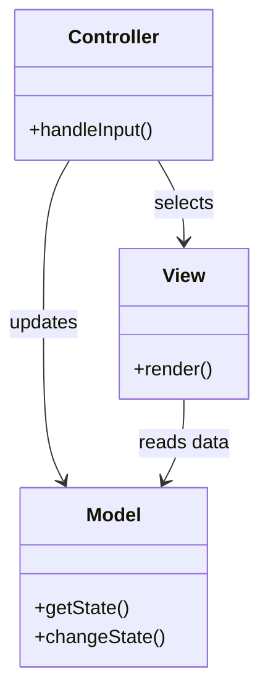

# Model View Controller

## Description

Model View Controller (MVC) splits user interaction into three roles. The **model** is an object that represents domain information and behavior and knows nothing about the interface. The **view** displays the model's data on screen. The **controller** receives user input, acts on the model, and chooses which view to display.

The central point is the separation between presentation and model: the model doesn't depend on any view, which allows multiple presentations of the same data and lets you test the domain logic without a UI. The separation between view and controller, although central in the original Smalltalk, matters less in web applications, where viewing and reacting to input happen in separate requests.

On the web, MVC is usually realized by combining more specific patterns: a Page Controller or Front Controller for the control, and a Template View, Transform View, or Two Step View for the view.

## Problems it solves

- Domain logic mixed with interface code, impossible to test without the screen.
- The need to display the same data in different ways (HTML, JSON, reports).
- Visual changes that force changes to business rules, and vice versa.
- Teams with different profiles (design and programming) working on the same files.

## When to use

- In practically any application with a non-trivial user interface.
- When you want to test the model's behavior without depending on the presentation.
- When the same model will have multiple views or input channels.

### When to avoid

- In very simple screens or throwaway scripts, where three roles are excessive ceremony.
- When the framework already imposes another model (for example, MVVM with data binding) and mixing vocabularies only causes confusion.

## Trade-offs

| Benefit | Cost / Risk |
| --- | --- |
| Model independent of the interface and easy to test | More files and indirection for simple flows |
| Several views over the same model | Keeping views in sync with the model may require notification mechanisms |
| Visual changes isolated from the domain logic | Bloated controllers absorb business logic ("fat controller") |
| Clear division of responsibilities within the team | Divergent interpretations of the term MVC across frameworks |

- **Coupling:** view and controller depend on the model, never the other way around.
- **Testability:** the model and the controller can be tested without rendering the interface.
- **Complexity:** moderate; the discipline of keeping the controller thin is the biggest challenge.

## Diagram



The `Controller` receives the input, changes the `Model`, and selects the `View`; the `View` reads the `Model`'s data to display it. The `Model` knows neither of them.

## Example

In an online store, the product screen shows the same `Product` in an HTML page and in a JSON endpoint for the mobile app. The controller fetches the model and chooses the view.

```python
class Product:                      # Model
    def __init__(self, name, price):
        self.name, self.price = name, price

class ProductController:            # Controller
    def __init__(self, repo, views):
        self.repo, self.views = repo, views

    def show(self, product_id, fmt="html"):
        product = self.repo.find(product_id)
        return self.views[fmt](product)

def html_view(p): return f"<h1>{p.name}</h1><p>$ {p.price:.2f}</p>"
def json_view(p): return {"name": p.name, "price": p.price}

controller = ProductController(repo, {"html": html_view, "json": json_view})
```

Spring MVC, ASP.NET MVC, and Rails implement this pattern. In SPAs, MVC moves to the client (or becomes MVVM/components), and the server exposes only the model as an API.

## Related patterns

- [Page Controller](/design/poeaa/web-presentation/page-controller) — a controller per page, one way to realize the C of MVC on the web.
- [Front Controller](/design/poeaa/web-presentation/front-controller) — a single controller at the entry point, another way to realize the C.
- [Template View](/design/poeaa/web-presentation/template-view) — a common way to implement the view.
- [Transform View](/design/poeaa/web-presentation/transform-view) — a view implemented as a transformation of the model's data.
- [Two Step View](/design/poeaa/web-presentation/two-step-view) — a two-step view to keep the look consistent.
- [Observer](/coding/gof/behavioral/observer) — the classic mechanism for the view to react to changes in the model.
- [Strategy](/coding/gof/behavioral/strategy) — the relationship between view and controller is usually a replaceable strategy.

## Reference

- [Pattern page in Fowler's catalog](https://martinfowler.com/eaaCatalog/modelViewController.html)
- *Patterns of Enterprise Application Architecture*, Martin Fowler (Addison-Wesley, 2002)
- [GUI Architectures, Martin Fowler](https://martinfowler.com/eaaDev/uiArchs.html)
