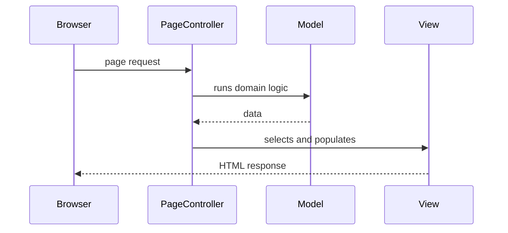

# Page Controller

## Description

Page Controller is an object that handles the request for a specific page or action of a website. Each page (or each logical action) has its own controller, which extracts the data from the request, invokes the domain logic, and chooses the view that will produce the response.

The controller can be the page itself (as in CGI scripts, servlets, or code-behind) or a separate object associated with a URL. The mapping between URL and controller is usually done by the web server or by naming convention, with no central entry point. Logic common to several pages can go in a base class or in helpers.

## Problems it solves

- Mixing control logic and formatting logic in the same page script.
- No clear place to receive the input and decide the flow of a screen.
- The need for a simple model for sites where each URL corresponds to one screen.

## When to use

- In sites with simple navigation logic, where each page has its own behavior.
- When the framework already maps URLs directly to handlers (code-behind, servlets, ASP.NET Web Forms).
- When you want the model that's simplest to understand for a small team.

## When to avoid

- When there's a lot of common behavior (authentication, logging, i18n) that would be duplicated in every controller; a Front Controller is a better fit.
- When navigation is complex and depends on dynamic decisions about which screen to show.

## Trade-offs

| Benefit | Cost / Risk |
| --- | --- |
| Simple model: one page, one controller | Duplication of common behavior across controllers |
| Easy to find the code for each screen | No single point to intercept requests |
| Small, independent controllers | A base class hierarchy can become a dumping ground for shared logic |
| Each controller is testable in isolation | Cross-cutting changes require touching many files |

- **Coupling:** controllers are independent of one another; the coupling is concentrated in the shared base class.
- **Testability:** good, as long as the controller doesn't depend directly on the HTTP context.
- **Complexity:** low, the simplest of the controller options.

## Diagram



The browser calls the page's controller directly; it queries the model and hands the data to the view, which generates the response.

## Example

The Pix receipt page (`/receipts/{id}`) has its own controller that reads the identifier from the URL, fetches the `PixTransfer`, and renders the template.

```java
@WebServlet("/receipts/*")
public class PixReceiptController extends HttpServlet {
    private final PixTransferService transfers = new PixTransferService();

    @Override
    protected void doGet(HttpServletRequest req, HttpServletResponse resp)
            throws ServletException, IOException {
        String id = req.getPathInfo().substring(1);  // /receipts/{id}
        PixTransfer transfer = transfers.find(id);
        req.setAttribute("transfer", transfer);
        req.getRequestDispatcher("/WEB-INF/receipt.jsp").forward(req, resp);
    }
}
```

In Spring MVC, a `@GetMapping` method in a `@Controller` is a per-action Page Controller, even though the `DispatcherServlet` is a Front Controller underneath. ASP.NET Web Forms (code-behind) and Razor Pages follow the same model.

## Related patterns

- [Front Controller](/design/poeaa/web-presentation/front-controller) — alternative with a single entry point for all requests.
- [Model View Controller](/design/poeaa/web-presentation/model-view-controller) — the Page Controller is one way to fulfill the controller role.
- [Template View](/design/poeaa/web-presentation/template-view) — the typical view chosen by a Page Controller.
- [Application Controller](/design/poeaa/web-presentation/application-controller) — can decide the screen flow when navigation is complex.
- [Template Method](/coding/gof/behavioral/template-method) — used in controller base classes to fix the common flow.

## Reference

- [Pattern page in Fowler's catalog](https://martinfowler.com/eaaCatalog/pageController.html)
- *Patterns of Enterprise Application Architecture*, Martin Fowler (Addison-Wesley, 2002)
